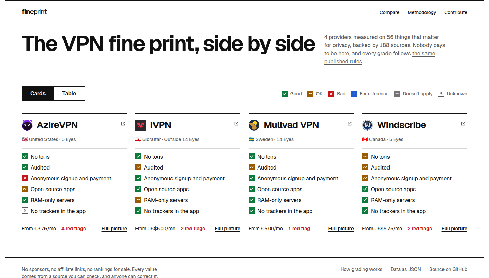

<h1 align="center">fineprint</h1>
<p align="center">
<b>🌐 <a href="https://fineprint.peng.ly/">fineprint.peng.ly</a></b><br />
<i>The unsponsored evidence-based VPN comparison database</i>
</p>

<p align="center">
<!-- badges-start -->


<!-- badges-end -->
</p>

<details>
  <summary>Contents</summary>

- [Comparison summary](#comparison-summary)
- [About](#about)
- [Usage](#usage)
- [Contributing data](#contributing-data)
- [Deployment](#deployment)
- [Development](#development)
- [Credits](#credits)

</details>

## Comparison summary

> Visit [fineprint.peng.ly](https://fineprint.peng.ly/) for a full privacy breakdown of each VPN provider<br>
> <sub><b>Key:</b>
> 🟢 Yes &nbsp; 🟡 Partly &nbsp; 🔴 No &nbsp; ⚪ Unknown &nbsp; ➖ Doesn't apply &nbsp;&nbsp;|&nbsp;&nbsp; Privacy issues: 🔴 serious &nbsp; 🟠 minor only
> </sub><br>
> <sub>Hover any dot for the details, follow the link for full details and sources</sub>

<!-- prettier-ignore-start -->
<!-- summary-start -->

| VPN | HQ | No logs | Audit | Anon signup | Open source | RAM only | No trackers | Privacy issues | Cost |
| :-- | :-: | :-: | :-: | :-: | :-: | :-: | :-: | :-- | --: |
| <a href="https://fineprint.peng.ly/mullvad"></a> **[Mullvad VPN](https://fineprint.peng.ly/mullvad)** | 🇸🇪 | <span title="No logs: yes&#10;Traffic: Not logged&#10;DNS requests: Not logged&#10;Connection times: Not logged&#10;Bandwidth: Not logged&#10;Your IP address: Not logged">🟢</span> | <span title="Audited: partly&#10;Audits: 16 audits, latest Apr 2026">🟡</span> | <span title="Anonymous signup and payment: yes&#10;Email: Not asked for&#10;Personal details: None&#10;Payment methods: Card, PayPal, Bank transfer, App store, Bitcoin, Lightning, Monero, Other crypto, Cash by post, Gift cards or vouchers">🟢</span> | <span title="Open source apps: yes&#10;Open source: All apps">🟢</span> | <span title="RAM-only servers: yes&#10;RAM-only: All servers">🟢</span> | <span title="No trackers in the app: yes&#10;Android trackers: 0">🟢</span> | [🟠 1](https://fineprint.peng.ly/mullvad "1 red flag (1 minor)&#10;· Transparency report: Not published") | €5.00 |
| <a href="https://fineprint.peng.ly/ivpn"></a> **[IVPN](https://fineprint.peng.ly/ivpn)** | 🇬🇮 | <span title="No logs: yes&#10;Traffic: Not logged&#10;DNS requests: Not logged&#10;Connection times: Not logged&#10;Bandwidth: Not logged&#10;Your IP address: Not logged">🟢</span> | <span title="Audited: partly&#10;Audits: 6 audits, latest Apr 2024">🟡</span> | <span title="Anonymous signup and payment: yes&#10;Email: Not asked for&#10;Personal details: None&#10;Payment methods: Card, PayPal, App store, Bitcoin, Lightning, Monero, Cash by post, Gift cards or vouchers">🟢</span> | <span title="Open source apps: yes&#10;Open source: All apps">🟢</span> | <span title="RAM-only servers: partly&#10;RAM-only: Some servers">🟡</span> | <span title="No trackers in the app: yes&#10;Android trackers: 0">🟢</span> | [🔴 2](https://fineprint.peng.ly/ivpn "2 red flags (1 serious, 1 minor)&#10;‼ Funds review sites: Yes&#10;· Telemetry: Opt-out") | $5.00 |
| <a href="https://fineprint.peng.ly/windscribe"></a> **[Windscribe](https://fineprint.peng.ly/windscribe)** | 🇨🇦 | <span title="No logs: partly&#10;Traffic: Not logged&#10;DNS requests: Not logged&#10;Connection times: Aggregated only&#10;Bandwidth: Aggregated only&#10;Your IP address: Not logged">🟡</span> | <span title="Audited: partly&#10;Audits: 4 audits, latest Jun 2024">🟡</span> | <span title="Anonymous signup and payment: partly&#10;Email: Optional&#10;Personal details: None&#10;Payment methods: Card, PayPal, App store, Bitcoin, Lightning, Monero, Other crypto, Cash by post">🟡</span> | <span title="Open source apps: yes&#10;Open source: All apps">🟢</span> | <span title="RAM-only servers: yes&#10;RAM-only: All servers">🟢</span> | <span title="No trackers in the app: yes&#10;Android trackers: 0">🟢</span> | [🔴 2](https://fineprint.peng.ly/windscribe "2 red flags (1 serious, 1 minor)&#10;‼ Eyes alliance: 5 Eyes&#10;· Misleading claims: Yes") | $5.75 |
| <a href="https://fineprint.peng.ly/hide-me"></a> **[hide.me VPN](https://fineprint.peng.ly/hide-me)** | 🇲🇾 | <span title="No logs: partly&#10;Traffic: Not logged&#10;DNS requests: Not logged&#10;Connection times: Deleted within 24 hours&#10;Bandwidth: Aggregated only&#10;Your IP address: Not logged">🟡</span> | <span title="Audited: partly&#10;Audits: 2 audits, latest Jun 2024">🟡</span> | <span title="Anonymous signup and payment: no&#10;Email: Required&#10;Personal details: None&#10;Payment methods: Card, PayPal, Bank transfer, App store, Bitcoin, Other crypto">🔴</span> | <span title="Open source apps: partly&#10;Open source: Some apps">🟡</span> | <span title="RAM-only servers: yes&#10;RAM-only: All servers">🟢</span> | <span title="No trackers in the app: no&#10;Android trackers: 1">🔴</span> | [🟠 4](https://fineprint.peng.ly/hide-me "4 red flags (4 minor)&#10;· Email: Required&#10;· Post-quantum: Not available&#10;· Android trackers: 1&#10;· Misleading claims: Yes") | $2.69 |
| <a href="https://fineprint.peng.ly/azirevpn"></a> **[AzireVPN](https://fineprint.peng.ly/azirevpn)** | 🇺🇸 | <span title="No logs: yes&#10;Traffic: Not logged&#10;DNS requests: Not logged&#10;Connection times: Not logged&#10;Bandwidth: Not logged&#10;Your IP address: Not logged">🟢</span> | <span title="Audited: yes&#10;Audits: 1 audit, latest Jan 2026">🟢</span> | <span title="Anonymous signup and payment: no&#10;Email: Optional&#10;Personal details: None&#10;Payment methods: Card, PayPal, Bank transfer, App store">🔴</span> | <span title="Open source apps: partly&#10;Open source: Some apps">🟡</span> | <span title="RAM-only servers: yes&#10;RAM-only: All servers">🟢</span> | <span title="No trackers in the app: yes&#10;Android trackers: 0">🟢</span> | [🔴 4](https://fineprint.peng.ly/azirevpn "4 red flags (1 serious, 3 minor)&#10;‼ Eyes alliance: 5 Eyes&#10;· Payment methods: Card, PayPal, Bank transfer, App store&#10;· Post-quantum: Not available&#10;· Misleading claims: Yes") | €3.75 |
| <a href="https://fineprint.peng.ly/riseupvpn"></a> **[RiseupVPN](https://fineprint.peng.ly/riseupvpn)** | 🇺🇸 | <span title="No logs: yes&#10;Traffic: Not logged&#10;DNS requests: Not logged&#10;Connection times: Not logged&#10;Bandwidth: Not logged&#10;Your IP address: Not logged">🟢</span> | <span title="Audited: partly&#10;Audits: 1 audit, latest Mar 2025">🟡</span> | <span title="Anonymous signup and payment: partly&#10;Email: Not asked for&#10;Personal details: None&#10;Payment methods: None">🟡</span> | <span title="Open source apps: yes&#10;Open source: All apps">🟢</span> | <span title="RAM-only servers: unknown&#10;RAM-only: Unknown">⚪</span> | <span title="No trackers in the app: yes&#10;Android trackers: 0">🟢</span> | [🔴 4](https://fineprint.peng.ly/riseupvpn "4 red flags (1 serious, 3 minor)&#10;‼ Eyes alliance: 5 Eyes&#10;· Proven: None&#10;· Transparency report: Not published&#10;· Post-quantum: Not available") | Free |
| <a href="https://fineprint.peng.ly/adguard-vpn"></a> **[AdGuard VPN](https://fineprint.peng.ly/adguard-vpn)** | 🇨🇾 | <span title="No logs: partly&#10;Traffic: Not logged&#10;DNS requests: Not logged&#10;Connection times: Not logged&#10;Bandwidth: Aggregated only&#10;Your IP address: Not logged">🟡</span> | <span title="Audited: partly&#10;Audits: 1 audit, latest Mar 2025">🟡</span> | <span title="Anonymous signup and payment: no&#10;Email: Required&#10;Personal details: None&#10;Payment methods: Card, PayPal, App store, Bitcoin, Other crypto">🔴</span> | <span title="Open source apps: partly&#10;Open source: Some apps">🟡</span> | <span title="RAM-only servers: no&#10;RAM-only: No">🔴</span> | <span title="No trackers in the app: no&#10;Android trackers: 1">🔴</span> | [🟠 5](https://fineprint.peng.ly/adguard-vpn "5 red flags (5 minor)&#10;· Proven: None&#10;· Email: Required&#10;· RAM-only: No&#10;· Android trackers: 1&#10;· Misleading claims: Yes") | $2.99 |
| <a href="https://fineprint.peng.ly/nymvpn"></a> **[NymVPN](https://fineprint.peng.ly/nymvpn)** | 🇨🇭 | <span title="No logs: partly&#10;Traffic: Not logged&#10;DNS requests: Not logged&#10;Connection times: Not logged&#10;Bandwidth: Aggregated only&#10;Your IP address: Not logged">🟡</span> | <span title="Audited: partly&#10;Audits: 2 audits, latest Jul 2024">🟡</span> | <span title="Anonymous signup and payment: yes&#10;Email: Not asked for&#10;Personal details: None&#10;Payment methods: Card, App store, Bitcoin, Lightning, Monero, Other crypto, Cash by post">🟢</span> | <span title="Open source apps: yes&#10;Open source: All apps">🟢</span> | <span title="RAM-only servers: unknown&#10;RAM-only: Unknown">⚪</span> | <span title="No trackers in the app: no&#10;Android trackers: 1">🔴</span> | [🟠 5](https://fineprint.peng.ly/nymvpn "5 red flags (5 minor)&#10;· Proven: None&#10;· Transparency report: Not published&#10;· DNS servers: Someone else's&#10;· Android trackers: 1&#10;· Misleading claims: Yes") | $4.00 |
| <a href="https://fineprint.peng.ly/proton-vpn"></a> **[Proton VPN](https://fineprint.peng.ly/proton-vpn)** | 🇨🇭 | <span title="No logs: unknown&#10;Traffic: Not logged&#10;DNS requests: Not logged&#10;Connection times: Not logged&#10;Bandwidth: Unknown&#10;Your IP address: Not logged">⚪</span> | <span title="Audited: yes&#10;Audits: 11 audits, latest May 2026">🟢</span> | <span title="Anonymous signup and payment: partly&#10;Email: Optional&#10;Personal details: None&#10;Payment methods: Card, PayPal, Bank transfer, App store, Bitcoin, Cash by post">🟡</span> | <span title="Open source apps: yes&#10;Open source: All apps">🟢</span> | <span title="RAM-only servers: no&#10;RAM-only: No">🔴</span> | <span title="No trackers in the app: no&#10;Android trackers: 1">🔴</span> | [🟠 5](https://fineprint.peng.ly/proton-vpn "5 red flags (5 minor)&#10;· Post-quantum: Not available&#10;· RAM-only: No&#10;· Telemetry: Opt-out&#10;· Android trackers: 1&#10;· Renewal increase: 100%") | $3.49 |
| <a href="https://fineprint.peng.ly/xeovo"></a> **[Xeovo](https://fineprint.peng.ly/xeovo)** | 🇫🇮 | <span title="No logs: yes&#10;Traffic: Not logged&#10;DNS requests: Not logged&#10;Connection times: Not logged&#10;Bandwidth: Not logged&#10;Your IP address: Not logged">🟢</span> | <span title="Audited: no&#10;Audits: None">🔴</span> | <span title="Anonymous signup and payment: partly&#10;Email: Optional&#10;Personal details: None&#10;Payment methods: Card, PayPal, Bitcoin, Monero, Other crypto, Cash by post">🟡</span> | <span title="Open source apps: doesn't apply&#10;Open source: Doesn't apply">➖</span> | <span title="RAM-only servers: no&#10;RAM-only: No">🔴</span> | <span title="No trackers in the app: doesn't apply&#10;Android trackers: Doesn't apply">➖</span> | [🟠 5](https://fineprint.peng.ly/xeovo "5 red flags (5 minor)&#10;· Proven: None&#10;· Audits: None&#10;· Post-quantum: Not available&#10;· RAM-only: No&#10;· Misleading claims: Yes") | €2.99 |
| <a href="https://fineprint.peng.ly/obscura-vpn"></a> **[Obscura VPN](https://fineprint.peng.ly/obscura-vpn)** | 🇺🇸 | <span title="No logs: unknown&#10;Traffic: Not logged&#10;DNS requests: Not logged&#10;Connection times: Unknown&#10;Bandwidth: Unknown&#10;Your IP address: Not logged">⚪</span> | <span title="Audited: partly&#10;Audits: 1 audit, latest May 2025">🟡</span> | <span title="Anonymous signup and payment: yes&#10;Email: Not asked for&#10;Personal details: None&#10;Payment methods: Card, App store, Lightning, Monero">🟢</span> | <span title="Open source apps: yes&#10;Open source: All apps">🟢</span> | <span title="RAM-only servers: unknown&#10;RAM-only: Unknown">⚪</span> | <span title="No trackers in the app: unknown&#10;Android trackers: Not checked">⚪</span> | [🔴 5](https://fineprint.peng.ly/obscura-vpn "5 red flags (1 serious, 4 minor)&#10;‼ Eyes alliance: 5 Eyes&#10;· Proven: None&#10;· Transparency report: Not published&#10;· Post-quantum: Not available&#10;· Refund window: 0 days") | $8.00 |
| <a href="https://fineprint.peng.ly/x-vpn"></a> **[X-VPN](https://fineprint.peng.ly/x-vpn)** | 🇸🇬 | <span title="No logs: yes&#10;Traffic: Not logged&#10;DNS requests: Not logged&#10;Connection times: Not logged&#10;Bandwidth: Not logged&#10;Your IP address: Not logged">🟢</span> | <span title="Audited: yes&#10;Audits: 2 audits, latest Sept 2026">🟢</span> | <span title="Anonymous signup and payment: no&#10;Email: Required&#10;Personal details: None&#10;Payment methods: Card, PayPal, App store, Bitcoin, Other crypto">🔴</span> | <span title="Open source apps: partly&#10;Open source: Some apps">🟡</span> | <span title="RAM-only servers: yes&#10;RAM-only: All servers">🟢</span> | <span title="No trackers in the app: no&#10;Android trackers: 3">🔴</span> | [🔴 5](https://fineprint.peng.ly/x-vpn "5 red flags (1 serious, 4 minor)&#10;‼ Team: Anonymous&#10;· Email: Required&#10;· Android trackers: 3&#10;· Renewal increase: 131%&#10;· Misleading claims: Yes") | $2.59 |
| <a href="https://fineprint.peng.ly/lantern"></a> **[Lantern](https://fineprint.peng.ly/lantern)** | 🇺🇸 | <span title="No logs: partly&#10;Traffic: Not logged&#10;DNS requests: Not logged&#10;Connection times: Not logged&#10;Bandwidth: Aggregated only&#10;Your IP address: Not logged">🟡</span> | <span title="Audited: partly&#10;Audits: 2 audits, latest Oct 2020">🟡</span> | <span title="Anonymous signup and payment: no&#10;Email: Optional&#10;Personal details: None&#10;Payment methods: Card, App store">🔴</span> | <span title="Open source apps: yes&#10;Open source: All apps">🟢</span> | <span title="RAM-only servers: unknown&#10;RAM-only: Unknown">⚪</span> | <span title="No trackers in the app: unknown&#10;Android trackers: Not checked">⚪</span> | [🔴 5](https://fineprint.peng.ly/lantern "5 red flags (2 serious, 3 minor)&#10;‼ Eyes alliance: 5 Eyes&#10;‼ Kill switch: None&#10;· Proven: None&#10;· Payment methods: Card, App store&#10;· Misleading claims: Yes") | $3.63 |
| <a href="https://fineprint.peng.ly/private-internet-access"></a> **[Private Internet Access](https://fineprint.peng.ly/private-internet-access)** | 🇺🇸 | <span title="No logs: yes&#10;Traffic: Not logged&#10;DNS requests: Not logged&#10;Connection times: Not logged&#10;Bandwidth: Not logged&#10;Your IP address: Not logged">🟢</span> | <span title="Audited: yes&#10;Audits: 4 audits, latest Oct 2025">🟢</span> | <span title="Anonymous signup and payment: no&#10;Email: Required&#10;Personal details: None&#10;Payment methods: Card, PayPal, App store, Gift cards or vouchers">🔴</span> | <span title="Open source apps: yes&#10;Open source: All apps">🟢</span> | <span title="RAM-only servers: yes&#10;RAM-only: All servers">🟢</span> | <span title="No trackers in the app: unknown&#10;Android trackers: Not checked">⚪</span> | [🔴 5](https://fineprint.peng.ly/private-internet-access "5 red flags (2 serious, 3 minor)&#10;‼ Eyes alliance: 5 Eyes&#10;‼ Funds review sites: Yes&#10;· Email: Required&#10;· Post-quantum: Not available&#10;· Misleading claims: Yes") | $2.03 |
| <a href="https://fineprint.peng.ly/njalla-vpn"></a> **[Njalla VPN](https://fineprint.peng.ly/njalla-vpn)** | 🇨🇷 | <span title="No logs: yes&#10;Traffic: Not logged&#10;DNS requests: Not logged&#10;Connection times: Not logged&#10;Bandwidth: Not logged&#10;Your IP address: Not logged">🟢</span> | <span title="Audited: no&#10;Audits: None">🔴</span> | <span title="Anonymous signup and payment: no&#10;Email: Required&#10;Personal details: None&#10;Payment methods: PayPal, Bitcoin, Monero, Other crypto">🔴</span> | <span title="Open source apps: doesn't apply&#10;Open source: Doesn't apply">➖</span> | <span title="RAM-only servers: unknown&#10;RAM-only: Unknown">⚪</span> | <span title="No trackers in the app: doesn't apply&#10;Android trackers: Doesn't apply">➖</span> | [🟠 6](https://fineprint.peng.ly/njalla-vpn "6 red flags (6 minor)&#10;· Proven: None&#10;· Audits: None&#10;· Transparency report: Not published&#10;· Email: Required&#10;· Refund window: 0 days&#10;· Misleading claims: Yes") | €5.00 |
| <a href="https://fineprint.peng.ly/swissvpn"></a> **[SwissVPN](https://fineprint.peng.ly/swissvpn)** | 🇨🇭 | <span title="No logs: unknown&#10;Traffic: Unknown&#10;DNS requests: Unknown&#10;Connection times: Unknown&#10;Bandwidth: Unknown&#10;Your IP address: Unknown">⚪</span> | <span title="Audited: no&#10;Audits: None">🔴</span> | <span title="Anonymous signup and payment: no&#10;Email: Optional&#10;Personal details: None&#10;Payment methods: Card, PayPal, Bank transfer">🔴</span> | <span title="Open source apps: doesn't apply&#10;Open source: Doesn't apply">➖</span> | <span title="RAM-only servers: unknown&#10;RAM-only: Unknown">⚪</span> | <span title="No trackers in the app: doesn't apply&#10;Android trackers: Doesn't apply">➖</span> | [🟠 6](https://fineprint.peng.ly/swissvpn "6 red flags (6 minor)&#10;· Proven: None&#10;· Audits: None&#10;· Transparency report: Not published&#10;· Payment methods: Card, PayPal, Bank transfer&#10;· Post-quantum: Not available&#10;· Devices: 1") | ? |
| <a href="https://fineprint.peng.ly/trust-zone"></a> **[Trust.Zone](https://fineprint.peng.ly/trust-zone)** | 🇸🇨 | <span title="No logs: partly&#10;Traffic: Not logged&#10;DNS requests: Not logged&#10;Connection times: Deleted within 24 hours&#10;Bandwidth: Deleted within 24 hours&#10;Your IP address: Not logged">🟡</span> | <span title="Audited: no&#10;Audits: None">🔴</span> | <span title="Anonymous signup and payment: no&#10;Email: Required&#10;Personal details: None&#10;Payment methods: Card, PayPal, App store, Bitcoin, Other crypto">🔴</span> | <span title="Open source apps: no&#10;Open source: None">🔴</span> | <span title="RAM-only servers: unknown&#10;RAM-only: Unknown">⚪</span> | <span title="No trackers in the app: unknown&#10;Android trackers: Not checked">⚪</span> | [🟠 6](https://fineprint.peng.ly/trust-zone "6 red flags (6 minor)&#10;· Proven: None&#10;· Audits: None&#10;· Transparency report: Not published&#10;· Email: Required&#10;· Open source: None&#10;· Misleading claims: Yes") | $1.87 |
| <a href="https://fineprint.peng.ly/turbo-vpn"></a> **[Turbo VPN](https://fineprint.peng.ly/turbo-vpn)** | 🇸🇬 | <span title="No logs: partly&#10;Traffic: Not logged&#10;DNS requests: Not logged&#10;Connection times: Unknown&#10;Bandwidth: Aggregated only&#10;Your IP address: Unknown">🟡</span> | <span title="Audited: partly&#10;Audits: 2 audits, latest Sept 2025">🟡</span> | <span title="Anonymous signup and payment: partly&#10;Email: Optional&#10;Personal details: None&#10;Payment methods: Card, App store, Bank transfer, Bitcoin, Other crypto, Gift cards or vouchers">🟡</span> | <span title="Open source apps: no&#10;Open source: None">🔴</span> | <span title="RAM-only servers: unknown&#10;RAM-only: Unknown">⚪</span> | <span title="No trackers in the app: no&#10;Android trackers: 30">🔴</span> | [🟠 6](https://fineprint.peng.ly/turbo-vpn "6 red flags (6 minor)&#10;· Proven: None&#10;· Transparency report: Not published&#10;· Post-quantum: Not available&#10;· Open source: None&#10;· Android trackers: 30&#10;· Misleading claims: Yes") | $3.33 |
| <a href="https://fineprint.peng.ly/vpn-proxy-master"></a> **[VPN Proxy Master](https://fineprint.peng.ly/vpn-proxy-master)** | 🇸🇬 | <span title="No logs: unknown&#10;Traffic: Not logged&#10;DNS requests: Not logged&#10;Connection times: Unknown&#10;Bandwidth: Unknown&#10;Your IP address: Unknown">⚪</span> | <span title="Audited: no&#10;Audits: None">🔴</span> | <span title="Anonymous signup and payment: partly&#10;Email: Optional&#10;Personal details: None&#10;Payment methods: Card, PayPal, App store, Bitcoin, Other crypto, Gift cards or vouchers">🟡</span> | <span title="Open source apps: no&#10;Open source: None">🔴</span> | <span title="RAM-only servers: unknown&#10;RAM-only: Unknown">⚪</span> | <span title="No trackers in the app: unknown&#10;Android trackers: Not checked">⚪</span> | [🟠 6](https://fineprint.peng.ly/vpn-proxy-master "6 red flags (6 minor)&#10;· Proven: None&#10;· Audits: None&#10;· Transparency report: Not published&#10;· Post-quantum: Not available&#10;· Open source: None&#10;· Misleading claims: Yes") | $3.70 |
| <a href="https://fineprint.peng.ly/vpn-ac"></a> **[VPN.ac](https://fineprint.peng.ly/vpn-ac)** | 🇷🇴 | <span title="No logs: partly&#10;Traffic: Not logged&#10;DNS requests: Not logged&#10;Connection times: Deleted within 24 hours&#10;Bandwidth: Deleted within 24 hours&#10;Your IP address: Deleted within 24 hours">🟡</span> | <span title="Audited: no&#10;Audits: None">🔴</span> | <span title="Anonymous signup and payment: no&#10;Email: Required&#10;Personal details: None&#10;Payment methods: Card, PayPal, Bank transfer, Bitcoin, Monero, Other crypto">🔴</span> | <span title="Open source apps: no&#10;Open source: None">🔴</span> | <span title="RAM-only servers: unknown&#10;RAM-only: Unknown">⚪</span> | <span title="No trackers in the app: yes&#10;Android trackers: 0">🟢</span> | [🟠 6](https://fineprint.peng.ly/vpn-ac "6 red flags (6 minor)&#10;· Proven: None&#10;· Audits: None&#10;· Transparency report: Not published&#10;· Email: Required&#10;· Post-quantum: Not available&#10;· Open source: None") | $3.75 |
| <a href="https://fineprint.peng.ly/vpnify"></a> **[vpnify](https://fineprint.peng.ly/vpnify)** | 🇭🇰 | <span title="No logs: yes&#10;Traffic: Not logged&#10;DNS requests: Not logged&#10;Connection times: Not logged&#10;Bandwidth: Not logged&#10;Your IP address: Not logged">🟢</span> | <span title="Audited: partly&#10;Audits: 1 audit, latest Jul 2022">🟡</span> | <span title="Anonymous signup and payment: no&#10;Email: Not asked for&#10;Personal details: None&#10;Payment methods: App store">🔴</span> | <span title="Open source apps: no&#10;Open source: None">🔴</span> | <span title="RAM-only servers: unknown&#10;RAM-only: Unknown">⚪</span> | <span title="No trackers in the app: unknown&#10;Android trackers: Not checked">⚪</span> | [🟠 6](https://fineprint.peng.ly/vpnify "6 red flags (6 minor)&#10;· Proven: None&#10;· Transparency report: Not published&#10;· Payment methods: App store&#10;· Post-quantum: Not available&#10;· Open source: None&#10;· Misleading claims: Yes") | $2.92 |
| <a href="https://fineprint.peng.ly/airvpn"></a> **[AirVPN](https://fineprint.peng.ly/airvpn)** | 🇮🇹 | <span title="No logs: partly&#10;Traffic: Not logged&#10;DNS requests: Not logged&#10;Connection times: Deleted within 24 hours&#10;Bandwidth: Deleted within 24 hours&#10;Your IP address: Deleted within 24 hours">🟡</span> | <span title="Audited: no&#10;Audits: None">🔴</span> | <span title="Anonymous signup and payment: partly&#10;Email: Optional&#10;Personal details: None&#10;Payment methods: Card, PayPal, Bank transfer, Bitcoin, Monero, Other crypto, Gift cards or vouchers">🟡</span> | <span title="Open source apps: yes&#10;Open source: All apps">🟢</span> | <span title="RAM-only servers: yes&#10;RAM-only: All servers">🟢</span> | <span title="No trackers in the app: unknown&#10;Android trackers: Not checked">⚪</span> | [🔴 6](https://fineprint.peng.ly/airvpn "6 red flags (1 serious, 5 minor)&#10;‼ Incidents: 3 incidents, latest Jan 2026&#10;· Proven: None&#10;· Audits: None&#10;· Transparency report: Not published&#10;· Post-quantum: Not available&#10;· Misleading claims: Yes") | €2.75 |
| <a href="https://fineprint.peng.ly/argovpn"></a> **[ArgoVPN](https://fineprint.peng.ly/argovpn)** | 🇬🇧 | <span title="No logs: yes&#10;Traffic: Not logged&#10;DNS requests: Not logged&#10;Connection times: Not logged&#10;Bandwidth: Not logged&#10;Your IP address: Not logged">🟢</span> | <span title="Audited: partly&#10;Audits: 1 audit, latest Mar 2023">🟡</span> | <span title="Anonymous signup and payment: partly&#10;Email: Not asked for&#10;Personal details: None&#10;Payment methods: None">🟡</span> | <span title="Open source apps: no&#10;Open source: None">🔴</span> | <span title="RAM-only servers: unknown&#10;RAM-only: Unknown">⚪</span> | <span title="No trackers in the app: unknown&#10;Android trackers: Not checked">⚪</span> | [🔴 6](https://fineprint.peng.ly/argovpn "6 red flags (1 serious, 5 minor)&#10;‼ Eyes alliance: 5 Eyes&#10;· Transparency report: Not published&#10;· Protocols: Other&#10;· Post-quantum: Not available&#10;· DNS servers: Someone else's&#10;· Open source: None") | Free |
| <a href="https://fineprint.peng.ly/cactusvpn"></a> **[CactusVPN](https://fineprint.peng.ly/cactusvpn)** | 🇺🇸 | <span title="No logs: yes&#10;Traffic: Not logged&#10;DNS requests: Not logged&#10;Connection times: Not logged&#10;Bandwidth: Not logged&#10;Your IP address: Not logged">🟢</span> | <span title="Audited: yes&#10;Audits: 1 audit, latest May 2026">🟢</span> | <span title="Anonymous signup and payment: no&#10;Email: Required&#10;Personal details: None&#10;Payment methods: Card, PayPal, Bank transfer, Bitcoin, Other crypto">🔴</span> | <span title="Open source apps: no&#10;Open source: None">🔴</span> | <span title="RAM-only servers: unknown&#10;RAM-only: Unknown">⚪</span> | <span title="No trackers in the app: unknown&#10;Android trackers: Not checked">⚪</span> | [🔴 6](https://fineprint.peng.ly/cactusvpn "6 red flags (1 serious, 5 minor)&#10;‼ Eyes alliance: 5 Eyes&#10;· Transparency report: Not published&#10;· Email: Required&#10;· Post-quantum: Not available&#10;· Open source: None&#10;· Misleading claims: Yes") | $3.96 |
| <a href="https://fineprint.peng.ly/eventvpn"></a> **[EventVPN](https://fineprint.peng.ly/eventvpn)** | 🇨🇾 | <span title="No logs: yes&#10;Traffic: Not logged&#10;DNS requests: Not logged&#10;Connection times: Not logged&#10;Bandwidth: Not logged&#10;Your IP address: Not logged">🟢</span> | <span title="Audited: partly&#10;Audits: 1 audit, latest Mar 2026">🟡</span> | <span title="Anonymous signup and payment: no&#10;Email: Not asked for&#10;Personal details: None&#10;Payment methods: App store">🔴</span> | <span title="Open source apps: no&#10;Open source: None">🔴</span> | <span title="RAM-only servers: yes&#10;RAM-only: All servers">🟢</span> | <span title="No trackers in the app: unknown&#10;Android trackers: Doesn't apply">⚪</span> | [🔴 6](https://fineprint.peng.ly/eventvpn "6 red flags (1 serious, 5 minor)&#10;‼ Funds review sites: Yes&#10;· Proven: None&#10;· Transparency report: Not published&#10;· Payment methods: App store&#10;· Open source: None&#10;· Misleading claims: Yes") | ? |

<details>
<summary><b>Show 158 more</b></summary>

> Note that 44 providers which had insufficient data, sources or testing are not yet included in the below list.<br>
> You can view these on [our website](https://fineprint.peng.ly/), or [contribute](https://fineprint.peng.ly/contributing) to help us fill in the gaps.

| VPN | HQ | No logs | Audit | Anon signup | Open source | RAM only | No trackers | Privacy issues | Cost |
| :-- | :-: | :-: | :-: | :-: | :-: | :-: | :-: | :-- | --: |
| <a href="https://fineprint.peng.ly/fastestvpn"></a> **[FastestVPN](https://fineprint.peng.ly/fastestvpn)** | 🇰🇾 | <span title="No logs: partly&#10;Traffic: Not logged&#10;DNS requests: Not logged&#10;Connection times: Aggregated only&#10;Bandwidth: Aggregated only&#10;Your IP address: Not logged">🟡</span> | <span title="Audited: partly&#10;Audits: 1 audit, latest Jan 2023">🟡</span> | <span title="Anonymous signup and payment: no&#10;Email: Required&#10;Personal details: Name&#10;Payment methods: Card, PayPal, App store, Bitcoin, Other crypto">🔴</span> | <span title="Open source apps: no&#10;Open source: None">🔴</span> | <span title="RAM-only servers: unknown&#10;RAM-only: Unknown">⚪</span> | <span title="No trackers in the app: unknown&#10;Android trackers: Not checked">⚪</span> | [🔴 6](https://fineprint.peng.ly/fastestvpn "6 red flags (1 serious, 5 minor)&#10;‼ Team: Anonymous&#10;· Email: Required&#10;· Personal details: Name&#10;· Post-quantum: Not available&#10;· Open source: None&#10;· Misleading claims: Yes") | $0.83 |
| <a href="https://fineprint.peng.ly/gnuvpn"></a> **[GnuVPN](https://fineprint.peng.ly/gnuvpn)** | 🇵🇹 | <span title="No logs: partly&#10;Traffic: Not logged&#10;DNS requests: Not logged&#10;Connection times: Aggregated only&#10;Bandwidth: Aggregated only&#10;Your IP address: Unknown">🟡</span> | <span title="Audited: partly&#10;Audits: 1 audit, latest Feb 2026">🟡</span> | <span title="Anonymous signup and payment: partly&#10;Email: Optional&#10;Personal details: None&#10;Payment methods: Card, PayPal, App store, Bitcoin, Other crypto">🟡</span> | <span title="Open source apps: no&#10;Open source: None">🔴</span> | <span title="RAM-only servers: unknown&#10;RAM-only: Unknown">⚪</span> | <span title="No trackers in the app: unknown&#10;Android trackers: Not checked">⚪</span> | [🔴 6](https://fineprint.peng.ly/gnuvpn "6 red flags (1 serious, 5 minor)&#10;‼ Team: Anonymous&#10;· Proven: None&#10;· Transparency report: Not published&#10;· Post-quantum: Not available&#10;· Open source: None&#10;· Misleading claims: Yes") | $3.50 |
| <a href="https://fineprint.peng.ly/guardian"></a> **[Guardian Firewall + VPN](https://fineprint.peng.ly/guardian)** | 🇺🇸 | <span title="No logs: partly&#10;Traffic: Logged&#10;DNS requests: Not logged&#10;Connection times: Aggregated only&#10;Bandwidth: Not logged&#10;Your IP address: Not logged">🟡</span> | <span title="Audited: yes&#10;Audits: 4 audits, latest Sept 2026">🟢</span> | <span title="Anonymous signup and payment: no&#10;Email: Optional&#10;Personal details: None&#10;Payment methods: Card, App store">🔴</span> | <span title="Open source apps: partly&#10;Open source: Some apps">🟡</span> | <span title="RAM-only servers: no&#10;RAM-only: No">🔴</span> | <span title="No trackers in the app: unknown&#10;Android trackers: Not checked">⚪</span> | [🔴 6](https://fineprint.peng.ly/guardian "6 red flags (1 serious, 5 minor)&#10;‼ Eyes alliance: 5 Eyes&#10;· Payment methods: Card, App store&#10;· Post-quantum: Not available&#10;· DNS servers: Someone else's&#10;· RAM-only: No&#10;· Misleading claims: Yes") | $8.33 |
| <a href="https://fineprint.peng.ly/safing-spn"></a> **[Safing SPN](https://fineprint.peng.ly/safing-spn)** | 🇦🇹 | <span title="No logs: yes&#10;Traffic: Not logged&#10;DNS requests: Not logged&#10;Connection times: Not logged&#10;Bandwidth: Not logged&#10;Your IP address: Not logged">🟢</span> | <span title="Audited: partly&#10;Audits: 1 audit, latest Jan 2020">🟡</span> | <span title="Anonymous signup and payment: partly&#10;Email: Optional&#10;Personal details: None&#10;Payment methods: Card, PayPal, Bitcoin, Monero, Cash by post">🟡</span> | <span title="Open source apps: yes&#10;Open source: All apps">🟢</span> | <span title="RAM-only servers: unknown&#10;RAM-only: Unknown">⚪</span> | <span title="No trackers in the app: unknown&#10;Android trackers: Not checked">⚪</span> | [🔴 6](https://fineprint.peng.ly/safing-spn "6 red flags (1 serious, 5 minor)&#10;‼ Funds review sites: Yes&#10;· Proven: None&#10;· Transparency report: Not published&#10;· Protocols: Own protocol&#10;· Post-quantum: Not available&#10;· DNS servers: Someone else's") | €6.67 |
| <a href="https://fineprint.peng.ly/surfshark"></a> **[Surfshark](https://fineprint.peng.ly/surfshark)** | 🇳🇱 | <span title="No logs: partly&#10;Traffic: Not logged&#10;DNS requests: Not logged&#10;Connection times: Deleted within 24 hours&#10;Bandwidth: Not logged&#10;Your IP address: Deleted within 24 hours">🟡</span> | <span title="Audited: yes&#10;Audits: 9 audits, latest Mar 2026">🟢</span> | <span title="Anonymous signup and payment: no&#10;Email: Required&#10;Personal details: None&#10;Payment methods: Card, PayPal, App store, Bitcoin, Other crypto">🔴</span> | <span title="Open source apps: no&#10;Open source: None">🔴</span> | <span title="RAM-only servers: yes&#10;RAM-only: All servers">🟢</span> | <span title="No trackers in the app: no&#10;Android trackers: 3">🔴</span> | [🔴 6](https://fineprint.peng.ly/surfshark "6 red flags (1 serious, 5 minor)&#10;‼ Funds review sites: Yes&#10;· Email: Required&#10;· Open source: None&#10;· Android trackers: 3&#10;· Renewal increase: 164%&#10;· Misleading claims: Yes") | $2.49 |
| <a href="https://fineprint.peng.ly/tunnelbear"></a> **[TunnelBear](https://fineprint.peng.ly/tunnelbear)** | 🇺🇸 | <span title="No logs: partly&#10;Traffic: Not logged&#10;DNS requests: Not logged&#10;Connection times: Aggregated only&#10;Bandwidth: Aggregated only&#10;Your IP address: Not logged">🟡</span> | <span title="Audited: partly&#10;Audits: 9 audits, latest Nov 2024">🟡</span> | <span title="Anonymous signup and payment: no&#10;Email: Required&#10;Personal details: None&#10;Payment methods: Card, App store">🔴</span> | <span title="Open source apps: no&#10;Open source: None">🔴</span> | <span title="RAM-only servers: unknown&#10;RAM-only: Unknown">⚪</span> | <span title="No trackers in the app: unknown&#10;Android trackers: Not checked">⚪</span> | [🔴 6](https://fineprint.peng.ly/tunnelbear "6 red flags (1 serious, 5 minor)&#10;‼ Eyes alliance: 5 Eyes&#10;· Email: Required&#10;· Payment methods: Card, App store&#10;· Post-quantum: Not available&#10;· Open source: None&#10;· Misleading claims: Yes") | $3.33 |
| <a href="https://fineprint.peng.ly/cryptostorm"></a> **[cryptostorm](https://fineprint.peng.ly/cryptostorm)** | 🇺🇸 | <span title="No logs: partly&#10;Traffic: Not logged&#10;DNS requests: Not logged&#10;Connection times: Not logged&#10;Bandwidth: Not logged&#10;Your IP address: Deleted within 24 hours">🟡</span> | <span title="Audited: no&#10;Audits: None">🔴</span> | <span title="Anonymous signup and payment: partly&#10;Email: Optional&#10;Personal details: None&#10;Payment methods: Card, PayPal, Bitcoin, Monero, Other crypto">🟡</span> | <span title="Open source apps: yes&#10;Open source: All apps">🟢</span> | <span title="RAM-only servers: no&#10;RAM-only: No">🔴</span> | <span title="No trackers in the app: unknown&#10;Android trackers: Doesn't apply">⚪</span> | [🔴 6](https://fineprint.peng.ly/cryptostorm "6 red flags (2 serious, 4 minor)&#10;‼ Team: Anonymous&#10;‼ Eyes alliance: 5 Eyes&#10;· Proven: None&#10;· Audits: None&#10;· Transparency report: Not published&#10;· RAM-only: No") | $3.92 |
| <a href="https://fineprint.peng.ly/mozilla-vpn"></a> **[Mozilla VPN](https://fineprint.peng.ly/mozilla-vpn)** | 🇺🇸 | <span title="No logs: yes&#10;Traffic: Not logged&#10;DNS requests: Not logged&#10;Connection times: Not logged&#10;Bandwidth: Not logged&#10;Your IP address: Not logged">🟢</span> | <span title="Audited: partly&#10;Audits: 2 audits, latest Jun 2023">🟡</span> | <span title="Anonymous signup and payment: no&#10;Email: Required&#10;Personal details: None&#10;Payment methods: Card, PayPal, App store">🔴</span> | <span title="Open source apps: yes&#10;Open source: All apps">🟢</span> | <span title="RAM-only servers: yes&#10;RAM-only: All servers">🟢</span> | <span title="No trackers in the app: unknown&#10;Android trackers: Not checked">⚪</span> | [🔴 6](https://fineprint.peng.ly/mozilla-vpn "6 red flags (2 serious, 4 minor)&#10;‼ Eyes alliance: 5 Eyes&#10;‼ Incidents: 3 incidents, latest May 2025&#10;· Proven: None&#10;· Email: Required&#10;· Payment methods: Card, PayPal, App store&#10;· Post-quantum: Not available") | $4.99 |
| <a href="https://fineprint.peng.ly/cool-vpn-pro"></a> **[Cool VPN Pro](https://fineprint.peng.ly/cool-vpn-pro)** | 🇸🇬 | <span title="No logs: partly&#10;Traffic: Not logged&#10;DNS requests: Not logged&#10;Connection times: Unknown&#10;Bandwidth: Aggregated only&#10;Your IP address: Unknown">🟡</span> | <span title="Audited: no&#10;Audits: None">🔴</span> | <span title="Anonymous signup and payment: partly&#10;Email: Optional&#10;Personal details: None&#10;Payment methods: Card, App store, Other crypto">🟡</span> | <span title="Open source apps: no&#10;Open source: None">🔴</span> | <span title="RAM-only servers: unknown&#10;RAM-only: Unknown">⚪</span> | <span title="No trackers in the app: no&#10;Android trackers: 14">🔴</span> | [🟠 7](https://fineprint.peng.ly/cool-vpn-pro "7 red flags (7 minor)&#10;· Proven: None&#10;· Audits: None&#10;· Transparency report: Not published&#10;· Post-quantum: Not available&#10;· Open source: None&#10;· Android trackers: 14&#10;· Misleading claims: Yes") | $2.42 |
| <a href="https://fineprint.peng.ly/forestvpn"></a> **[ForestVPN](https://fineprint.peng.ly/forestvpn)** | 🇬🇪 | <span title="No logs: partly&#10;Traffic: Not logged&#10;DNS requests: Not logged&#10;Connection times: Aggregated only&#10;Bandwidth: Aggregated only&#10;Your IP address: Not logged">🟡</span> | <span title="Audited: no&#10;Audits: None">🔴</span> | <span title="Anonymous signup and payment: partly&#10;Email: Not asked for&#10;Personal details: None&#10;Payment methods: Card, App store, Other crypto">🟡</span> | <span title="Open source apps: no&#10;Open source: None">🔴</span> | <span title="RAM-only servers: yes&#10;RAM-only: All servers">🟢</span> | <span title="No trackers in the app: unknown&#10;Android trackers: Not checked">⚪</span> | [🟠 7](https://fineprint.peng.ly/forestvpn "7 red flags (7 minor)&#10;· Proven: None&#10;· Audits: None&#10;· Transparency report: Not published&#10;· Post-quantum: Not available&#10;· DNS servers: Someone else's&#10;· Open source: None&#10;· Telemetry: Can't be turned off") | $4.17 |
| <a href="https://fineprint.peng.ly/hma"></a> **[HMA VPN](https://fineprint.peng.ly/hma)** | 🇨🇿 | <span title="No logs: partly&#10;Traffic: Not logged&#10;DNS requests: Not logged&#10;Connection times: Aggregated only&#10;Bandwidth: Aggregated only&#10;Your IP address: Not logged">🟡</span> | <span title="Audited: partly&#10;Audits: 1 audit, latest Aug 2020">🟡</span> | <span title="Anonymous signup and payment: no&#10;Email: Required&#10;Personal details: None&#10;Payment methods: Card, PayPal, App store">🔴</span> | <span title="Open source apps: no&#10;Open source: None">🔴</span> | <span title="RAM-only servers: unknown&#10;RAM-only: Unknown">⚪</span> | <span title="No trackers in the app: unknown&#10;Android trackers: Not checked">⚪</span> | [🟠 7](https://fineprint.peng.ly/hma "7 red flags (7 minor)&#10;· Transparency report: Not published&#10;· Email: Required&#10;· Payment methods: Card, PayPal, App store&#10;· Open source: None&#10;· Telemetry: Can't be turned off&#10;· Renewal increase: 301%&#10;· Misleading claims: Yes") | $2.99 |
| <a href="https://fineprint.peng.ly/zoogvpn"></a> **[ZoogVPN](https://fineprint.peng.ly/zoogvpn)** | 🇬🇷 | <span title="No logs: partly&#10;Traffic: Not logged&#10;DNS requests: Not logged&#10;Connection times: Not logged&#10;Bandwidth: Aggregated only&#10;Your IP address: Not logged">🟡</span> | <span title="Audited: partly&#10;Audits: 1 audit, latest Dec 2025">🟡</span> | <span title="Anonymous signup and payment: no&#10;Email: Required&#10;Personal details: None&#10;Payment methods: Card, PayPal, App store, Bitcoin, Other crypto">🔴</span> | <span title="Open source apps: no&#10;Open source: None">🔴</span> | <span title="RAM-only servers: unknown&#10;RAM-only: Unknown">⚪</span> | <span title="No trackers in the app: no&#10;Android trackers: 30">🔴</span> | [🟠 7](https://fineprint.peng.ly/zoogvpn "7 red flags (7 minor)&#10;· Proven: None&#10;· Transparency report: Not published&#10;· Email: Required&#10;· Post-quantum: Not available&#10;· Open source: None&#10;· Android trackers: 30&#10;· Misleading claims: Yes") | $2.22 |
| <a href="https://fineprint.peng.ly/amnezia-vpn"></a> **[Amnezia VPN](https://fineprint.peng.ly/amnezia-vpn)** | 🇷🇴 | <span title="No logs: no&#10;Traffic: Not logged&#10;DNS requests: Not logged&#10;Connection times: Unknown&#10;Bandwidth: Unknown&#10;Your IP address: Logged">🔴</span> | <span title="Audited: partly&#10;Audits: 3 audits, latest Jan 2025">🟡</span> | <span title="Anonymous signup and payment: no&#10;Email: Required&#10;Personal details: None&#10;Payment methods: Card, Bank transfer, App store, Bitcoin, Other crypto">🔴</span> | <span title="Open source apps: yes&#10;Open source: All apps">🟢</span> | <span title="RAM-only servers: yes&#10;RAM-only: All servers">🟢</span> | <span title="No trackers in the app: unknown&#10;Android trackers: Not checked">⚪</span> | [🔴 7](https://fineprint.peng.ly/amnezia-vpn "7 red flags (1 serious, 6 minor)&#10;‼ Your IP address: Logged&#10;· Proven: None&#10;· Transparency report: Not published&#10;· Email: Required&#10;· Post-quantum: Not available&#10;· Telemetry: Can't be turned off&#10;· Misleading claims: Yes") | $3.33 |
| <a href="https://fineprint.peng.ly/duckduckgo-vpn"></a> **[DuckDuckGo VPN](https://fineprint.peng.ly/duckduckgo-vpn)** | 🇺🇸 | <span title="No logs: yes&#10;Traffic: Not logged&#10;DNS requests: Not logged&#10;Connection times: Not logged&#10;Bandwidth: Not logged&#10;Your IP address: Not logged">🟢</span> | <span title="Audited: yes&#10;Audits: 2 audits, latest Jan 2026">🟢</span> | <span title="Anonymous signup and payment: no&#10;Email: Optional&#10;Personal details: None&#10;Payment methods: Card, App store">🔴</span> | <span title="Open source apps: partly&#10;Open source: Some apps">🟡</span> | <span title="RAM-only servers: unknown&#10;RAM-only: Unknown">⚪</span> | <span title="No trackers in the app: yes&#10;Android trackers: 0">🟢</span> | [🔴 7](https://fineprint.peng.ly/duckduckgo-vpn "7 red flags (1 serious, 6 minor)&#10;‼ Eyes alliance: 5 Eyes&#10;· Transparency report: Not published&#10;· Payment methods: Card, App store&#10;· Post-quantum: Not available&#10;· Telemetry: Can't be turned off&#10;· Refund window: 0 days&#10;· Misleading claims: Yes") | $8.33 |
| <a href="https://fineprint.peng.ly/expressvpn"></a> **[ExpressVPN](https://fineprint.peng.ly/expressvpn)** | 🇻🇬 | <span title="No logs: partly&#10;Traffic: Not logged&#10;DNS requests: Not logged&#10;Connection times: Aggregated only&#10;Bandwidth: Aggregated only&#10;Your IP address: Not logged">🟡</span> | <span title="Audited: yes&#10;Audits: 21 audits, latest Feb 2025">🟢</span> | <span title="Anonymous signup and payment: no&#10;Email: Required&#10;Personal details: None&#10;Payment methods: Card, PayPal, App store">🔴</span> | <span title="Open source apps: partly&#10;Open source: Some apps">🟡</span> | <span title="RAM-only servers: yes&#10;RAM-only: All servers">🟢</span> | <span title="No trackers in the app: no&#10;Android trackers: 4">🔴</span> | [🔴 7](https://fineprint.peng.ly/expressvpn "7 red flags (1 serious, 6 minor)&#10;‼ Funds review sites: Yes&#10;· Email: Required&#10;· Payment methods: Card, PayPal, App store&#10;· Telemetry: Can't be turned off&#10;· Android trackers: 4&#10;· Renewal increase: 179%&#10;· Misleading claims: Yes") | $2.99 |
| <a href="https://fineprint.peng.ly/hirovpn"></a> **[Hiro VPN](https://fineprint.peng.ly/hirovpn)** | 🇭🇰 | <span title="No logs: partly&#10;Traffic: Not logged&#10;DNS requests: Not logged&#10;Connection times: Not logged&#10;Bandwidth: Aggregated only&#10;Your IP address: Not logged">🟡</span> | <span title="Audited: no&#10;Audits: None">🔴</span> | <span title="Anonymous signup and payment: partly&#10;Email: Optional&#10;Personal details: None&#10;Payment methods: Card, Bank transfer, App store, Other crypto">🟡</span> | <span title="Open source apps: no&#10;Open source: None">🔴</span> | <span title="RAM-only servers: unknown&#10;RAM-only: Unknown">⚪</span> | <span title="No trackers in the app: unknown&#10;Android trackers: Not checked">⚪</span> | [🔴 7](https://fineprint.peng.ly/hirovpn "7 red flags (1 serious, 6 minor)&#10;‼ Team: Anonymous&#10;· Proven: None&#10;· Audits: None&#10;· Transparency report: Not published&#10;· Protocols: Other&#10;· Open source: None&#10;· Misleading claims: Yes") | RUB 159.00 |
| <a href="https://fineprint.peng.ly/lockdown-privacy"></a> **[Lockdown Privacy](https://fineprint.peng.ly/lockdown-privacy)** | 🇪🇸 | <span title="No logs: partly&#10;Traffic: Not logged&#10;DNS requests: Not logged&#10;Connection times: Unknown&#10;Bandwidth: Aggregated only&#10;Your IP address: Unknown">🟡</span> | <span title="Audited: partly&#10;Audits: 5 audits, latest Aug 2020">🟡</span> | <span title="Anonymous signup and payment: no&#10;Email: Optional&#10;Personal details: None&#10;Payment methods: App store">🔴</span> | <span title="Open source apps: no&#10;Open source: None">🔴</span> | <span title="RAM-only servers: unknown&#10;RAM-only: Unknown">⚪</span> | <span title="No trackers in the app: unknown&#10;Android trackers: Doesn't apply">⚪</span> | [🔴 7](https://fineprint.peng.ly/lockdown-privacy "7 red flags (1 serious, 6 minor)&#10;‼ Kill switch: None&#10;· Transparency report: Not published&#10;· Payment methods: App store&#10;· Post-quantum: Not available&#10;· DNS servers: Someone else's&#10;· Open source: None&#10;· Misleading claims: Yes") | $5.00 |
| <a href="https://fineprint.peng.ly/malwarebytes-privacy-vpn"></a> **[Malwarebytes Privacy VPN](https://fineprint.peng.ly/malwarebytes-privacy-vpn)** | 🇺🇸 | <span title="No logs: partly&#10;Traffic: Not logged&#10;DNS requests: Not logged&#10;Connection times: Not logged&#10;Bandwidth: Aggregated only&#10;Your IP address: Not logged">🟡</span> | <span title="Audited: yes&#10;Audits: 1 audit, latest Jan 2026">🟢</span> | <span title="Anonymous signup and payment: no&#10;Email: Required&#10;Personal details: Name&#10;Payment methods: Card, PayPal, App store">🔴</span> | <span title="Open source apps: partly&#10;Open source: Some apps">🟡</span> | <span title="RAM-only servers: yes&#10;RAM-only: All servers">🟢</span> | <span title="No trackers in the app: unknown&#10;Android trackers: Not checked">⚪</span> | [🔴 7](https://fineprint.peng.ly/malwarebytes-privacy-vpn "7 red flags (1 serious, 6 minor)&#10;‼ Eyes alliance: 5 Eyes&#10;· Email: Required&#10;· Personal details: Name&#10;· Payment methods: Card, PayPal, App store&#10;· Post-quantum: Not available&#10;· Telemetry: Opt-out&#10;· Misleading claims: Yes") | $4.17 |
| <a href="https://fineprint.peng.ly/seed4-me"></a> **[Seed4.Me](https://fineprint.peng.ly/seed4-me)** | 🇺🇸 | <span title="No logs: unknown&#10;Traffic: Not logged&#10;DNS requests: Unknown&#10;Connection times: Unknown&#10;Bandwidth: Unknown&#10;Your IP address: Unknown">⚪</span> | <span title="Audited: no&#10;Audits: None">🔴</span> | <span title="Anonymous signup and payment: partly&#10;Email: Optional&#10;Personal details: None&#10;Payment methods: Card, PayPal, Bitcoin, Other crypto, Gift cards or vouchers, App store">🟡</span> | <span title="Open source apps: no&#10;Open source: None">🔴</span> | <span title="RAM-only servers: unknown&#10;RAM-only: Unknown">⚪</span> | <span title="No trackers in the app: unknown&#10;Android trackers: Not checked">⚪</span> | [🔴 7](https://fineprint.peng.ly/seed4-me "7 red flags (1 serious, 6 minor)&#10;‼ Eyes alliance: 5 Eyes&#10;· Proven: None&#10;· Audits: None&#10;· Transparency report: Not published&#10;· Post-quantum: Not available&#10;· Open source: None&#10;· Misleading claims: Yes") | $2.99 |
| <a href="https://fineprint.peng.ly/tegant-vpn"></a> **[Tegant VPN](https://fineprint.peng.ly/tegant-vpn)** | 🇬🇧 | <span title="No logs: unknown&#10;Traffic: Not logged&#10;DNS requests: Not logged&#10;Connection times: Not logged&#10;Bandwidth: Unknown&#10;Your IP address: Not logged">⚪</span> | <span title="Audited: no&#10;Audits: None">🔴</span> | <span title="Anonymous signup and payment: no&#10;Email: Not asked for&#10;Personal details: None&#10;Payment methods: App store">🔴</span> | <span title="Open source apps: no&#10;Open source: None">🔴</span> | <span title="RAM-only servers: unknown&#10;RAM-only: Unknown">⚪</span> | <span title="No trackers in the app: unknown&#10;Android trackers: Not checked">⚪</span> | [🔴 7](https://fineprint.peng.ly/tegant-vpn "7 red flags (1 serious, 6 minor)&#10;‼ Eyes alliance: 5 Eyes&#10;· Proven: None&#10;· Audits: None&#10;· Transparency report: Not published&#10;· Payment methods: App store&#10;· Post-quantum: Not available&#10;· Open source: None") | $6.67 |
| <a href="https://fineprint.peng.ly/tera-vpn"></a> **[Tera VPN](https://fineprint.peng.ly/tera-vpn)** | 🇦🇪 | <span title="No logs: unknown&#10;Traffic: Not logged&#10;DNS requests: Not logged&#10;Connection times: Unknown&#10;Bandwidth: Unknown&#10;Your IP address: Unknown">⚪</span> | <span title="Audited: no&#10;Audits: None">🔴</span> | <span title="Anonymous signup and payment: partly&#10;Email: Not asked for&#10;Personal details: None&#10;Payment methods: None">🟡</span> | <span title="Open source apps: no&#10;Open source: None">🔴</span> | <span title="RAM-only servers: unknown&#10;RAM-only: Unknown">⚪</span> | <span title="No trackers in the app: unknown&#10;Android trackers: Not checked">⚪</span> | [🔴 7](https://fineprint.peng.ly/tera-vpn "7 red flags (1 serious, 6 minor)&#10;‼ Kill switch: None&#10;· Proven: None&#10;· Audits: None&#10;· Transparency report: Not published&#10;· Post-quantum: Not available&#10;· DNS servers: Someone else's&#10;· Open source: None") | Free |
| <a href="https://fineprint.peng.ly/extremevpn"></a> **[ExtremeVPN](https://fineprint.peng.ly/extremevpn)** | 🇬🇧 | <span title="No logs: partly&#10;Traffic: Not logged&#10;DNS requests: Not logged&#10;Connection times: Unknown&#10;Bandwidth: Aggregated only&#10;Your IP address: Not logged">🟡</span> | <span title="Audited: no&#10;Audits: None">🔴</span> | <span title="Anonymous signup and payment: no&#10;Email: Required&#10;Personal details: None&#10;Payment methods: Card, PayPal, Bitcoin, App store">🔴</span> | <span title="Open source apps: no&#10;Open source: None">🔴</span> | <span title="RAM-only servers: unknown&#10;RAM-only: Unknown">⚪</span> | <span title="No trackers in the app: unknown&#10;Android trackers: Not checked">⚪</span> | [🔴 7](https://fineprint.peng.ly/extremevpn "7 red flags (2 serious, 5 minor)&#10;‼ Eyes alliance: 5 Eyes&#10;‼ Warrant canary: Gone stale&#10;· Proven: None&#10;· Audits: None&#10;· Email: Required&#10;· Open source: None&#10;· Misleading claims: Yes") | $3.29 |
| <a href="https://fineprint.peng.ly/nordvpn"></a> **[NordVPN](https://fineprint.peng.ly/nordvpn)** | 🇵🇦 | <span title="No logs: partly&#10;Traffic: Not logged&#10;DNS requests: Not logged&#10;Connection times: Deleted within 24 hours&#10;Bandwidth: Not logged&#10;Your IP address: Not logged">🟡</span> | <span title="Audited: yes&#10;Audits: 12 audits, latest Dec 2025">🟢</span> | <span title="Anonymous signup and payment: no&#10;Email: Required&#10;Personal details: None&#10;Payment methods: Card, PayPal, Bank transfer, App store, Bitcoin, Other crypto, Gift cards or vouchers">🔴</span> | <span title="Open source apps: partly&#10;Open source: Some apps">🟡</span> | <span title="RAM-only servers: yes&#10;RAM-only: All servers">🟢</span> | <span title="No trackers in the app: no&#10;Android trackers: 3">🔴</span> | [🔴 7](https://fineprint.peng.ly/nordvpn "7 red flags (2 serious, 5 minor)&#10;‼ Incidents: 6 incidents, latest Oct 2026&#10;‼ Funds review sites: Yes&#10;· Email: Required&#10;· Telemetry: Can't be turned off&#10;· Android trackers: 3&#10;· Renewal increase: 232%&#10;· Misleading claims: Yes") | $3.49 |
| <a href="https://fineprint.peng.ly/ovpn"></a> **[OVPN](https://fineprint.peng.ly/ovpn)** | 🇺🇸 | <span title="No logs: partly&#10;Traffic: Not logged&#10;DNS requests: Not logged&#10;Connection times: Not logged&#10;Bandwidth: Not logged&#10;Your IP address: Deleted within 24 hours">🟡</span> | <span title="Audited: no&#10;Audits: None">🔴</span> | <span title="Anonymous signup and payment: no&#10;Email: Required&#10;Personal details: None&#10;Payment methods: Card, PayPal, App store, Bitcoin, Other crypto">🔴</span> | <span title="Open source apps: no&#10;Open source: None">🔴</span> | <span title="RAM-only servers: yes&#10;RAM-only: All servers">🟢</span> | <span title="No trackers in the app: unknown&#10;Android trackers: Not checked">⚪</span> | [🔴 7](https://fineprint.peng.ly/ovpn "7 red flags (2 serious, 5 minor)&#10;‼ Eyes alliance: 5 Eyes&#10;‼ Funds review sites: Yes&#10;· Audits: None&#10;· Email: Required&#10;· Post-quantum: Not available&#10;· Open source: None&#10;· Misleading claims: Yes") | $4.22 |
| <a href="https://fineprint.peng.ly/torguard"></a> **[TorGuard](https://fineprint.peng.ly/torguard)** | 🇺🇸 | <span title="No logs: yes&#10;Traffic: Not logged&#10;DNS requests: Not logged&#10;Connection times: Not logged&#10;Bandwidth: Not logged&#10;Your IP address: Not logged">🟢</span> | <span title="Audited: no&#10;Audits: None">🔴</span> | <span title="Anonymous signup and payment: partly&#10;Email: Not checked&#10;Personal details: Not checked&#10;Payment methods: Card, Bitcoin, Other crypto, Gift cards or vouchers">🟡</span> | <span title="Open source apps: partly&#10;Open source: Some apps">🟡</span> | <span title="RAM-only servers: unknown&#10;RAM-only: Unknown">⚪</span> | <span title="No trackers in the app: unknown&#10;Android trackers: Not checked">⚪</span> | [🔴 7](https://fineprint.peng.ly/torguard "7 red flags (2 serious, 5 minor)&#10;‼ Eyes alliance: 5 Eyes&#10;‼ Incidents: 4 incidents, latest Feb 2023&#10;· Proven: None&#10;· Audits: None&#10;· Transparency report: Not published&#10;· Post-quantum: Not available&#10;· Misleading claims: Yes") | $5.00 |
| <a href="https://fineprint.peng.ly/blancvpn"></a> **[BlancVPN](https://fineprint.peng.ly/blancvpn)** | 🇪🇪 | <span title="No logs: unknown&#10;Traffic: Not logged&#10;DNS requests: Not logged&#10;Connection times: Unknown&#10;Bandwidth: Unknown&#10;Your IP address: Not logged">⚪</span> | <span title="Audited: no&#10;Audits: None">🔴</span> | <span title="Anonymous signup and payment: no&#10;Email: Required&#10;Personal details: None&#10;Payment methods: Card, App store, Bitcoin, Other crypto">🔴</span> | <span title="Open source apps: no&#10;Open source: None">🔴</span> | <span title="RAM-only servers: unknown&#10;RAM-only: Unknown">⚪</span> | <span title="No trackers in the app: unknown&#10;Android trackers: Not checked">⚪</span> | [🟠 8](https://fineprint.peng.ly/blancvpn "8 red flags (8 minor)&#10;· Proven: None&#10;· Audits: None&#10;· Transparency report: Not published&#10;· Email: Required&#10;· Post-quantum: Not available&#10;· Open source: None&#10;· Renewal increase: 150%&#10;· Misleading claims: Yes") | €2.99 |
| <a href="https://fineprint.peng.ly/easylight-vpn"></a> **[EasyLight VPN](https://fineprint.peng.ly/easylight-vpn)** | 🇷🇺 | <span title="No logs: unknown&#10;Traffic: Not logged&#10;DNS requests: Not logged&#10;Connection times: Not logged&#10;Bandwidth: Unknown&#10;Your IP address: Unknown">⚪</span> | <span title="Audited: no&#10;Audits: None">🔴</span> | <span title="Anonymous signup and payment: no&#10;Email: Optional&#10;Personal details: None&#10;Payment methods: App store, Card">🔴</span> | <span title="Open source apps: no&#10;Open source: None">🔴</span> | <span title="RAM-only servers: unknown&#10;RAM-only: Unknown">⚪</span> | <span title="No trackers in the app: no&#10;Android trackers: 1">🔴</span> | [🟠 8](https://fineprint.peng.ly/easylight-vpn "8 red flags (8 minor)&#10;· Proven: None&#10;· Audits: None&#10;· Transparency report: Not published&#10;· Payment methods: App store, Card&#10;· Protocols: Other&#10;· Open source: None&#10;· Android trackers: 1&#10;· Misleading claims: Yes") | RUB 166.50 |
| <a href="https://fineprint.peng.ly/eset-vpn"></a> **[ESET VPN](https://fineprint.peng.ly/eset-vpn)** | 🇸🇰 | <span title="No logs: partly&#10;Traffic: Not logged&#10;DNS requests: Not logged&#10;Connection times: Deleted within 24 hours&#10;Bandwidth: Aggregated only&#10;Your IP address: Not logged">🟡</span> | <span title="Audited: no&#10;Audits: None">🔴</span> | <span title="Anonymous signup and payment: no&#10;Email: Required&#10;Personal details: Name&#10;Payment methods: Unknown">🔴</span> | <span title="Open source apps: no&#10;Open source: None">🔴</span> | <span title="RAM-only servers: unknown&#10;RAM-only: Unknown">⚪</span> | <span title="No trackers in the app: unknown&#10;Android trackers: Not checked">⚪</span> | [🟠 8](https://fineprint.peng.ly/eset-vpn "8 red flags (8 minor)&#10;· Proven: None&#10;· Audits: None&#10;· Transparency report: Not published&#10;· Email: Required&#10;· Personal details: Name&#10;· Post-quantum: Not available&#10;· Open source: None&#10;· Misleading claims: Yes") | $5.33 |
| <a href="https://fineprint.peng.ly/geph"></a> **[Geph](https://fineprint.peng.ly/geph)** | 🇪🇪 | <span title="No logs: partly&#10;Traffic: Deleted within 24 hours&#10;DNS requests: Deleted within 24 hours&#10;Connection times: Aggregated only&#10;Bandwidth: Unknown&#10;Your IP address: Deleted within 24 hours">🟡</span> | <span title="Audited: yes&#10;Audits: 2 audits, latest Aug 2025">🟢</span> | <span title="Anonymous signup and payment: partly&#10;Email: Not asked for&#10;Personal details: None&#10;Payment methods: Card, Other crypto, App store">🟡</span> | <span title="Open source apps: yes&#10;Open source: All apps">🟢</span> | <span title="RAM-only servers: unknown&#10;RAM-only: Unknown">⚪</span> | <span title="No trackers in the app: no&#10;Android trackers: 1">🔴</span> | [🟠 8](https://fineprint.peng.ly/geph "8 red flags (8 minor)&#10;· Proven: None&#10;· Transparency report: Not published&#10;· Protocols: Own protocol&#10;· Post-quantum: Not available&#10;· DNS servers: Someone else's&#10;· Telemetry: Can't be turned off&#10;· Android trackers: 1&#10;· Misleading claims: Yes") | $5.99 |
| <a href="https://fineprint.peng.ly/goose-vpn"></a> **[Goose VPN](https://fineprint.peng.ly/goose-vpn)** | 🇳🇱 | <span title="No logs: partly&#10;Traffic: Not logged&#10;DNS requests: Not logged&#10;Connection times: Not logged&#10;Bandwidth: Aggregated only&#10;Your IP address: Not logged">🟡</span> | <span title="Audited: no&#10;Audits: None">🔴</span> | <span title="Anonymous signup and payment: no&#10;Email: Required&#10;Personal details: None&#10;Payment methods: Card, PayPal, Bank transfer, App store">🔴</span> | <span title="Open source apps: no&#10;Open source: None">🔴</span> | <span title="RAM-only servers: unknown&#10;RAM-only: Unknown">⚪</span> | <span title="No trackers in the app: unknown&#10;Android trackers: Not checked">⚪</span> | [🟠 8](https://fineprint.peng.ly/goose-vpn "8 red flags (8 minor)&#10;· Proven: None&#10;· Audits: None&#10;· Transparency report: Not published&#10;· Email: Required&#10;· Payment methods: Card, PayPal, Bank transfer, App store&#10;· Post-quantum: Not available&#10;· Open source: None&#10;· Misleading claims: Yes") | €4.99 |
| <a href="https://fineprint.peng.ly/hidemy-name"></a> **[hidemy.name VPN](https://fineprint.peng.ly/hidemy-name)** | 🇧🇿 | <span title="No logs: partly&#10;Traffic: Not logged&#10;DNS requests: Unknown&#10;Connection times: Deleted within 24 hours&#10;Bandwidth: Aggregated only&#10;Your IP address: Not logged">🟡</span> | <span title="Audited: no&#10;Audits: None">🔴</span> | <span title="Anonymous signup and payment: no&#10;Email: Required&#10;Personal details: None&#10;Payment methods: Card, PayPal, App store, Bitcoin, Monero, Other crypto">🔴</span> | <span title="Open source apps: no&#10;Open source: None">🔴</span> | <span title="RAM-only servers: unknown&#10;RAM-only: Unknown">⚪</span> | <span title="No trackers in the app: unknown&#10;Android trackers: Not checked">⚪</span> | [🟠 8](https://fineprint.peng.ly/hidemy-name "8 red flags (8 minor)&#10;· Proven: None&#10;· Audits: None&#10;· Transparency report: Not published&#10;· Email: Required&#10;· Post-quantum: Not available&#10;· DNS servers: Someone else's&#10;· Open source: None&#10;· Misleading claims: Yes") | $2.00 |
| <a href="https://fineprint.peng.ly/mysterium-vpn"></a> **[Mysterium VPN](https://fineprint.peng.ly/mysterium-vpn)** | 🇱🇹 | <span title="No logs: partly&#10;Traffic: Not logged&#10;DNS requests: Not logged&#10;Connection times: Deleted within 24 hours&#10;Bandwidth: Deleted within 24 hours&#10;Your IP address: Not logged">🟡</span> | <span title="Audited: no&#10;Audits: None">🔴</span> | <span title="Anonymous signup and payment: no&#10;Email: Required&#10;Personal details: None&#10;Payment methods: Card, PayPal, App store, Bitcoin, Other crypto">🔴</span> | <span title="Open source apps: partly&#10;Open source: Some apps">🟡</span> | <span title="RAM-only servers: unknown&#10;RAM-only: Unknown">⚪</span> | <span title="No trackers in the app: unknown&#10;Android trackers: Not checked">⚪</span> | [🟠 8](https://fineprint.peng.ly/mysterium-vpn "8 red flags (8 minor)&#10;· Proven: None&#10;· Audits: None&#10;· Transparency report: Not published&#10;· Email: Required&#10;· Post-quantum: Not available&#10;· DNS servers: Someone else's&#10;· Telemetry: Can't be turned off&#10;· Misleading claims: Yes") | $2.59 |
| <a href="https://fineprint.peng.ly/protasov-vpn"></a> **[Protasov VPN](https://fineprint.peng.ly/protasov-vpn)** | 🇷🇺 | <span title="No logs: unknown&#10;Traffic: Not logged&#10;DNS requests: Unknown&#10;Connection times: Unknown&#10;Bandwidth: Unknown&#10;Your IP address: Unknown">⚪</span> | <span title="Audited: no&#10;Audits: None">🔴</span> | <span title="Anonymous signup and payment: no&#10;Email: Optional&#10;Personal details: None&#10;Payment methods: Card, Bank transfer">🔴</span> | <span title="Open source apps: no&#10;Open source: None">🔴</span> | <span title="RAM-only servers: unknown&#10;RAM-only: Unknown">⚪</span> | <span title="No trackers in the app: yes&#10;Android trackers: 0">🟢</span> | [🟠 8](https://fineprint.peng.ly/protasov-vpn "8 red flags (8 minor)&#10;· Proven: None&#10;· Audits: None&#10;· Transparency report: Not published&#10;· Payment methods: Card, Bank transfer&#10;· Post-quantum: Not available&#10;· Open source: None&#10;· Telemetry: Opt-out&#10;· Misleading claims: Yes") | RUB 83.25 |
| <a href="https://fineprint.peng.ly/realvpn"></a> **[RealVPN](https://fineprint.peng.ly/realvpn)** | 🇪🇪 | <span title="No logs: partly&#10;Traffic: Aggregated only&#10;DNS requests: Unknown&#10;Connection times: Unknown&#10;Bandwidth: Unknown&#10;Your IP address: Deleted within 24 hours">🟡</span> | <span title="Audited: no&#10;Audits: None">🔴</span> | <span title="Anonymous signup and payment: no&#10;Email: Required&#10;Personal details: None&#10;Payment methods: Card, App store, Gift cards or vouchers">🔴</span> | <span title="Open source apps: no&#10;Open source: None">🔴</span> | <span title="RAM-only servers: unknown&#10;RAM-only: Unknown">⚪</span> | <span title="No trackers in the app: unknown&#10;Android trackers: Not checked">⚪</span> | [🟠 8](https://fineprint.peng.ly/realvpn "8 red flags (8 minor)&#10;· Proven: None&#10;· Audits: None&#10;· Transparency report: Not published&#10;· Email: Required&#10;· DNS servers: Someone else's&#10;· Open source: None&#10;· Refund window: 0 days&#10;· Misleading claims: Yes") | €4.17 |
| <a href="https://fineprint.peng.ly/symlex-vpn"></a> **[Symlex VPN](https://fineprint.peng.ly/symlex-vpn)** | 🇧🇩 | <span title="No logs: partly&#10;Traffic: Not logged&#10;DNS requests: Not logged&#10;Connection times: Aggregated only&#10;Bandwidth: Aggregated only&#10;Your IP address: Not logged">🟡</span> | <span title="Audited: no&#10;Audits: None">🔴</span> | <span title="Anonymous signup and payment: no&#10;Email: Required&#10;Personal details: None&#10;Payment methods: Card, PayPal, App store">🔴</span> | <span title="Open source apps: no&#10;Open source: None">🔴</span> | <span title="RAM-only servers: unknown&#10;RAM-only: Unknown">⚪</span> | <span title="No trackers in the app: unknown&#10;Android trackers: Not checked">⚪</span> | [🟠 8](https://fineprint.peng.ly/symlex-vpn "8 red flags (8 minor)&#10;· Proven: None&#10;· Audits: None&#10;· Transparency report: Not published&#10;· Email: Required&#10;· Payment methods: Card, PayPal, App store&#10;· Post-quantum: Not available&#10;· Open source: None&#10;· Misleading claims: Yes") | $2.22 |
| <a href="https://fineprint.peng.ly/bolehvpn"></a> **[BolehVPN](https://fineprint.peng.ly/bolehvpn)** | 🇲🇾 | <span title="No logs: yes&#10;Traffic: Not logged&#10;DNS requests: Not logged&#10;Connection times: Not logged&#10;Bandwidth: Not logged&#10;Your IP address: Not logged">🟢</span> | <span title="Audited: no&#10;Audits: None">🔴</span> | <span title="Anonymous signup and payment: no&#10;Email: Required&#10;Personal details: None&#10;Payment methods: Card, Bitcoin, Monero, Other crypto">🔴</span> | <span title="Open source apps: no&#10;Open source: None">🔴</span> | <span title="RAM-only servers: unknown&#10;RAM-only: Unknown">⚪</span> | <span title="No trackers in the app: unknown&#10;Android trackers: Not checked">⚪</span> | [🔴 8](https://fineprint.peng.ly/bolehvpn "8 red flags (1 serious, 7 minor)&#10;‼ Warrant canary: Gone stale&#10;· Proven: None&#10;· Audits: None&#10;· Transparency report: Not published&#10;· Email: Required&#10;· Post-quantum: Not available&#10;· Open source: None&#10;· Misleading claims: Yes") | $5.79 |
| <a href="https://fineprint.peng.ly/clearvpn"></a> **[ClearVPN](https://fineprint.peng.ly/clearvpn)** | 🇨🇾 | <span title="No logs: unknown&#10;Traffic: Not logged&#10;DNS requests: Not logged&#10;Connection times: Not logged&#10;Bandwidth: Unknown&#10;Your IP address: Not logged">⚪</span> | <span title="Audited: no&#10;Audits: None">🔴</span> | <span title="Anonymous signup and payment: no&#10;Email: Optional&#10;Personal details: None&#10;Payment methods: Card, App store">🔴</span> | <span title="Open source apps: no&#10;Open source: None">🔴</span> | <span title="RAM-only servers: unknown&#10;RAM-only: Unknown">⚪</span> | <span title="No trackers in the app: unknown&#10;Android trackers: Not checked">⚪</span> | [🔴 8](https://fineprint.peng.ly/clearvpn "8 red flags (1 serious, 7 minor)&#10;‼ Funds review sites: Yes&#10;· Proven: None&#10;· Audits: None&#10;· Transparency report: Not published&#10;· Payment methods: Card, App store&#10;· Post-quantum: Not available&#10;· Open source: None&#10;· Misleading claims: Yes") | £3.00 |
| <a href="https://fineprint.peng.ly/cyberghost"></a> **[CyberGhost VPN](https://fineprint.peng.ly/cyberghost)** | 🇷🇴 | <span title="No logs: yes&#10;Traffic: Not logged&#10;DNS requests: Not logged&#10;Connection times: Not logged&#10;Bandwidth: Not logged&#10;Your IP address: Not logged">🟢</span> | <span title="Audited: yes&#10;Audits: 3 audits, latest Oct 2025">🟢</span> | <span title="Anonymous signup and payment: no&#10;Email: Required&#10;Personal details: None&#10;Payment methods: Card, PayPal, App store">🔴</span> | <span title="Open source apps: no&#10;Open source: None">🔴</span> | <span title="RAM-only servers: yes&#10;RAM-only: All servers">🟢</span> | <span title="No trackers in the app: no&#10;Android trackers: 4">🔴</span> | [🔴 8](https://fineprint.peng.ly/cyberghost "8 red flags (1 serious, 7 minor)&#10;‼ Funds review sites: Yes&#10;· Email: Required&#10;· Payment methods: Card, PayPal, App store&#10;· Post-quantum: Not available&#10;· Open source: None&#10;· Android trackers: 4&#10;· Renewal increase: 117%&#10;· Misleading claims: Yes") | $2.19 |
| <a href="https://fineprint.peng.ly/hide-my-ip"></a> **[Hide My IP](https://fineprint.peng.ly/hide-my-ip)** | 🇺🇸 | <span title="No logs: unknown&#10;Traffic: Not logged&#10;DNS requests: Not logged&#10;Connection times: Unknown&#10;Bandwidth: Unknown&#10;Your IP address: Unknown">⚪</span> | <span title="Audited: no&#10;Audits: None">🔴</span> | <span title="Anonymous signup and payment: no&#10;Email: Required&#10;Personal details: None&#10;Payment methods: Card, PayPal, Bitcoin, Other crypto, App store">🔴</span> | <span title="Open source apps: no&#10;Open source: None">🔴</span> | <span title="RAM-only servers: unknown&#10;RAM-only: Unknown">⚪</span> | <span title="No trackers in the app: unknown&#10;Android trackers: Not checked">⚪</span> | [🔴 8](https://fineprint.peng.ly/hide-my-ip "8 red flags (1 serious, 7 minor)&#10;‼ Eyes alliance: 5 Eyes&#10;· Audits: None&#10;· Transparency report: Not published&#10;· Email: Required&#10;· Post-quantum: Not available&#10;· DNS servers: Someone else's&#10;· Open source: None&#10;· Misleading claims: Yes") | $2.91 |
| <a href="https://fineprint.peng.ly/hideipvpn"></a> **[HideIPVPN](https://fineprint.peng.ly/hideipvpn)** | 🇺🇸 | <span title="No logs: unknown&#10;Traffic: Not logged&#10;DNS requests: Not logged&#10;Connection times: Unknown&#10;Bandwidth: Unknown&#10;Your IP address: Not logged">⚪</span> | <span title="Audited: no&#10;Audits: None">🔴</span> | <span title="Anonymous signup and payment: no&#10;Email: Required&#10;Personal details: None&#10;Payment methods: Card, PayPal, Bitcoin, App store">🔴</span> | <span title="Open source apps: no&#10;Open source: None">🔴</span> | <span title="RAM-only servers: unknown&#10;RAM-only: Unknown">⚪</span> | <span title="No trackers in the app: unknown&#10;Android trackers: Not checked">⚪</span> | [🔴 8](https://fineprint.peng.ly/hideipvpn "8 red flags (1 serious, 7 minor)&#10;‼ Eyes alliance: 5 Eyes&#10;· Proven: None&#10;· Audits: None&#10;· Transparency report: Not published&#10;· Email: Required&#10;· Post-quantum: Not available&#10;· Open source: None&#10;· Misleading claims: Yes") | $2.99 |
| <a href="https://fineprint.peng.ly/mena-vpn"></a> **[MenaVPN](https://fineprint.peng.ly/mena-vpn)** | 🇳🇱 | <span title="No logs: unknown&#10;Traffic: Not logged&#10;DNS requests: Not logged&#10;Connection times: Not logged&#10;Bandwidth: Unknown&#10;Your IP address: Not logged">⚪</span> | <span title="Audited: no&#10;Audits: None">🔴</span> | <span title="Anonymous signup and payment: no&#10;Email: Unknown&#10;Personal details: None&#10;Payment methods: Card, App store">🔴</span> | <span title="Open source apps: no&#10;Open source: None">🔴</span> | <span title="RAM-only servers: unknown&#10;RAM-only: Unknown">⚪</span> | <span title="No trackers in the app: unknown&#10;Android trackers: Not checked">⚪</span> | [🔴 8](https://fineprint.peng.ly/mena-vpn "8 red flags (1 serious, 7 minor)&#10;‼ Team: Anonymous&#10;· Proven: None&#10;· Audits: None&#10;· Transparency report: Not published&#10;· Payment methods: Card, App store&#10;· Post-quantum: Not available&#10;· Open source: None&#10;· Misleading claims: Yes") | $3.33 |
| <a href="https://fineprint.peng.ly/planet-vpn"></a> **[Planet VPN](https://fineprint.peng.ly/planet-vpn)** | 🇷🇴 | <span title="No logs: unknown&#10;Traffic: Not logged&#10;DNS requests: Not logged&#10;Connection times: Unknown&#10;Bandwidth: Unknown&#10;Your IP address: Not logged">⚪</span> | <span title="Audited: partly&#10;Audits: 1 audit, latest Aug 2026">🟡</span> | <span title="Anonymous signup and payment: no&#10;Email: Required&#10;Personal details: None&#10;Payment methods: Card, App store, Bitcoin, Other crypto">🔴</span> | <span title="Open source apps: no&#10;Open source: None">🔴</span> | <span title="RAM-only servers: yes&#10;RAM-only: All servers">🟢</span> | <span title="No trackers in the app: no&#10;Android trackers: 30">🔴</span> | [🔴 8](https://fineprint.peng.ly/planet-vpn "8 red flags (1 serious, 7 minor)&#10;‼ Team: Anonymous&#10;· Proven: None&#10;· Transparency report: Not published&#10;· Email: Required&#10;· Post-quantum: Not available&#10;· Open source: None&#10;· Android trackers: 30&#10;· Misleading claims: Yes") | $1.99 |
| <a href="https://fineprint.peng.ly/red-shield-vpn"></a> **[Red Shield VPN](https://fineprint.peng.ly/red-shield-vpn)** | 🇺🇸 | <span title="No logs: partly&#10;Traffic: Not logged&#10;DNS requests: Unknown&#10;Connection times: Not logged&#10;Bandwidth: Aggregated only&#10;Your IP address: Not logged">🟡</span> | <span title="Audited: no&#10;Audits: None">🔴</span> | <span title="Anonymous signup and payment: no&#10;Email: Required&#10;Personal details: None&#10;Payment methods: Card, App store, Bitcoin, Other crypto">🔴</span> | <span title="Open source apps: no&#10;Open source: None">🔴</span> | <span title="RAM-only servers: unknown&#10;RAM-only: Unknown">⚪</span> | <span title="No trackers in the app: unknown&#10;Android trackers: Not checked">⚪</span> | [🔴 8](https://fineprint.peng.ly/red-shield-vpn "8 red flags (1 serious, 7 minor)&#10;‼ Eyes alliance: 5 Eyes&#10;· Proven: None&#10;· Audits: None&#10;· Transparency report: Not published&#10;· Email: Required&#10;· Post-quantum: Not available&#10;· Open source: None&#10;· Misleading claims: Yes") | $5.95 |
| <a href="https://fineprint.peng.ly/vanyavpn"></a> **[VanyaVPN](https://fineprint.peng.ly/vanyavpn)** | 🇬🇧 | <span title="No logs: partly&#10;Traffic: Not logged&#10;DNS requests: Not logged&#10;Connection times: Unknown&#10;Bandwidth: Aggregated only&#10;Your IP address: Unknown">🟡</span> | <span title="Audited: no&#10;Audits: None">🔴</span> | <span title="Anonymous signup and payment: partly&#10;Email: Optional&#10;Personal details: None&#10;Payment methods: Card, Bank transfer, App store, Other crypto">🟡</span> | <span title="Open source apps: no&#10;Open source: None">🔴</span> | <span title="RAM-only servers: unknown&#10;RAM-only: Unknown">⚪</span> | <span title="No trackers in the app: unknown&#10;Android trackers: Not checked">⚪</span> | [🔴 8](https://fineprint.peng.ly/vanyavpn "8 red flags (1 serious, 7 minor)&#10;‼ Eyes alliance: 5 Eyes&#10;· Proven: None&#10;· Audits: None&#10;· Transparency report: Not published&#10;· Post-quantum: Not available&#10;· DNS servers: Someone else's&#10;· Open source: None&#10;· Telemetry: Can't be turned off") | RUB 190.00 |
| <a href="https://fineprint.peng.ly/vp-net"></a> **[VP.NET](https://fineprint.peng.ly/vp-net)** | 🇺🇸 | <span title="No logs: yes&#10;Traffic: Not logged&#10;DNS requests: Not logged&#10;Connection times: Not logged&#10;Bandwidth: Not logged&#10;Your IP address: Not logged">🟢</span> | <span title="Audited: no&#10;Audits: None">🔴</span> | <span title="Anonymous signup and payment: partly&#10;Email: Optional&#10;Personal details: None&#10;Payment methods: Card, App store, Bitcoin, Other crypto">🟡</span> | <span title="Open source apps: yes&#10;Open source: All apps">🟢</span> | <span title="RAM-only servers: unknown&#10;RAM-only: Unknown">⚪</span> | <span title="No trackers in the app: unknown&#10;Android trackers: Not checked">⚪</span> | [🔴 8](https://fineprint.peng.ly/vp-net "8 red flags (1 serious, 7 minor)&#10;‼ Eyes alliance: 5 Eyes&#10;· Proven: None&#10;· Audits: None&#10;· Transparency report: Not published&#10;· Post-quantum: Not available&#10;· DNS servers: Someone else's&#10;· Refund window: 0 days&#10;· Misleading claims: Yes") | $5.55 |
| <a href="https://fineprint.peng.ly/vpn-super"></a> **[VPN Super](https://fineprint.peng.ly/vpn-super)** | 🇺🇸 | <span title="No logs: partly&#10;Traffic: Not logged&#10;DNS requests: Not logged&#10;Connection times: Not logged&#10;Bandwidth: Unknown&#10;Your IP address: Deleted within 24 hours">🟡</span> | <span title="Audited: no&#10;Audits: None">🔴</span> | <span title="Anonymous signup and payment: no&#10;Email: Optional&#10;Personal details: None&#10;Payment methods: Card, PayPal, App store">🔴</span> | <span title="Open source apps: no&#10;Open source: None">🔴</span> | <span title="RAM-only servers: unknown&#10;RAM-only: Unknown">⚪</span> | <span title="No trackers in the app: no&#10;Android trackers: 28">🔴</span> | [🔴 8](https://fineprint.peng.ly/vpn-super "8 red flags (1 serious, 7 minor)&#10;‼ Eyes alliance: 5 Eyes&#10;· Proven: None&#10;· Audits: None&#10;· Transparency report: Not published&#10;· Payment methods: Card, PayPal, App store&#10;· Open source: None&#10;· Android trackers: 28&#10;· Misleading claims: Yes") | $4.99 |
| <a href="https://fineprint.peng.ly/vpnsecure"></a> **[VPNSecure](https://fineprint.peng.ly/vpnsecure)** | 🇧🇸 | <span title="No logs: yes&#10;Traffic: Not logged&#10;DNS requests: Not logged&#10;Connection times: Not logged&#10;Bandwidth: Not logged&#10;Your IP address: Not logged">🟢</span> | <span title="Audited: no&#10;Audits: None">🔴</span> | <span title="Anonymous signup and payment: no&#10;Email: Required&#10;Personal details: None&#10;Payment methods: Card, PayPal, App store, Bitcoin, Other crypto">🔴</span> | <span title="Open source apps: no&#10;Open source: None">🔴</span> | <span title="RAM-only servers: unknown&#10;RAM-only: Unknown">⚪</span> | <span title="No trackers in the app: unknown&#10;Android trackers: Not checked">⚪</span> | [🔴 8](https://fineprint.peng.ly/vpnsecure "8 red flags (1 serious, 7 minor)&#10;‼ Incidents: 1 incident, latest Apr 2025&#10;· Proven: None&#10;· Audits: None&#10;· Transparency report: Not published&#10;· Email: Required&#10;· Post-quantum: Not available&#10;· Open source: None&#10;· Misleading claims: Yes") | $2.99 |
| <a href="https://fineprint.peng.ly/yoga-vpn"></a> **[Yoga VPN](https://fineprint.peng.ly/yoga-vpn)** | 🇭🇰 | <span title="No logs: unknown&#10;Traffic: Not logged&#10;DNS requests: Not logged&#10;Connection times: Not logged&#10;Bandwidth: Not logged&#10;Your IP address: Unknown">⚪</span> | <span title="Audited: no&#10;Audits: None">🔴</span> | <span title="Anonymous signup and payment: partly&#10;Email: Not asked for&#10;Personal details: None&#10;Payment methods: None">🟡</span> | <span title="Open source apps: no&#10;Open source: None">🔴</span> | <span title="RAM-only servers: unknown&#10;RAM-only: Unknown">⚪</span> | <span title="No trackers in the app: unknown&#10;Android trackers: Not checked">⚪</span> | [🔴 8](https://fineprint.peng.ly/yoga-vpn "8 red flags (1 serious, 7 minor)&#10;‼ Team: Anonymous&#10;· Proven: None&#10;· Audits: None&#10;· Transparency report: Not published&#10;· Protocols: Other&#10;· Post-quantum: Not available&#10;· Open source: None&#10;· Misleading claims: Yes") | Free |
| <a href="https://fineprint.peng.ly/norton-vpn"></a> **[Norton VPN](https://fineprint.peng.ly/norton-vpn)** | 🇺🇸 | <span title="No logs: partly&#10;Traffic: Not logged&#10;DNS requests: Not logged&#10;Connection times: Aggregated only&#10;Bandwidth: Aggregated only&#10;Your IP address: Not logged">🟡</span> | <span title="Audited: yes&#10;Audits: 3 audits, latest Nov 2025">🟢</span> | <span title="Anonymous signup and payment: no&#10;Email: Required&#10;Personal details: None&#10;Payment methods: Card, PayPal, App store">🔴</span> | <span title="Open source apps: no&#10;Open source: None">🔴</span> | <span title="RAM-only servers: unknown&#10;RAM-only: Unknown">⚪</span> | <span title="No trackers in the app: unknown&#10;Android trackers: Not checked">⚪</span> | [🔴 8](https://fineprint.peng.ly/norton-vpn "8 red flags (2 serious, 6 minor)&#10;‼ Eyes alliance: 5 Eyes&#10;‼ Incidents: 1 incident, latest May 2026&#10;· Email: Required&#10;· Payment methods: Card, PayPal, App store&#10;· Open source: None&#10;· Telemetry: Can't be turned off&#10;· Renewal increase: 213%&#10;· Misleading claims: Yes") | $2.66 |
| <a href="https://fineprint.peng.ly/ultrasurf"></a> **[Ultrasurf](https://fineprint.peng.ly/ultrasurf)** | 🇺🇸 | <span title="No logs: unknown&#10;Traffic: Not logged&#10;DNS requests: Not logged&#10;Connection times: Unknown&#10;Bandwidth: Unknown&#10;Your IP address: Not logged">⚪</span> | <span title="Audited: partly&#10;Audits: 1 audit, latest Mar 2022">🟡</span> | <span title="Anonymous signup and payment: no&#10;Email: Not asked for&#10;Personal details: None&#10;Payment methods: App store">🔴</span> | <span title="Open source apps: no&#10;Open source: None">🔴</span> | <span title="RAM-only servers: unknown&#10;RAM-only: Unknown">⚪</span> | <span title="No trackers in the app: unknown&#10;Android trackers: Not checked">⚪</span> | [🔴 8](https://fineprint.peng.ly/ultrasurf "8 red flags (2 serious, 6 minor)&#10;‼ Team: Anonymous&#10;‼ Eyes alliance: 5 Eyes&#10;· Proven: None&#10;· Transparency report: Not published&#10;· Payment methods: App store&#10;· Protocols: Own protocol&#10;· Open source: None&#10;· Misleading claims: Yes") | $4.17 |
| <a href="https://fineprint.peng.ly/ultravpn"></a> **[UltraVPN](https://fineprint.peng.ly/ultravpn)** | 🇵🇦 | <span title="No logs: no&#10;Traffic: Aggregated only&#10;DNS requests: Aggregated only&#10;Connection times: Logged&#10;Bandwidth: Logged&#10;Your IP address: Deleted within 24 hours">🔴</span> | <span title="Audited: partly&#10;Audits: 1 audit, latest Aug 2023">🟡</span> | <span title="Anonymous signup and payment: no&#10;Email: Required&#10;Personal details: None&#10;Payment methods: Card, PayPal, App store">🔴</span> | <span title="Open source apps: no&#10;Open source: None">🔴</span> | <span title="RAM-only servers: unknown&#10;RAM-only: Unknown">⚪</span> | <span title="No trackers in the app: unknown&#10;Android trackers: Not checked">⚪</span> | [🔴 8](https://fineprint.peng.ly/ultravpn "8 red flags (2 serious, 6 minor)&#10;‼ Connection times: Logged&#10;‼ Funds review sites: Yes&#10;· Bandwidth: Logged&#10;· Email: Required&#10;· Payment methods: Card, PayPal, App store&#10;· Post-quantum: Not available&#10;· Open source: None&#10;· Misleading claims: Yes") | $2.99 |
| <a href="https://fineprint.peng.ly/urnetwork"></a> **[URnetwork](https://fineprint.peng.ly/urnetwork)** | 🇺🇸 | <span title="No logs: no&#10;Traffic: Not logged&#10;DNS requests: Not logged&#10;Connection times: Logged&#10;Bandwidth: Logged&#10;Your IP address: Deleted within 24 hours">🔴</span> | <span title="Audited: partly&#10;Audits: 1 audit, latest May 2025">🟡</span> | <span title="Anonymous signup and payment: partly&#10;Email: Optional&#10;Personal details: None&#10;Payment methods: Card, App store, Monero, Other crypto">🟡</span> | <span title="Open source apps: yes&#10;Open source: All apps">🟢</span> | <span title="RAM-only servers: unknown&#10;RAM-only: Unknown">⚪</span> | <span title="No trackers in the app: yes&#10;Android trackers: 0">🟢</span> | [🔴 8](https://fineprint.peng.ly/urnetwork "8 red flags (3 serious, 5 minor)&#10;‼ Eyes alliance: 5 Eyes&#10;‼ Connection times: Logged&#10;‼ Other red flags: Some traffic bypasses the VPN by default&#10;· Bandwidth: Logged&#10;· Proven: None&#10;· Transparency report: Not published&#10;· DNS servers: Someone else's&#10;· Misleading claims: Yes") | $3.33 |
| <a href="https://fineprint.peng.ly/avira-phantom-vpn"></a> **[Avira Phantom VPN](https://fineprint.peng.ly/avira-phantom-vpn)** | 🇩🇪 | <span title="No logs: partly&#10;Traffic: Not logged&#10;DNS requests: Not logged&#10;Connection times: Unknown&#10;Bandwidth: Aggregated only&#10;Your IP address: Unknown">🟡</span> | <span title="Audited: no&#10;Audits: None">🔴</span> | <span title="Anonymous signup and payment: no&#10;Email: Required&#10;Personal details: None&#10;Payment methods: Card, PayPal, App store">🔴</span> | <span title="Open source apps: no&#10;Open source: None">🔴</span> | <span title="RAM-only servers: unknown&#10;RAM-only: Unknown">⚪</span> | <span title="No trackers in the app: unknown&#10;Android trackers: Not checked">⚪</span> | [🟠 9](https://fineprint.peng.ly/avira-phantom-vpn "9 red flags (9 minor)&#10;· Proven: None&#10;· Audits: None&#10;· Transparency report: Not published&#10;· Email: Required&#10;· Payment methods: Card, PayPal, App store&#10;· Post-quantum: Not available&#10;· Open source: None&#10;· Telemetry: Opt-out&#10;· Misleading claims: Yes") | $6.50 |
| <a href="https://fineprint.peng.ly/opera-vpn-pro"></a> **[Opera VPN Pro](https://fineprint.peng.ly/opera-vpn-pro)** | 🇳🇴 | <span title="No logs: unknown&#10;Traffic: Not logged&#10;DNS requests: Unknown&#10;Connection times: Unknown&#10;Bandwidth: Unknown&#10;Your IP address: Not logged">⚪</span> | <span title="Audited: no&#10;Audits: None">🔴</span> | <span title="Anonymous signup and payment: no&#10;Email: Required&#10;Personal details: None&#10;Payment methods: Card, App store">🔴</span> | <span title="Open source apps: no&#10;Open source: None">🔴</span> | <span title="RAM-only servers: unknown&#10;RAM-only: Unknown">⚪</span> | <span title="No trackers in the app: no&#10;Android trackers: 10">🔴</span> | [🟠 9](https://fineprint.peng.ly/opera-vpn-pro "9 red flags (9 minor)&#10;· Proven: None&#10;· Audits: None&#10;· Email: Required&#10;· Payment methods: Card, App store&#10;· Protocols: Own protocol&#10;· Open source: None&#10;· Telemetry: Opt-out&#10;· Android trackers: 10&#10;· Misleading claims: Yes") | $3.33 |
| <a href="https://fineprint.peng.ly/privadovpn"></a> **[PrivadoVPN](https://fineprint.peng.ly/privadovpn)** | 🇮🇸 | <span title="No logs: partly&#10;Traffic: Not logged&#10;DNS requests: Not logged&#10;Connection times: Unknown&#10;Bandwidth: Aggregated only&#10;Your IP address: Not logged">🟡</span> | <span title="Audited: no&#10;Audits: None">🔴</span> | <span title="Anonymous signup and payment: no&#10;Email: Required&#10;Personal details: None&#10;Payment methods: Card, PayPal, Bank transfer, App store, Bitcoin, Other crypto">🔴</span> | <span title="Open source apps: no&#10;Open source: None">🔴</span> | <span title="RAM-only servers: unknown&#10;RAM-only: Unknown">⚪</span> | <span title="No trackers in the app: no&#10;Android trackers: 2">🔴</span> | [🟠 9](https://fineprint.peng.ly/privadovpn "9 red flags (9 minor)&#10;· Proven: None&#10;· Audits: None&#10;· Transparency report: Not published&#10;· Email: Required&#10;· Post-quantum: Not available&#10;· Open source: None&#10;· Android trackers: 2&#10;· Renewal increase: 259%&#10;· Misleading claims: Yes") | $1.11 |
| <a href="https://fineprint.peng.ly/sota-vpn"></a> **[Sota VPN](https://fineprint.peng.ly/sota-vpn)** | 🇫🇮 | <span title="No logs: partly&#10;Traffic: Not logged&#10;DNS requests: Not logged&#10;Connection times: Deleted within 24 hours&#10;Bandwidth: Not logged&#10;Your IP address: Deleted within 24 hours">🟡</span> | <span title="Audited: no&#10;Audits: None">🔴</span> | <span title="Anonymous signup and payment: no&#10;Email: Required&#10;Personal details: None&#10;Payment methods: Card, PayPal, App store">🔴</span> | <span title="Open source apps: no&#10;Open source: None">🔴</span> | <span title="RAM-only servers: unknown&#10;RAM-only: Unknown">⚪</span> | <span title="No trackers in the app: unknown&#10;Android trackers: Not checked">⚪</span> | [🟠 9](https://fineprint.peng.ly/sota-vpn "9 red flags (9 minor)&#10;· Proven: None&#10;· Audits: None&#10;· Transparency report: Not published&#10;· Email: Required&#10;· Payment methods: Card, PayPal, App store&#10;· Protocols: Other&#10;· Post-quantum: Not available&#10;· DNS servers: Someone else's&#10;· Open source: None") | €3.15 |
| <a href="https://fineprint.peng.ly/steganos-vpn"></a> **[Steganos VPN Online Shield](https://fineprint.peng.ly/steganos-vpn)** | 🇩🇪 | <span title="No logs: partly&#10;Traffic: Not logged&#10;DNS requests: Not logged&#10;Connection times: Unknown&#10;Bandwidth: Aggregated only&#10;Your IP address: Not logged">🟡</span> | <span title="Audited: no&#10;Audits: None">🔴</span> | <span title="Anonymous signup and payment: no&#10;Email: Required&#10;Personal details: Name&#10;Payment methods: Card, PayPal, Bank transfer, App store">🔴</span> | <span title="Open source apps: no&#10;Open source: None">🔴</span> | <span title="RAM-only servers: unknown&#10;RAM-only: Unknown">⚪</span> | <span title="No trackers in the app: unknown&#10;Android trackers: Not checked">⚪</span> | [🟠 9](https://fineprint.peng.ly/steganos-vpn "9 red flags (9 minor)&#10;· Proven: None&#10;· Audits: None&#10;· Transparency report: Not published&#10;· Email: Required&#10;· Personal details: Name&#10;· Payment methods: Card, PayPal, Bank transfer, App store&#10;· Post-quantum: Not available&#10;· Open source: None&#10;· Misleading claims: Yes") | €2.91 |
| <a href="https://fineprint.peng.ly/anonine"></a> **[Anonine](https://fineprint.peng.ly/anonine)** | 🇸🇨 | <span title="No logs: partly&#10;Traffic: Not logged&#10;DNS requests: Not logged&#10;Connection times: Not logged&#10;Bandwidth: Aggregated only&#10;Your IP address: Not logged">🟡</span> | <span title="Audited: no&#10;Audits: None">🔴</span> | <span title="Anonymous signup and payment: no&#10;Email: Required&#10;Personal details: None&#10;Payment methods: Card, PayPal, App store">🔴</span> | <span title="Open source apps: no&#10;Open source: None">🔴</span> | <span title="RAM-only servers: unknown&#10;RAM-only: Unknown">⚪</span> | <span title="No trackers in the app: unknown&#10;Android trackers: Not checked">⚪</span> | [🔴 9](https://fineprint.peng.ly/anonine "9 red flags (1 serious, 8 minor)&#10;‼ Team: Anonymous&#10;· Proven: None&#10;· Audits: None&#10;· Transparency report: Not published&#10;· Email: Required&#10;· Payment methods: Card, PayPal, App store&#10;· Post-quantum: Not available&#10;· Open source: None&#10;· Misleading claims: Yes") | $7.86 |
| <a href="https://fineprint.peng.ly/bens-vpn"></a> **[Ben's VPN](https://fineprint.peng.ly/bens-vpn)** | 🇬🇧 | <span title="No logs: partly&#10;Traffic: Not logged&#10;DNS requests: Not logged&#10;Connection times: Unknown&#10;Bandwidth: Aggregated only&#10;Your IP address: Unknown">🟡</span> | <span title="Audited: no&#10;Audits: None">🔴</span> | <span title="Anonymous signup and payment: partly&#10;Email: Optional&#10;Personal details: None&#10;Payment methods: Card, Bank transfer, App store, Other crypto">🟡</span> | <span title="Open source apps: no&#10;Open source: None">🔴</span> | <span title="RAM-only servers: yes&#10;RAM-only: All servers">🟢</span> | <span title="No trackers in the app: yes&#10;Android trackers: 0">🟢</span> | [🔴 9](https://fineprint.peng.ly/bens-vpn "9 red flags (1 serious, 8 minor)&#10;‼ Eyes alliance: 5 Eyes&#10;· Proven: None&#10;· Audits: None&#10;· Transparency report: Not published&#10;· Post-quantum: Not available&#10;· DNS servers: Someone else's&#10;· Open source: None&#10;· Telemetry: Can't be turned off&#10;· Other red flags: Hands out shared Apple accounts") | $1.90 |
| <a href="https://fineprint.peng.ly/cloudbric-vpn"></a> **[Cloudbric VPN](https://fineprint.peng.ly/cloudbric-vpn)** | 🇰🇷 | <span title="No logs: no&#10;Traffic: Not logged&#10;DNS requests: Not logged&#10;Connection times: Logged&#10;Bandwidth: Logged&#10;Your IP address: Not logged">🔴</span> | <span title="Audited: no&#10;Audits: None">🔴</span> | <span title="Anonymous signup and payment: no&#10;Email: Required&#10;Personal details: None&#10;Payment methods: App store">🔴</span> | <span title="Open source apps: no&#10;Open source: None">🔴</span> | <span title="RAM-only servers: unknown&#10;RAM-only: Unknown">⚪</span> | <span title="No trackers in the app: yes&#10;Android trackers: 0">🟢</span> | [🔴 9](https://fineprint.peng.ly/cloudbric-vpn "9 red flags (1 serious, 8 minor)&#10;‼ Connection times: Logged&#10;· Bandwidth: Logged&#10;· Proven: None&#10;· Audits: None&#10;· Transparency report: Not published&#10;· Email: Required&#10;· Payment methods: App store&#10;· Open source: None&#10;· Misleading claims: Yes") | $2.08 |
| <a href="https://fineprint.peng.ly/curevpn"></a> **[CureVPN](https://fineprint.peng.ly/curevpn)** | 🇨🇦 | <span title="No logs: unknown&#10;Traffic: Not logged&#10;DNS requests: Not logged&#10;Connection times: Unknown&#10;Bandwidth: Unknown&#10;Your IP address: Unknown">⚪</span> | <span title="Audited: no&#10;Audits: None">🔴</span> | <span title="Anonymous signup and payment: no&#10;Email: Required&#10;Personal details: None&#10;Payment methods: Card, App store">🔴</span> | <span title="Open source apps: no&#10;Open source: None">🔴</span> | <span title="RAM-only servers: unknown&#10;RAM-only: Unknown">⚪</span> | <span title="No trackers in the app: unknown&#10;Android trackers: Not checked">⚪</span> | [🔴 9](https://fineprint.peng.ly/curevpn "9 red flags (1 serious, 8 minor)&#10;‼ Eyes alliance: 5 Eyes&#10;· Proven: None&#10;· Audits: None&#10;· Transparency report: Not published&#10;· Email: Required&#10;· Payment methods: Card, App store&#10;· Post-quantum: Not available&#10;· Open source: None&#10;· Misleading claims: Yes") | $2.00 |
| <a href="https://fineprint.peng.ly/flyvpn"></a> **[FlyVPN](https://fineprint.peng.ly/flyvpn)** | 🇭🇰 | <span title="No logs: unknown&#10;Traffic: Not logged&#10;DNS requests: Not logged&#10;Connection times: Unknown&#10;Bandwidth: Unknown&#10;Your IP address: Unknown">⚪</span> | <span title="Audited: no&#10;Audits: None">🔴</span> | <span title="Anonymous signup and payment: no&#10;Email: Required&#10;Personal details: None&#10;Payment methods: Card, PayPal, Bank transfer, App store, Bitcoin, Gift cards or vouchers">🔴</span> | <span title="Open source apps: no&#10;Open source: None">🔴</span> | <span title="RAM-only servers: unknown&#10;RAM-only: Unknown">⚪</span> | <span title="No trackers in the app: unknown&#10;Android trackers: Not checked">⚪</span> | [🔴 9](https://fineprint.peng.ly/flyvpn "9 red flags (1 serious, 8 minor)&#10;‼ Team: Anonymous&#10;· Proven: None&#10;· Audits: None&#10;· Transparency report: Not published&#10;· Email: Required&#10;· Post-quantum: Not available&#10;· Devices: 1&#10;· Open source: None&#10;· Misleading claims: Yes") | $4.96 |
| <a href="https://fineprint.peng.ly/hello-vpn"></a> **[Hello VPN](https://fineprint.peng.ly/hello-vpn)** | 🇪🇪 | <span title="No logs: no&#10;Traffic: Not logged&#10;DNS requests: Not logged&#10;Connection times: Logged&#10;Bandwidth: Logged&#10;Your IP address: Not logged">🔴</span> | <span title="Audited: no&#10;Audits: None">🔴</span> | <span title="Anonymous signup and payment: no&#10;Email: Not asked for&#10;Personal details: None&#10;Payment methods: App store">🔴</span> | <span title="Open source apps: no&#10;Open source: None">🔴</span> | <span title="RAM-only servers: unknown&#10;RAM-only: Unknown">⚪</span> | <span title="No trackers in the app: unknown&#10;Android trackers: Not checked">⚪</span> | [🔴 9](https://fineprint.peng.ly/hello-vpn "9 red flags (1 serious, 8 minor)&#10;‼ Connection times: Logged&#10;· Bandwidth: Logged&#10;· Proven: None&#10;· Audits: None&#10;· Transparency report: Not published&#10;· Payment methods: App store&#10;· Post-quantum: Not available&#10;· Open source: None&#10;· Misleading claims: Yes") | $2.92 |
| <a href="https://fineprint.peng.ly/kaspersky-vpn"></a> **[Kaspersky VPN](https://fineprint.peng.ly/kaspersky-vpn)** | 🇷🇺 | <span title="No logs: unknown&#10;Traffic: Unknown&#10;DNS requests: Unknown&#10;Connection times: Unknown&#10;Bandwidth: Unknown&#10;Your IP address: Unknown">⚪</span> | <span title="Audited: no&#10;Audits: None">🔴</span> | <span title="Anonymous signup and payment: no&#10;Email: Optional&#10;Personal details: None&#10;Payment methods: Card, App store">🔴</span> | <span title="Open source apps: no&#10;Open source: None">🔴</span> | <span title="RAM-only servers: unknown&#10;RAM-only: Unknown">⚪</span> | <span title="No trackers in the app: no&#10;Android trackers: 7">🔴</span> | [🔴 9](https://fineprint.peng.ly/kaspersky-vpn "9 red flags (1 serious, 8 minor)&#10;‼ Incidents: 6 incidents, latest Jun 2024&#10;· Proven: None&#10;· Audits: None&#10;· Payment methods: Card, App store&#10;· Post-quantum: Not available&#10;· Open source: None&#10;· Telemetry: Can't be turned off&#10;· Android trackers: 7&#10;· Misleading claims: Yes") | $3.42 |
| <a href="https://fineprint.peng.ly/melon-vpn"></a> **[Melon VPN](https://fineprint.peng.ly/melon-vpn)** | 🇸🇬 | <span title="No logs: unknown&#10;Traffic: Not logged&#10;DNS requests: Not logged&#10;Connection times: Not logged&#10;Bandwidth: Unknown&#10;Your IP address: Unknown">⚪</span> | <span title="Audited: no&#10;Audits: None">🔴</span> | <span title="Anonymous signup and payment: no&#10;Email: Not asked for&#10;Personal details: None&#10;Payment methods: App store">🔴</span> | <span title="Open source apps: no&#10;Open source: None">🔴</span> | <span title="RAM-only servers: unknown&#10;RAM-only: Unknown">⚪</span> | <span title="No trackers in the app: unknown&#10;Android trackers: Not checked">⚪</span> | [🔴 9](https://fineprint.peng.ly/melon-vpn "9 red flags (1 serious, 8 minor)&#10;‼ Team: Anonymous&#10;· Proven: None&#10;· Audits: None&#10;· Transparency report: Not published&#10;· Payment methods: App store&#10;· Protocols: Other&#10;· Post-quantum: Not available&#10;· Open source: None&#10;· Misleading claims: Yes") | $4.17 |
| <a href="https://fineprint.peng.ly/orchid"></a> **[Orchid](https://fineprint.peng.ly/orchid)** | 🇺🇸 | <span title="No logs: unknown&#10;Traffic: Unknown&#10;DNS requests: Unknown&#10;Connection times: Unknown&#10;Bandwidth: Unknown&#10;Your IP address: Unknown">⚪</span> | <span title="Audited: no&#10;Audits: None">🔴</span> | <span title="Anonymous signup and payment: partly&#10;Email: Not asked for&#10;Personal details: None&#10;Payment methods: App store, Other crypto">🟡</span> | <span title="Open source apps: yes&#10;Open source: All apps">🟢</span> | <span title="RAM-only servers: unknown&#10;RAM-only: Unknown">⚪</span> | <span title="No trackers in the app: unknown&#10;Android trackers: Not checked">⚪</span> | [🔴 9](https://fineprint.peng.ly/orchid "9 red flags (1 serious, 8 minor)&#10;‼ Eyes alliance: 5 Eyes&#10;· Proven: None&#10;· Audits: None&#10;· Transparency report: Not published&#10;· Protocols: Own protocol&#10;· Post-quantum: Not available&#10;· DNS servers: Someone else's&#10;· Misleading claims: Yes&#10;· Other red flags: Some payments land on a public blockchain") | ? |
| <a href="https://fineprint.peng.ly/pandavpn"></a> **[PandaVPN](https://fineprint.peng.ly/pandavpn)** | 🇭🇰 | <span title="No logs: unknown&#10;Traffic: Not logged&#10;DNS requests: Not logged&#10;Connection times: Unknown&#10;Bandwidth: Unknown&#10;Your IP address: Unknown">⚪</span> | <span title="Audited: no&#10;Audits: None">🔴</span> | <span title="Anonymous signup and payment: partly&#10;Email: Optional&#10;Personal details: None&#10;Payment methods: Card, PayPal, App store, Bitcoin, Other crypto">🟡</span> | <span title="Open source apps: no&#10;Open source: None">🔴</span> | <span title="RAM-only servers: unknown&#10;RAM-only: Unknown">⚪</span> | <span title="No trackers in the app: no&#10;Android trackers: 7">🔴</span> | [🔴 9](https://fineprint.peng.ly/pandavpn "9 red flags (1 serious, 8 minor)&#10;‼ Team: Anonymous&#10;· Proven: None&#10;· Audits: None&#10;· Transparency report: Not published&#10;· Post-quantum: Not available&#10;· Open source: None&#10;· Android trackers: 7&#10;· Renewal increase: 100%&#10;· Misleading claims: Yes") | $2.50 |
| <a href="https://fineprint.peng.ly/privatevpn"></a> **[PrivateVPN](https://fineprint.peng.ly/privatevpn)** | 🇸🇪 | <span title="No logs: yes&#10;Traffic: Not logged&#10;DNS requests: Not logged&#10;Connection times: Not logged&#10;Bandwidth: Not logged&#10;Your IP address: Not logged">🟢</span> | <span title="Audited: no&#10;Audits: None">🔴</span> | <span title="Anonymous signup and payment: no&#10;Email: Required&#10;Personal details: None&#10;Payment methods: Card, PayPal, App store, Bitcoin">🔴</span> | <span title="Open source apps: no&#10;Open source: None">🔴</span> | <span title="RAM-only servers: unknown&#10;RAM-only: Unknown">⚪</span> | <span title="No trackers in the app: unknown&#10;Android trackers: Not checked">⚪</span> | [🔴 9](https://fineprint.peng.ly/privatevpn "9 red flags (1 serious, 8 minor)&#10;‼ Incidents: 1 incident, latest Feb 2018&#10;· Proven: None&#10;· Audits: None&#10;· Transparency report: Not published&#10;· Email: Required&#10;· Post-quantum: Not available&#10;· Open source: None&#10;· Renewal increase: 200%&#10;· Misleading claims: Yes") | $2.00 |
| <a href="https://fineprint.peng.ly/shellfire-vpn"></a> **[Shellfire VPN](https://fineprint.peng.ly/shellfire-vpn)** | 🇩🇪 | <span title="No logs: yes&#10;Traffic: Not logged&#10;DNS requests: Not logged&#10;Connection times: Not logged&#10;Bandwidth: Not logged&#10;Your IP address: Not logged">🟢</span> | <span title="Audited: no&#10;Audits: None">🔴</span> | <span title="Anonymous signup and payment: no&#10;Email: Required&#10;Personal details: None&#10;Payment methods: Card, PayPal, Bank transfer, App store, Bitcoin, Monero, Other crypto">🔴</span> | <span title="Open source apps: partly&#10;Open source: Some apps">🟡</span> | <span title="RAM-only servers: unknown&#10;RAM-only: Unknown">⚪</span> | <span title="No trackers in the app: unknown&#10;Android trackers: Not checked">⚪</span> | [🔴 9](https://fineprint.peng.ly/shellfire-vpn "9 red flags (1 serious, 8 minor)&#10;‼ Kill switch: None&#10;· Proven: None&#10;· Audits: None&#10;· Transparency report: Not published&#10;· Email: Required&#10;· Post-quantum: Not available&#10;· DNS servers: Someone else's&#10;· Telemetry: Can't be turned off&#10;· Misleading claims: Yes") | €3.33 |
| <a href="https://fineprint.peng.ly/skyvpn"></a> **[SkyVPN](https://fineprint.peng.ly/skyvpn)** | 🇭🇰 | <span title="No logs: partly&#10;Traffic: Not logged&#10;DNS requests: Not logged&#10;Connection times: Unknown&#10;Bandwidth: Aggregated only&#10;Your IP address: Unknown">🟡</span> | <span title="Audited: no&#10;Audits: None">🔴</span> | <span title="Anonymous signup and payment: no&#10;Email: Unknown&#10;Personal details: None&#10;Payment methods: Card, App store">🔴</span> | <span title="Open source apps: no&#10;Open source: None">🔴</span> | <span title="RAM-only servers: unknown&#10;RAM-only: Unknown">⚪</span> | <span title="No trackers in the app: unknown&#10;Android trackers: Not checked">⚪</span> | [🔴 9](https://fineprint.peng.ly/skyvpn "9 red flags (1 serious, 8 minor)&#10;‼ Team: Anonymous&#10;· Proven: None&#10;· Audits: None&#10;· Transparency report: Not published&#10;· Payment methods: Card, App store&#10;· Protocols: Own protocol&#10;· Post-quantum: Not available&#10;· Open source: None&#10;· Misleading claims: Yes") | $1.99 |
| <a href="https://fineprint.peng.ly/toggle-vpn"></a> **[Toggle VPN](https://fineprint.peng.ly/toggle-vpn)** | 🇺🇸 | <span title="No logs: unknown&#10;Traffic: Not logged&#10;DNS requests: Not logged&#10;Connection times: Unknown&#10;Bandwidth: Not logged&#10;Your IP address: Unknown">⚪</span> | <span title="Audited: no&#10;Audits: None">🔴</span> | <span title="Anonymous signup and payment: no&#10;Email: Optional&#10;Personal details: None&#10;Payment methods: Card, App store">🔴</span> | <span title="Open source apps: no&#10;Open source: None">🔴</span> | <span title="RAM-only servers: no&#10;RAM-only: No">🔴</span> | <span title="No trackers in the app: unknown&#10;Android trackers: Not checked">⚪</span> | [🔴 9](https://fineprint.peng.ly/toggle-vpn "9 red flags (1 serious, 8 minor)&#10;‼ Eyes alliance: 5 Eyes&#10;· Proven: None&#10;· Audits: None&#10;· Transparency report: Not published&#10;· Payment methods: Card, App store&#10;· Post-quantum: Not available&#10;· RAM-only: No&#10;· Open source: None&#10;· Misleading claims: Yes") | $4.17 |
| <a href="https://fineprint.peng.ly/vpn-lat"></a> **[VPN.lat](https://fineprint.peng.ly/vpn-lat)** | 🇸🇨 | <span title="No logs: unknown&#10;Traffic: Not logged&#10;DNS requests: Not logged&#10;Connection times: Unknown&#10;Bandwidth: Unknown&#10;Your IP address: Not logged">⚪</span> | <span title="Audited: no&#10;Audits: None">🔴</span> | <span title="Anonymous signup and payment: no&#10;Email: Not asked for&#10;Personal details: None&#10;Payment methods: App store">🔴</span> | <span title="Open source apps: no&#10;Open source: None">🔴</span> | <span title="RAM-only servers: unknown&#10;RAM-only: Unknown">⚪</span> | <span title="No trackers in the app: no&#10;Android trackers: 6">🔴</span> | [🔴 9](https://fineprint.peng.ly/vpn-lat "9 red flags (1 serious, 8 minor)&#10;‼ Team: Anonymous&#10;· Proven: None&#10;· Audits: None&#10;· Transparency report: Not published&#10;· Payment methods: App store&#10;· Post-quantum: Not available&#10;· Open source: None&#10;· Android trackers: 6&#10;· Misleading claims: Yes") | Free |
| <a href="https://fineprint.peng.ly/vpntunnel"></a> **[VPNTunnel](https://fineprint.peng.ly/vpntunnel)** | 🇸🇨 | <span title="No logs: unknown&#10;Traffic: Not logged&#10;DNS requests: Not logged&#10;Connection times: Not logged&#10;Bandwidth: Unknown&#10;Your IP address: Not logged">⚪</span> | <span title="Audited: no&#10;Audits: None">🔴</span> | <span title="Anonymous signup and payment: no&#10;Email: Required&#10;Personal details: None&#10;Payment methods: Card, PayPal, App store">🔴</span> | <span title="Open source apps: no&#10;Open source: None">🔴</span> | <span title="RAM-only servers: unknown&#10;RAM-only: Unknown">⚪</span> | <span title="No trackers in the app: unknown&#10;Android trackers: Doesn't apply">⚪</span> | [🔴 9](https://fineprint.peng.ly/vpntunnel "9 red flags (1 serious, 8 minor)&#10;‼ Team: Anonymous&#10;· Proven: None&#10;· Audits: None&#10;· Transparency report: Not published&#10;· Email: Required&#10;· Payment methods: Card, PayPal, App store&#10;· Post-quantum: Not available&#10;· Open source: None&#10;· Misleading claims: Yes") | $2.50 |
| <a href="https://fineprint.peng.ly/vpnuk"></a> **[VPNUK](https://fineprint.peng.ly/vpnuk)** | 🇬🇧 | <span title="No logs: unknown&#10;Traffic: Not logged&#10;DNS requests: Not logged&#10;Connection times: Unknown&#10;Bandwidth: Not logged&#10;Your IP address: Unknown">⚪</span> | <span title="Audited: no&#10;Audits: None">🔴</span> | <span title="Anonymous signup and payment: no&#10;Email: Required&#10;Personal details: None&#10;Payment methods: Card, PayPal, Bank transfer, App store">🔴</span> | <span title="Open source apps: partly&#10;Open source: Some apps">🟡</span> | <span title="RAM-only servers: unknown&#10;RAM-only: Unknown">⚪</span> | <span title="No trackers in the app: unknown&#10;Android trackers: Not checked">⚪</span> | [🔴 9](https://fineprint.peng.ly/vpnuk "9 red flags (1 serious, 8 minor)&#10;‼ Eyes alliance: 5 Eyes&#10;· Proven: None&#10;· Audits: None&#10;· Transparency report: Not published&#10;· Email: Required&#10;· Payment methods: Card, PayPal, Bank transfer, App store&#10;· Post-quantum: Not available&#10;· Devices: 1&#10;· Misleading claims: Yes") | £2.50 |
| <a href="https://fineprint.peng.ly/btguard"></a> **[BTGuard](https://fineprint.peng.ly/btguard)** | 🇺🇸 | <span title="No logs: unknown&#10;Traffic: Not logged&#10;DNS requests: Not logged&#10;Connection times: Not logged&#10;Bandwidth: Unknown&#10;Your IP address: Unknown">⚪</span> | <span title="Audited: no&#10;Audits: None">🔴</span> | <span title="Anonymous signup and payment: no&#10;Email: Required&#10;Personal details: None&#10;Payment methods: Card, PayPal, Bitcoin, Other crypto">🔴</span> | <span title="Open source apps: no&#10;Open source: None">🔴</span> | <span title="RAM-only servers: unknown&#10;RAM-only: Unknown">⚪</span> | <span title="No trackers in the app: unknown&#10;Android trackers: Not checked">⚪</span> | [🔴 9](https://fineprint.peng.ly/btguard "9 red flags (2 serious, 7 minor)&#10;‼ Team: Anonymous&#10;‼ Eyes alliance: 5 Eyes&#10;· Proven: None&#10;· Audits: None&#10;· Transparency report: Not published&#10;· Email: Required&#10;· Post-quantum: Not available&#10;· Open source: None&#10;· Misleading claims: Yes") | $5.83 |
| <a href="https://fineprint.peng.ly/le-vpn"></a> **[Le VPN](https://fineprint.peng.ly/le-vpn)** | 🇭🇰 | <span title="No logs: no&#10;Traffic: Not logged&#10;DNS requests: Not logged&#10;Connection times: Logged&#10;Bandwidth: Logged&#10;Your IP address: Logged">🔴</span> | <span title="Audited: no&#10;Audits: None">🔴</span> | <span title="Anonymous signup and payment: partly&#10;Email: Optional&#10;Personal details: None&#10;Payment methods: Card, App store, Bitcoin, Other crypto">🟡</span> | <span title="Open source apps: no&#10;Open source: None">🔴</span> | <span title="RAM-only servers: unknown&#10;RAM-only: Unknown">⚪</span> | <span title="No trackers in the app: unknown&#10;Android trackers: Not checked">⚪</span> | [🔴 9](https://fineprint.peng.ly/le-vpn "9 red flags (2 serious, 7 minor)&#10;‼ Connection times: Logged&#10;‼ Your IP address: Logged&#10;· Bandwidth: Logged&#10;· Proven: None&#10;· Audits: None&#10;· Transparency report: Not published&#10;· Post-quantum: Not available&#10;· Open source: None&#10;· Misleading claims: Yes") | $4.95 |
| <a href="https://fineprint.peng.ly/purevpn"></a> **[PureVPN](https://fineprint.peng.ly/purevpn)** | 🇻🇬 | <span title="No logs: partly&#10;Traffic: Not logged&#10;DNS requests: Not logged&#10;Connection times: Aggregated only&#10;Bandwidth: Aggregated only&#10;Your IP address: Not logged">🟡</span> | <span title="Audited: partly&#10;Audits: 4 audits, latest Apr 2023">🟡</span> | <span title="Anonymous signup and payment: no&#10;Email: Required&#10;Personal details: Name&#10;Payment methods: Card, PayPal, App store, Bitcoin, Other crypto">🔴</span> | <span title="Open source apps: no&#10;Open source: None">🔴</span> | <span title="RAM-only servers: no&#10;RAM-only: No">🔴</span> | <span title="No trackers in the app: no&#10;Android trackers: 9">🔴</span> | [🔴 9](https://fineprint.peng.ly/purevpn "9 red flags (2 serious, 7 minor)&#10;‼ Warrant canary: Gone stale&#10;‼ Incidents: 5 incidents, latest Sept 2025&#10;· Email: Required&#10;· Personal details: Name&#10;· RAM-only: No&#10;· Open source: None&#10;· Android trackers: 9&#10;· Renewal increase: 85%&#10;· Misleading claims: Yes") | $2.16 |
| <a href="https://fineprint.peng.ly/vpn-local"></a> **[VPN Local](https://fineprint.peng.ly/vpn-local)** | 🇬🇧 | <span title="No logs: no&#10;Traffic: Not logged&#10;DNS requests: Not logged&#10;Connection times: Unknown&#10;Bandwidth: Not logged&#10;Your IP address: Logged">🔴</span> | <span title="Audited: no&#10;Audits: None">🔴</span> | <span title="Anonymous signup and payment: partly&#10;Email: Optional&#10;Personal details: None&#10;Payment methods: Card, PayPal, Bitcoin, Other crypto, App store">🟡</span> | <span title="Open source apps: no&#10;Open source: None">🔴</span> | <span title="RAM-only servers: unknown&#10;RAM-only: Unknown">⚪</span> | <span title="No trackers in the app: unknown&#10;Android trackers: Not checked">⚪</span> | [🔴 9](https://fineprint.peng.ly/vpn-local "9 red flags (2 serious, 7 minor)&#10;‼ Eyes alliance: 5 Eyes&#10;‼ Your IP address: Logged&#10;· Proven: None&#10;· Audits: None&#10;· Transparency report: Not published&#10;· Post-quantum: Not available&#10;· Devices: 1&#10;· Open source: None&#10;· Misleading claims: Yes") | $1.83 |
| <a href="https://fineprint.peng.ly/vpn-unlimited"></a> **[VPN Unlimited](https://fineprint.peng.ly/vpn-unlimited)** | 🇺🇸 | <span title="No logs: partly&#10;Traffic: Not logged&#10;DNS requests: Not logged&#10;Connection times: Not logged&#10;Bandwidth: Not logged&#10;Your IP address: Deleted within 24 hours">🟡</span> | <span title="Audited: no&#10;Audits: None">🔴</span> | <span title="Anonymous signup and payment: no&#10;Email: Required&#10;Personal details: None&#10;Payment methods: Card, PayPal, App store, Bitcoin, Other crypto, Gift cards or vouchers">🔴</span> | <span title="Open source apps: no&#10;Open source: None">🔴</span> | <span title="RAM-only servers: unknown&#10;RAM-only: Unknown">⚪</span> | <span title="No trackers in the app: unknown&#10;Android trackers: Not checked">⚪</span> | [🔴 9](https://fineprint.peng.ly/vpn-unlimited "9 red flags (2 serious, 7 minor)&#10;‼ Eyes alliance: 5 Eyes&#10;‼ Warrant canary: Gone stale&#10;· Proven: None&#10;· Audits: None&#10;· Transparency report: Not published&#10;· Email: Required&#10;· Post-quantum: Not available&#10;· Open source: None&#10;· Misleading claims: Yes") | $4.50 |
| <a href="https://fineprint.peng.ly/betternet"></a> **[Betternet](https://fineprint.peng.ly/betternet)** | 🇺🇸 | <span title="No logs: no&#10;Traffic: Aggregated only&#10;DNS requests: Aggregated only&#10;Connection times: Logged&#10;Bandwidth: Logged&#10;Your IP address: Deleted within 24 hours">🔴</span> | <span title="Audited: partly&#10;Audits: 1 audit, latest Aug 2023">🟡</span> | <span title="Anonymous signup and payment: no&#10;Email: Required&#10;Personal details: Unknown&#10;Payment methods: Card, PayPal, App store">🔴</span> | <span title="Open source apps: no&#10;Open source: None">🔴</span> | <span title="RAM-only servers: unknown&#10;RAM-only: Unknown">⚪</span> | <span title="No trackers in the app: unknown&#10;Android trackers: Not checked">⚪</span> | [🔴 9](https://fineprint.peng.ly/betternet "9 red flags (3 serious, 6 minor)&#10;‼ Eyes alliance: 5 Eyes&#10;‼ Connection times: Logged&#10;‼ Funds review sites: Yes&#10;· Bandwidth: Logged&#10;· Email: Required&#10;· Payment methods: Card, PayPal, App store&#10;· Post-quantum: Not available&#10;· Open source: None&#10;· Misleading claims: Yes") | $8.00 |
| <a href="https://fineprint.peng.ly/ipvanish"></a> **[IPVanish](https://fineprint.peng.ly/ipvanish)** | 🇺🇸 | <span title="No logs: partly&#10;Traffic: Not logged&#10;DNS requests: Not logged&#10;Connection times: Deleted within 24 hours&#10;Bandwidth: Deleted within 24 hours&#10;Your IP address: Deleted within 24 hours">🟡</span> | <span title="Audited: yes&#10;Audits: 2 audits, latest Feb 2025">🟢</span> | <span title="Anonymous signup and payment: no&#10;Email: Required&#10;Personal details: None&#10;Payment methods: Card, PayPal, App store">🔴</span> | <span title="Open source apps: no&#10;Open source: None">🔴</span> | <span title="RAM-only servers: partly&#10;RAM-only: Some servers">🟡</span> | <span title="No trackers in the app: unknown&#10;Android trackers: Not checked">⚪</span> | [🔴 9](https://fineprint.peng.ly/ipvanish "9 red flags (3 serious, 6 minor)&#10;‼ Eyes alliance: 5 Eyes&#10;‼ Incidents: 2 incidents, latest Mar 2026&#10;‼ Funds review sites: Yes&#10;· Email: Required&#10;· Payment methods: Card, PayPal, App store&#10;· Post-quantum: Not available&#10;· Open source: None&#10;· Renewal increase: 249%&#10;· Misleading claims: Yes") | $2.39 |
| <a href="https://fineprint.peng.ly/rostam-vpn"></a> **[RostamVPN](https://fineprint.peng.ly/rostam-vpn)** | 🇺🇸 | <span title="No logs: no&#10;Traffic: Not logged&#10;DNS requests: Deleted within 24 hours&#10;Connection times: Logged&#10;Bandwidth: Aggregated only&#10;Your IP address: Logged">🔴</span> | <span title="Audited: no&#10;Audits: None">🔴</span> | <span title="Anonymous signup and payment: no&#10;Email: Not asked for&#10;Personal details: None&#10;Payment methods: App store">🔴</span> | <span title="Open source apps: partly&#10;Open source: Some apps">🟡</span> | <span title="RAM-only servers: unknown&#10;RAM-only: Unknown">⚪</span> | <span title="No trackers in the app: unknown&#10;Android trackers: Not checked">⚪</span> | [🔴 9](https://fineprint.peng.ly/rostam-vpn "9 red flags (3 serious, 6 minor)&#10;‼ Eyes alliance: 5 Eyes&#10;‼ Connection times: Logged&#10;‼ Your IP address: Logged&#10;· Proven: None&#10;· Audits: None&#10;· Transparency report: Not published&#10;· Payment methods: App store&#10;· Protocols: Own protocol&#10;· Post-quantum: Not available") | $3.33 |
| <a href="https://fineprint.peng.ly/tor-vpn"></a> **[Tor VPN](https://fineprint.peng.ly/tor-vpn)** | 🇺🇸 | <span title="No logs: yes&#10;Traffic: Not logged&#10;DNS requests: Not logged&#10;Connection times: Not logged&#10;Bandwidth: Not logged&#10;Your IP address: Not logged">🟢</span> | <span title="Audited: partly&#10;Audits: 1 audit, latest Jun 2025">🟡</span> | <span title="Anonymous signup and payment: partly&#10;Email: Not asked for&#10;Personal details: None&#10;Payment methods: None">🟡</span> | <span title="Open source apps: yes&#10;Open source: All apps">🟢</span> | <span title="RAM-only servers: unknown&#10;RAM-only: Unknown">⚪</span> | <span title="No trackers in the app: unknown&#10;Android trackers: Not checked">⚪</span> | [🔴 9](https://fineprint.peng.ly/tor-vpn "9 red flags (3 serious, 6 minor)&#10;‼ Eyes alliance: 5 Eyes&#10;‼ Kill switch: None&#10;‼ Other red flags: Exit relays can read unencrypted traffic&#10;· Proven: None&#10;· Transparency report: Not published&#10;· Protocols: Other&#10;· Post-quantum: Not available&#10;· DNS servers: Someone else's&#10;· Other red flags: Beta software that may leak information") | Free |
| <a href="https://fineprint.peng.ly/vpn-fast"></a> **[VPN Fast](https://fineprint.peng.ly/vpn-fast)** | 🇮🇳 | <span title="No logs: no&#10;Traffic: Unknown&#10;DNS requests: Unknown&#10;Connection times: Logged&#10;Bandwidth: Unknown&#10;Your IP address: Logged">🔴</span> | <span title="Audited: no&#10;Audits: None">🔴</span> | <span title="Anonymous signup and payment: no&#10;Email: Optional&#10;Personal details: None&#10;Payment methods: Card, App store">🔴</span> | <span title="Open source apps: no&#10;Open source: None">🔴</span> | <span title="RAM-only servers: unknown&#10;RAM-only: Unknown">⚪</span> | <span title="No trackers in the app: unknown&#10;Android trackers: Not checked">⚪</span> | [🔴 9](https://fineprint.peng.ly/vpn-fast "9 red flags (3 serious, 6 minor)&#10;‼ Team: Anonymous&#10;‼ Connection times: Logged&#10;‼ Your IP address: Logged&#10;· Proven: None&#10;· Audits: None&#10;· Transparency report: Not published&#10;· Payment methods: Card, App store&#10;· Open source: None&#10;· Misleading claims: Yes") | $4.17 |
| <a href="https://fineprint.peng.ly/vpn-generator"></a> **[VPN Generator](https://fineprint.peng.ly/vpn-generator)** | 🇩🇪 | <span title="No logs: no&#10;Traffic: Logged&#10;DNS requests: Unknown&#10;Connection times: Logged&#10;Bandwidth: Aggregated only&#10;Your IP address: Logged">🔴</span> | <span title="Audited: partly&#10;Audits: 1 audit, latest Jul 2023">🟡</span> | <span title="Anonymous signup and payment: partly&#10;Email: Not asked for&#10;Personal details: None&#10;Payment methods: None">🟡</span> | <span title="Open source apps: doesn't apply&#10;Open source: Doesn't apply">➖</span> | <span title="RAM-only servers: no&#10;RAM-only: No">🔴</span> | <span title="No trackers in the app: doesn't apply&#10;Android trackers: Doesn't apply">➖</span> | [🔴 9](https://fineprint.peng.ly/vpn-generator "9 red flags (3 serious, 6 minor)&#10;‼ Traffic: Logged&#10;‼ Connection times: Logged&#10;‼ Your IP address: Logged&#10;· Transparency report: Not published&#10;· Post-quantum: Not available&#10;· DNS servers: Someone else's&#10;· RAM-only: No&#10;· Misleading claims: Yes&#10;· Other red flags: Signup ties it to your Telegram account") | Free |
| <a href="https://fineprint.peng.ly/avg-secure-vpn"></a> **[AVG Secure VPN](https://fineprint.peng.ly/avg-secure-vpn)** | 🇨🇿 | <span title="No logs: partly&#10;Traffic: Not logged&#10;DNS requests: Not logged&#10;Connection times: Aggregated only&#10;Bandwidth: Aggregated only&#10;Your IP address: Not logged">🟡</span> | <span title="Audited: no&#10;Audits: None">🔴</span> | <span title="Anonymous signup and payment: no&#10;Email: Required&#10;Personal details: None&#10;Payment methods: Card, PayPal, App store">🔴</span> | <span title="Open source apps: no&#10;Open source: None">🔴</span> | <span title="RAM-only servers: unknown&#10;RAM-only: Unknown">⚪</span> | <span title="No trackers in the app: unknown&#10;Android trackers: Not checked">⚪</span> | [🟠 10](https://fineprint.peng.ly/avg-secure-vpn "10 red flags (10 minor)&#10;· Proven: None&#10;· Audits: None&#10;· Transparency report: Not published&#10;· Email: Required&#10;· Payment methods: Card, PayPal, App store&#10;· Post-quantum: Not available&#10;· Open source: None&#10;· Telemetry: Can't be turned off&#10;· Renewal increase: 144%&#10;· Misleading claims: Yes") | $3.75 |
| <a href="https://fineprint.peng.ly/bitdefender-vpn"></a> **[Bitdefender VPN](https://fineprint.peng.ly/bitdefender-vpn)** | 🇷🇴 | <span title="No logs: partly&#10;Traffic: Not logged&#10;DNS requests: Not logged&#10;Connection times: Not logged&#10;Bandwidth: Unknown&#10;Your IP address: Deleted within 24 hours">🟡</span> | <span title="Audited: no&#10;Audits: None">🔴</span> | <span title="Anonymous signup and payment: no&#10;Email: Required&#10;Personal details: Name&#10;Payment methods: Card, PayPal, App store">🔴</span> | <span title="Open source apps: no&#10;Open source: None">🔴</span> | <span title="RAM-only servers: unknown&#10;RAM-only: Unknown">⚪</span> | <span title="No trackers in the app: unknown&#10;Android trackers: Not checked">⚪</span> | [🟠 10](https://fineprint.peng.ly/bitdefender-vpn "10 red flags (10 minor)&#10;· Proven: None&#10;· Audits: None&#10;· Transparency report: Not published&#10;· Email: Required&#10;· Personal details: Name&#10;· Payment methods: Card, PayPal, App store&#10;· Post-quantum: Not available&#10;· Open source: None&#10;· Renewal increase: 100%&#10;· Misleading claims: Yes") | $2.92 |
| <a href="https://fineprint.peng.ly/millenvpn"></a> **[MillenVPN](https://fineprint.peng.ly/millenvpn)** | 🇯🇵 | <span title="No logs: partly&#10;Traffic: Not logged&#10;DNS requests: Not logged&#10;Connection times: Not logged&#10;Bandwidth: Aggregated only&#10;Your IP address: Not logged">🟡</span> | <span title="Audited: no&#10;Audits: None">🔴</span> | <span title="Anonymous signup and payment: no&#10;Email: Required&#10;Personal details: Name&#10;Payment methods: Card, PayPal, Bank transfer">🔴</span> | <span title="Open source apps: no&#10;Open source: None">🔴</span> | <span title="RAM-only servers: unknown&#10;RAM-only: Unknown">⚪</span> | <span title="No trackers in the app: unknown&#10;Android trackers: Not checked">⚪</span> | [🟠 10](https://fineprint.peng.ly/millenvpn "10 red flags (10 minor)&#10;· Proven: None&#10;· Audits: None&#10;· Transparency report: Not published&#10;· Email: Required&#10;· Personal details: Name&#10;· Payment methods: Card, PayPal, Bank transfer&#10;· Post-quantum: Not available&#10;· Open source: None&#10;· Renewal increase: 164%&#10;· Misleading claims: Yes") | JP¥396 |
| <a href="https://fineprint.peng.ly/astrill"></a> **[Astrill VPN](https://fineprint.peng.ly/astrill)** | 🇱🇮 | <span title="No logs: no&#10;Traffic: Not logged&#10;DNS requests: Not logged&#10;Connection times: Logged&#10;Bandwidth: Aggregated only&#10;Your IP address: Deleted within 24 hours">🔴</span> | <span title="Audited: no&#10;Audits: None">🔴</span> | <span title="Anonymous signup and payment: no&#10;Email: Required&#10;Personal details: Name&#10;Payment methods: Card, PayPal, Bank transfer, App store, Bitcoin, Monero, Other crypto">🔴</span> | <span title="Open source apps: no&#10;Open source: None">🔴</span> | <span title="RAM-only servers: yes&#10;RAM-only: All servers">🟢</span> | <span title="No trackers in the app: unknown&#10;Android trackers: Not checked">⚪</span> | [🔴 10](https://fineprint.peng.ly/astrill "10 red flags (1 serious, 9 minor)&#10;‼ Connection times: Logged&#10;· Proven: None&#10;· Audits: None&#10;· Transparency report: Not published&#10;· Email: Required&#10;· Personal details: Name&#10;· Post-quantum: Not available&#10;· Open source: None&#10;· Refund window: 0 days&#10;· Misleading claims: Yes") | $12.50 |
| <a href="https://fineprint.peng.ly/avast-premium-vpn"></a> **[Avast Premium VPN](https://fineprint.peng.ly/avast-premium-vpn)** | 🇨🇿 | <span title="No logs: partly&#10;Traffic: Not logged&#10;DNS requests: Not logged&#10;Connection times: Aggregated only&#10;Bandwidth: Aggregated only&#10;Your IP address: Not logged">🟡</span> | <span title="Audited: no&#10;Audits: None">🔴</span> | <span title="Anonymous signup and payment: no&#10;Email: Required&#10;Personal details: None&#10;Payment methods: Card, PayPal, App store">🔴</span> | <span title="Open source apps: no&#10;Open source: None">🔴</span> | <span title="RAM-only servers: unknown&#10;RAM-only: Unknown">⚪</span> | <span title="No trackers in the app: unknown&#10;Android trackers: Not checked">⚪</span> | [🔴 10](https://fineprint.peng.ly/avast-premium-vpn "10 red flags (1 serious, 9 minor)&#10;‼ Incidents: 2 incidents, latest Jun 2024&#10;· Proven: None&#10;· Audits: None&#10;· Transparency report: Not published&#10;· Email: Required&#10;· Payment methods: Card, PayPal, App store&#10;· Open source: None&#10;· Telemetry: Can't be turned off&#10;· Renewal increase: 109%&#10;· Misleading claims: Yes") | $3.99 |
| <a href="https://fineprint.peng.ly/bebra-vpn"></a> **[Bebra VPN](https://fineprint.peng.ly/bebra-vpn)** | 🇺🇸 | <span title="No logs: partly&#10;Traffic: Not logged&#10;DNS requests: Not logged&#10;Connection times: Unknown&#10;Bandwidth: Aggregated only&#10;Your IP address: Unknown">🟡</span> | <span title="Audited: no&#10;Audits: None">🔴</span> | <span title="Anonymous signup and payment: partly&#10;Email: Optional&#10;Personal details: None&#10;Payment methods: Card, Bank transfer, App store, Other crypto">🟡</span> | <span title="Open source apps: no&#10;Open source: None">🔴</span> | <span title="RAM-only servers: partly&#10;RAM-only: Some servers">🟡</span> | <span title="No trackers in the app: yes&#10;Android trackers: 0">🟢</span> | [🔴 10](https://fineprint.peng.ly/bebra-vpn "10 red flags (1 serious, 9 minor)&#10;‼ Eyes alliance: 5 Eyes&#10;· Proven: None&#10;· Audits: None&#10;· Transparency report: Not published&#10;· Post-quantum: Not available&#10;· DNS servers: Someone else's&#10;· Open source: None&#10;· Telemetry: Can't be turned off&#10;· Misleading claims: Yes&#10;· Other red flags: Hands out shared Apple accounts") | $1.90 |
| <a href="https://fineprint.peng.ly/fastvpn"></a> **[FastVPN](https://fineprint.peng.ly/fastvpn)** | 🇺🇸 | <span title="No logs: unknown&#10;Traffic: Not logged&#10;DNS requests: Not logged&#10;Connection times: Unknown&#10;Bandwidth: Unknown&#10;Your IP address: Unknown">⚪</span> | <span title="Audited: no&#10;Audits: None">🔴</span> | <span title="Anonymous signup and payment: no&#10;Email: Required&#10;Personal details: Name&#10;Payment methods: Card, PayPal, Bitcoin, App store">🔴</span> | <span title="Open source apps: no&#10;Open source: None">🔴</span> | <span title="RAM-only servers: unknown&#10;RAM-only: Unknown">⚪</span> | <span title="No trackers in the app: unknown&#10;Android trackers: Not checked">⚪</span> | [🔴 10](https://fineprint.peng.ly/fastvpn "10 red flags (1 serious, 9 minor)&#10;‼ Eyes alliance: 5 Eyes&#10;· Proven: None&#10;· Audits: None&#10;· Transparency report: Not published&#10;· Email: Required&#10;· Personal details: Name&#10;· Post-quantum: Not available&#10;· Open source: None&#10;· Renewal increase: 188%&#10;· Misleading claims: Yes") | $1.00 |
| <a href="https://fineprint.peng.ly/frootvpn"></a> **[FrootVPN](https://fineprint.peng.ly/frootvpn)** | 🇸🇨 | <span title="No logs: partly&#10;Traffic: Not logged&#10;DNS requests: Not logged&#10;Connection times: Not logged&#10;Bandwidth: Aggregated only&#10;Your IP address: Not logged">🟡</span> | <span title="Audited: no&#10;Audits: None">🔴</span> | <span title="Anonymous signup and payment: no&#10;Email: Required&#10;Personal details: None&#10;Payment methods: Card, PayPal">🔴</span> | <span title="Open source apps: no&#10;Open source: None">🔴</span> | <span title="RAM-only servers: unknown&#10;RAM-only: Unknown">⚪</span> | <span title="No trackers in the app: unknown&#10;Android trackers: Doesn't apply">⚪</span> | [🔴 10](https://fineprint.peng.ly/frootvpn "10 red flags (1 serious, 9 minor)&#10;‼ Team: Anonymous&#10;· Proven: None&#10;· Audits: None&#10;· Transparency report: Not published&#10;· Email: Required&#10;· Payment methods: Card, PayPal&#10;· Post-quantum: Not available&#10;· Open source: None&#10;· Misleading claims: Yes&#10;· Other red flags: Affiliate links log your IP indefinitely") | $6.36 |
| <a href="https://fineprint.peng.ly/ghostpath"></a> **[Ghost Path](https://fineprint.peng.ly/ghostpath)** | 🇺🇸 | <span title="No logs: yes&#10;Traffic: Not logged&#10;DNS requests: Not logged&#10;Connection times: Not logged&#10;Bandwidth: Not logged&#10;Your IP address: Not logged">🟢</span> | <span title="Audited: no&#10;Audits: None">🔴</span> | <span title="Anonymous signup and payment: no&#10;Email: Required&#10;Personal details: None&#10;Payment methods: Card">🔴</span> | <span title="Open source apps: no&#10;Open source: None">🔴</span> | <span title="RAM-only servers: unknown&#10;RAM-only: Unknown">⚪</span> | <span title="No trackers in the app: unknown&#10;Android trackers: Doesn't apply">⚪</span> | [🔴 10](https://fineprint.peng.ly/ghostpath "10 red flags (1 serious, 9 minor)&#10;‼ Eyes alliance: 5 Eyes&#10;· Proven: None&#10;· Audits: None&#10;· Transparency report: Not published&#10;· Email: Required&#10;· Payment methods: Card&#10;· Post-quantum: Not available&#10;· Open source: None&#10;· Misleading claims: Yes&#10;· Other red flags: Every IPsec user shares one secret") | $1.67 |
| <a href="https://fineprint.peng.ly/oystervpn"></a> **[OysterVPN](https://fineprint.peng.ly/oystervpn)** | 🇮🇪 | <span title="No logs: no&#10;Traffic: Unknown&#10;DNS requests: Unknown&#10;Connection times: Logged&#10;Bandwidth: Unknown&#10;Your IP address: Unknown">🔴</span> | <span title="Audited: no&#10;Audits: None">🔴</span> | <span title="Anonymous signup and payment: no&#10;Email: Required&#10;Personal details: None&#10;Payment methods: Card, PayPal, App store">🔴</span> | <span title="Open source apps: no&#10;Open source: None">🔴</span> | <span title="RAM-only servers: unknown&#10;RAM-only: Unknown">⚪</span> | <span title="No trackers in the app: unknown&#10;Android trackers: Not checked">⚪</span> | [🔴 10](https://fineprint.peng.ly/oystervpn "10 red flags (1 serious, 9 minor)&#10;‼ Connection times: Logged&#10;· Proven: None&#10;· Audits: None&#10;· Transparency report: Not published&#10;· Email: Required&#10;· Payment methods: Card, PayPal, App store&#10;· Post-quantum: Not available&#10;· Open source: None&#10;· Renewal increase: 200%&#10;· Misleading claims: Yes") | $2.00 |
| <a href="https://fineprint.peng.ly/vpnhouse"></a> **[VPNHouse](https://fineprint.peng.ly/vpnhouse)** | 🇨🇾 | <span title="No logs: partly&#10;Traffic: Not logged&#10;DNS requests: Not logged&#10;Connection times: Not logged&#10;Bandwidth: Not logged&#10;Your IP address: Deleted within 24 hours">🟡</span> | <span title="Audited: no&#10;Audits: None">🔴</span> | <span title="Anonymous signup and payment: no&#10;Email: Required&#10;Personal details: None&#10;Payment methods: Card, App store, Other crypto">🔴</span> | <span title="Open source apps: no&#10;Open source: None">🔴</span> | <span title="RAM-only servers: unknown&#10;RAM-only: Unknown">⚪</span> | <span title="No trackers in the app: no&#10;Android trackers: 30">🔴</span> | [🔴 10](https://fineprint.peng.ly/vpnhouse "10 red flags (1 serious, 9 minor)&#10;‼ Warrant canary: Gone stale&#10;· Proven: None&#10;· Audits: None&#10;· Transparency report: Not published&#10;· Email: Required&#10;· Post-quantum: Not available&#10;· Open source: None&#10;· Android trackers: 30&#10;· Refund window: 0 days&#10;· Misleading claims: Yes") | $4.99 |
| <a href="https://fineprint.peng.ly/witopia"></a> **[WiTopia personalVPN](https://fineprint.peng.ly/witopia)** | 🇺🇸 | <span title="No logs: yes&#10;Traffic: Not logged&#10;DNS requests: Not logged&#10;Connection times: Not logged&#10;Bandwidth: Not logged&#10;Your IP address: Not logged">🟢</span> | <span title="Audited: no&#10;Audits: None">🔴</span> | <span title="Anonymous signup and payment: no&#10;Email: Required&#10;Personal details: None&#10;Payment methods: Card, PayPal, App store">🔴</span> | <span title="Open source apps: no&#10;Open source: None">🔴</span> | <span title="RAM-only servers: unknown&#10;RAM-only: Unknown">⚪</span> | <span title="No trackers in the app: unknown&#10;Android trackers: Not checked">⚪</span> | [🔴 10](https://fineprint.peng.ly/witopia "10 red flags (1 serious, 9 minor)&#10;‼ Eyes alliance: 5 Eyes&#10;· Proven: None&#10;· Audits: None&#10;· Transparency report: Not published&#10;· Email: Required&#10;· Payment methods: Card, PayPal, App store&#10;· Post-quantum: Not available&#10;· Open source: None&#10;· Renewal increase: 60%&#10;· Misleading claims: Yes") | $2.49 |
| <a href="https://fineprint.peng.ly/bullvpn"></a> **[BullVPN](https://fineprint.peng.ly/bullvpn)** | 🇹🇭 | <span title="No logs: no&#10;Traffic: Not logged&#10;DNS requests: Unknown&#10;Connection times: Logged&#10;Bandwidth: Unknown&#10;Your IP address: Unknown">🔴</span> | <span title="Audited: no&#10;Audits: None">🔴</span> | <span title="Anonymous signup and payment: no&#10;Email: Required&#10;Personal details: None&#10;Payment methods: Card, PayPal, Bank transfer, App store">🔴</span> | <span title="Open source apps: no&#10;Open source: None">🔴</span> | <span title="RAM-only servers: unknown&#10;RAM-only: Unknown">⚪</span> | <span title="No trackers in the app: unknown&#10;Android trackers: Not checked">⚪</span> | [🔴 10](https://fineprint.peng.ly/bullvpn "10 red flags (2 serious, 8 minor)&#10;‼ Team: Anonymous&#10;‼ Connection times: Logged&#10;· Proven: None&#10;· Audits: None&#10;· Transparency report: Not published&#10;· Email: Required&#10;· Payment methods: Card, PayPal, Bank transfer, App store&#10;· Post-quantum: Not available&#10;· Open source: None&#10;· Misleading claims: Yes") | $4.83 |
| <a href="https://fineprint.peng.ly/celo-vpn"></a> **[Celo VPN](https://fineprint.peng.ly/celo-vpn)** | 🇦🇺 | <span title="No logs: partly&#10;Traffic: Not logged&#10;DNS requests: Not logged&#10;Connection times: Not logged&#10;Bandwidth: Not logged&#10;Your IP address: Deleted within 24 hours">🟡</span> | <span title="Audited: no&#10;Audits: None">🔴</span> | <span title="Anonymous signup and payment: no&#10;Email: Required&#10;Personal details: None&#10;Payment methods: Card, App store">🔴</span> | <span title="Open source apps: no&#10;Open source: None">🔴</span> | <span title="RAM-only servers: unknown&#10;RAM-only: Unknown">⚪</span> | <span title="No trackers in the app: yes&#10;Android trackers: 0">🟢</span> | [🔴 10](https://fineprint.peng.ly/celo-vpn "10 red flags (2 serious, 8 minor)&#10;‼ Team: Anonymous&#10;‼ Eyes alliance: 5 Eyes&#10;· Proven: None&#10;· Audits: None&#10;· Transparency report: Not published&#10;· Email: Required&#10;· Payment methods: Card, App store&#10;· Post-quantum: Not available&#10;· Open source: None&#10;· Misleading claims: Yes") | $4.83 |
| <a href="https://fineprint.peng.ly/cometvpn"></a> **[CometVPN](https://fineprint.peng.ly/cometvpn)** | 🇵🇦 | <span title="No logs: no&#10;Traffic: Not logged&#10;DNS requests: Not logged&#10;Connection times: Logged&#10;Bandwidth: Aggregated only&#10;Your IP address: Not logged">🔴</span> | <span title="Audited: no&#10;Audits: None">🔴</span> | <span title="Anonymous signup and payment: no&#10;Email: Required&#10;Personal details: None&#10;Payment methods: Card, PayPal, App store, Bitcoin, Other crypto">🔴</span> | <span title="Open source apps: no&#10;Open source: None">🔴</span> | <span title="RAM-only servers: unknown&#10;RAM-only: Unknown">⚪</span> | <span title="No trackers in the app: no&#10;Android trackers: 4">🔴</span> | [🔴 10](https://fineprint.peng.ly/cometvpn "10 red flags (2 serious, 8 minor)&#10;‼ Team: Anonymous&#10;‼ Connection times: Logged&#10;· Proven: None&#10;· Audits: None&#10;· Transparency report: Not published&#10;· Email: Required&#10;· Post-quantum: Not available&#10;· Open source: None&#10;· Android trackers: 4&#10;· Misleading claims: Yes") | $1.68 |
| <a href="https://fineprint.peng.ly/exir-vpn"></a> **[Exir VPN](https://fineprint.peng.ly/exir-vpn)** | 🇩🇪 | <span title="No logs: no&#10;Traffic: Unknown&#10;DNS requests: Unknown&#10;Connection times: Logged&#10;Bandwidth: Unknown&#10;Your IP address: Unknown">🔴</span> | <span title="Audited: no&#10;Audits: None">🔴</span> | <span title="Anonymous signup and payment: partly&#10;Email: Not asked for&#10;Personal details: None&#10;Payment methods: None">🟡</span> | <span title="Open source apps: no&#10;Open source: None">🔴</span> | <span title="RAM-only servers: unknown&#10;RAM-only: Unknown">⚪</span> | <span title="No trackers in the app: unknown&#10;Android trackers: Not checked">⚪</span> | [🔴 10](https://fineprint.peng.ly/exir-vpn "10 red flags (2 serious, 8 minor)&#10;‼ Connection times: Logged&#10;‼ Kill switch: None&#10;· Proven: None&#10;· Audits: None&#10;· Transparency report: Not published&#10;· Protocols: Other&#10;· Post-quantum: Not available&#10;· DNS servers: Someone else's&#10;· Open source: None&#10;· Telemetry: Can't be turned off") | Free |
| <a href="https://fineprint.peng.ly/iprovpn"></a> **[iProVPN](https://fineprint.peng.ly/iprovpn)** | 🇺🇸 | <span title="No logs: unknown&#10;Traffic: Not logged&#10;DNS requests: Not logged&#10;Connection times: Not logged&#10;Bandwidth: Unknown&#10;Your IP address: Not logged">⚪</span> | <span title="Audited: no&#10;Audits: None">🔴</span> | <span title="Anonymous signup and payment: no&#10;Email: Required&#10;Personal details: None&#10;Payment methods: Card, PayPal, App store">🔴</span> | <span title="Open source apps: no&#10;Open source: None">🔴</span> | <span title="RAM-only servers: unknown&#10;RAM-only: Unknown">⚪</span> | <span title="No trackers in the app: unknown&#10;Android trackers: Not checked">⚪</span> | [🔴 10](https://fineprint.peng.ly/iprovpn "10 red flags (2 serious, 8 minor)&#10;‼ Team: Anonymous&#10;‼ Eyes alliance: 5 Eyes&#10;· Proven: None&#10;· Audits: None&#10;· Transparency report: Not published&#10;· Email: Required&#10;· Payment methods: Card, PayPal, App store&#10;· Post-quantum: Not available&#10;· Open source: None&#10;· Misleading claims: Yes") | $0.66 |
| <a href="https://fineprint.peng.ly/lightxtreme-vpn"></a> **[LightXtreme VPN](https://fineprint.peng.ly/lightxtreme-vpn)** | 🇺🇸 | <span title="No logs: unknown&#10;Traffic: Not logged&#10;DNS requests: Not logged&#10;Connection times: Not logged&#10;Bandwidth: Unknown&#10;Your IP address: Not logged">⚪</span> | <span title="Audited: no&#10;Audits: None">🔴</span> | <span title="Anonymous signup and payment: partly&#10;Email: Optional&#10;Personal details: None&#10;Payment methods: Card, PayPal, App store, Other crypto">🟡</span> | <span title="Open source apps: no&#10;Open source: None">🔴</span> | <span title="RAM-only servers: unknown&#10;RAM-only: Unknown">⚪</span> | <span title="No trackers in the app: unknown&#10;Android trackers: Not checked">⚪</span> | [🔴 10](https://fineprint.peng.ly/lightxtreme-vpn "10 red flags (2 serious, 8 minor)&#10;‼ Team: Anonymous&#10;‼ Eyes alliance: 5 Eyes&#10;· Proven: None&#10;· Audits: None&#10;· Transparency report: Not published&#10;· Post-quantum: Not available&#10;· DNS servers: Someone else's&#10;· Open source: None&#10;· Refund window: 0 days&#10;· Misleading claims: Yes") | $5.00 |
| <a href="https://fineprint.peng.ly/limevpn"></a> **[LimeVPN](https://fineprint.peng.ly/limevpn)** | 🇸🇬 | <span title="No logs: partly&#10;Traffic: Not logged&#10;DNS requests: Not logged&#10;Connection times: Deleted within 24 hours&#10;Bandwidth: Unknown&#10;Your IP address: Unknown">🟡</span> | <span title="Audited: no&#10;Audits: None">🔴</span> | <span title="Anonymous signup and payment: no&#10;Email: Required&#10;Personal details: None&#10;Payment methods: Card, PayPal">🔴</span> | <span title="Open source apps: no&#10;Open source: None">🔴</span> | <span title="RAM-only servers: yes&#10;RAM-only: All servers">🟢</span> | <span title="No trackers in the app: unknown&#10;Android trackers: Doesn't apply">⚪</span> | [🔴 10](https://fineprint.peng.ly/limevpn "10 red flags (2 serious, 8 minor)&#10;‼ Team: Anonymous&#10;‼ Incidents: 1 incident, latest Oct 2020&#10;· Proven: None&#10;· Audits: None&#10;· Transparency report: Not published&#10;· Email: Required&#10;· Payment methods: Card, PayPal&#10;· Post-quantum: Not available&#10;· Open source: None&#10;· Misleading claims: Yes") | $4.08 |
| <a href="https://fineprint.peng.ly/sekai-vpn"></a> **[Sekai VPN](https://fineprint.peng.ly/sekai-vpn)** | 🇯🇵 | <span title="No logs: no&#10;Traffic: Unknown&#10;DNS requests: Unknown&#10;Connection times: Logged&#10;Bandwidth: Unknown&#10;Your IP address: Unknown">🔴</span> | <span title="Audited: no&#10;Audits: None">🔴</span> | <span title="Anonymous signup and payment: no&#10;Email: Required&#10;Personal details: Name&#10;Payment methods: Card, Bank transfer, App store">🔴</span> | <span title="Open source apps: no&#10;Open source: None">🔴</span> | <span title="RAM-only servers: unknown&#10;RAM-only: Unknown">⚪</span> | <span title="No trackers in the app: unknown&#10;Android trackers: Not checked">⚪</span> | [🔴 10](https://fineprint.peng.ly/sekai-vpn "10 red flags (2 serious, 8 minor)&#10;‼ Connection times: Logged&#10;‼ Kill switch: None&#10;· Proven: None&#10;· Audits: None&#10;· Transparency report: Not published&#10;· Email: Required&#10;· Personal details: Name&#10;· Payment methods: Card, Bank transfer, App store&#10;· Post-quantum: Not available&#10;· Open source: None") | JP¥1,100 |
| <a href="https://fineprint.peng.ly/skybluevpn"></a> **[SkyBlueVPN](https://fineprint.peng.ly/skybluevpn)** | 🇺🇸 | <span title="No logs: unknown&#10;Traffic: Not logged&#10;DNS requests: Not logged&#10;Connection times: Unknown&#10;Bandwidth: Unknown&#10;Your IP address: Unknown">⚪</span> | <span title="Audited: no&#10;Audits: None">🔴</span> | <span title="Anonymous signup and payment: no&#10;Email: Optional&#10;Personal details: None&#10;Payment methods: Card, App store">🔴</span> | <span title="Open source apps: no&#10;Open source: None">🔴</span> | <span title="RAM-only servers: unknown&#10;RAM-only: Unknown">⚪</span> | <span title="No trackers in the app: unknown&#10;Android trackers: Not checked">⚪</span> | [🔴 10](https://fineprint.peng.ly/skybluevpn "10 red flags (2 serious, 8 minor)&#10;‼ Team: Anonymous&#10;‼ Eyes alliance: 5 Eyes&#10;· Proven: None&#10;· Audits: None&#10;· Transparency report: Not published&#10;· Payment methods: Card, App store&#10;· Post-quantum: Not available&#10;· Open source: None&#10;· Refund window: 0 days&#10;· Misleading claims: Yes") | $7.99 |
| <a href="https://fineprint.peng.ly/strongvpn"></a> **[StrongVPN](https://fineprint.peng.ly/strongvpn)** | 🇺🇸 | <span title="No logs: yes&#10;Traffic: Not logged&#10;DNS requests: Not logged&#10;Connection times: Not logged&#10;Bandwidth: Not logged&#10;Your IP address: Not logged">🟢</span> | <span title="Audited: no&#10;Audits: None">🔴</span> | <span title="Anonymous signup and payment: no&#10;Email: Required&#10;Personal details: None&#10;Payment methods: Card, PayPal, App store">🔴</span> | <span title="Open source apps: no&#10;Open source: None">🔴</span> | <span title="RAM-only servers: unknown&#10;RAM-only: Unknown">⚪</span> | <span title="No trackers in the app: unknown&#10;Android trackers: Not checked">⚪</span> | [🔴 10](https://fineprint.peng.ly/strongvpn "10 red flags (2 serious, 8 minor)&#10;‼ Eyes alliance: 5 Eyes&#10;‼ Funds review sites: Yes&#10;· Proven: None&#10;· Audits: None&#10;· Transparency report: Not published&#10;· Email: Required&#10;· Payment methods: Card, PayPal, App store&#10;· Post-quantum: Not available&#10;· Open source: None&#10;· Misleading claims: Yes") | $3.97 |
| <a href="https://fineprint.peng.ly/veepn"></a> **[VeePN](https://fineprint.peng.ly/veepn)** | 🇵🇦 | <span title="No logs: no&#10;Traffic: Not logged&#10;DNS requests: Not logged&#10;Connection times: Logged&#10;Bandwidth: Logged&#10;Your IP address: Not logged">🔴</span> | <span title="Audited: partly&#10;Audits: 1 audit, latest Apr 2021">🟡</span> | <span title="Anonymous signup and payment: no&#10;Email: Required&#10;Personal details: Name&#10;Payment methods: Card, PayPal, Bank transfer, App store, Other crypto">🔴</span> | <span title="Open source apps: no&#10;Open source: None">🔴</span> | <span title="RAM-only servers: yes&#10;RAM-only: All servers">🟢</span> | <span title="No trackers in the app: unknown&#10;Android trackers: Not checked">⚪</span> | [🔴 10](https://fineprint.peng.ly/veepn "10 red flags (2 serious, 8 minor)&#10;‼ Connection times: Logged&#10;‼ Incidents: 2 incidents, latest Oct 2025&#10;· Bandwidth: Logged&#10;· Proven: None&#10;· Transparency report: Not published&#10;· Email: Required&#10;· Personal details: Name&#10;· Post-quantum: Not available&#10;· Open source: None&#10;· Misleading claims: Yes") | $1.99 |
| <a href="https://fineprint.peng.ly/vpn-vault"></a> **[VPN Vault](https://fineprint.peng.ly/vpn-vault)** | 🇺🇸 | <span title="No logs: partly&#10;Traffic: Not logged&#10;DNS requests: Not logged&#10;Connection times: Unknown&#10;Bandwidth: Unknown&#10;Your IP address: Deleted within 24 hours">🟡</span> | <span title="Audited: no&#10;Audits: None">🔴</span> | <span title="Anonymous signup and payment: no&#10;Email: Optional&#10;Personal details: None&#10;Payment methods: App store, Card">🔴</span> | <span title="Open source apps: no&#10;Open source: None">🔴</span> | <span title="RAM-only servers: unknown&#10;RAM-only: Unknown">⚪</span> | <span title="No trackers in the app: unknown&#10;Android trackers: Not checked">⚪</span> | [🔴 10](https://fineprint.peng.ly/vpn-vault "10 red flags (2 serious, 8 minor)&#10;‼ Team: Anonymous&#10;‼ Eyes alliance: 5 Eyes&#10;· Proven: None&#10;· Audits: None&#10;· Transparency report: Not published&#10;· Payment methods: App store, Card&#10;· Post-quantum: Not available&#10;· Open source: None&#10;· Refund window: 0 days&#10;· Misleading claims: Yes") | $4.15 |
| <a href="https://fineprint.peng.ly/cloudflare-warp"></a> **[Cloudflare WARP](https://fineprint.peng.ly/cloudflare-warp)** | 🇺🇸 | <span title="No logs: no&#10;Traffic: Unknown&#10;DNS requests: Not logged&#10;Connection times: Unknown&#10;Bandwidth: Aggregated only&#10;Your IP address: Logged">🔴</span> | <span title="Audited: no&#10;Audits: None">🔴</span> | <span title="Anonymous signup and payment: no&#10;Email: Not asked for&#10;Personal details: None&#10;Payment methods: App store">🔴</span> | <span title="Open source apps: no&#10;Open source: None">🔴</span> | <span title="RAM-only servers: no&#10;RAM-only: No">🔴</span> | <span title="No trackers in the app: unknown&#10;Android trackers: Not checked">⚪</span> | [🔴 10](https://fineprint.peng.ly/cloudflare-warp "10 red flags (3 serious, 7 minor)&#10;‼ Eyes alliance: 5 Eyes&#10;‼ Your IP address: Logged&#10;‼ Kill switch: None&#10;· Proven: None&#10;· Audits: None&#10;· Payment methods: App store&#10;· RAM-only: No&#10;· Open source: None&#10;· Telemetry: Can't be turned off&#10;· Misleading claims: Yes") | $4.99 |
| <a href="https://fineprint.peng.ly/psiphon"></a> **[Psiphon](https://fineprint.peng.ly/psiphon)** | 🇨🇦 | <span title="No logs: no&#10;Traffic: Not logged&#10;DNS requests: Not logged&#10;Connection times: Logged&#10;Bandwidth: Logged&#10;Your IP address: Deleted within 24 hours">🔴</span> | <span title="Audited: partly&#10;Audits: 9 audits, latest May 2024">🟡</span> | <span title="Anonymous signup and payment: no&#10;Email: Not asked for&#10;Personal details: None&#10;Payment methods: App store">🔴</span> | <span title="Open source apps: partly&#10;Open source: Some apps">🟡</span> | <span title="RAM-only servers: unknown&#10;RAM-only: Unknown">⚪</span> | <span title="No trackers in the app: unknown&#10;Android trackers: Not checked">⚪</span> | [🔴 10](https://fineprint.peng.ly/psiphon "10 red flags (3 serious, 7 minor)&#10;‼ Eyes alliance: 5 Eyes&#10;‼ Connection times: Logged&#10;‼ Kill switch: None&#10;· Bandwidth: Logged&#10;· Proven: None&#10;· Transparency report: Not published&#10;· Payment methods: App store&#10;· Protocols: Own protocol, Other&#10;· DNS servers: Someone else's&#10;· Telemetry: Can't be turned off") | $2.92 |
| <a href="https://fineprint.peng.ly/ufo-vpn"></a> **[UFO VPN](https://fineprint.peng.ly/ufo-vpn)** | 🇭🇰 | <span title="No logs: no&#10;Traffic: Unknown&#10;DNS requests: Not logged&#10;Connection times: Logged&#10;Bandwidth: Aggregated only&#10;Your IP address: Unknown">🔴</span> | <span title="Audited: no&#10;Audits: None">🔴</span> | <span title="Anonymous signup and payment: partly&#10;Email: Optional&#10;Personal details: None&#10;Payment methods: Card, PayPal, App store, Bitcoin, Other crypto">🟡</span> | <span title="Open source apps: no&#10;Open source: None">🔴</span> | <span title="RAM-only servers: unknown&#10;RAM-only: Unknown">⚪</span> | <span title="No trackers in the app: unknown&#10;Android trackers: Not checked">⚪</span> | [🔴 10](https://fineprint.peng.ly/ufo-vpn "10 red flags (3 serious, 7 minor)&#10;‼ Team: Anonymous&#10;‼ Connection times: Logged&#10;‼ Incidents: 1 incident, latest Jul 2020&#10;· Proven: None&#10;· Audits: None&#10;· Transparency report: Not published&#10;· Post-quantum: Not available&#10;· Open source: None&#10;· Renewal increase: 39%&#10;· Misleading claims: Yes") | $3.00 |
| <a href="https://fineprint.peng.ly/vpn-360"></a> **[VPN 360](https://fineprint.peng.ly/vpn-360)** | 🇺🇸 | <span title="No logs: no&#10;Traffic: Aggregated only&#10;DNS requests: Aggregated only&#10;Connection times: Logged&#10;Bandwidth: Logged&#10;Your IP address: Deleted within 24 hours">🔴</span> | <span title="Audited: partly&#10;Audits: 2 audits, latest Aug 2023">🟡</span> | <span title="Anonymous signup and payment: no&#10;Email: Required&#10;Personal details: Unknown&#10;Payment methods: Card, PayPal, App store">🔴</span> | <span title="Open source apps: no&#10;Open source: None">🔴</span> | <span title="RAM-only servers: unknown&#10;RAM-only: Unknown">⚪</span> | <span title="No trackers in the app: unknown&#10;Android trackers: Not checked">⚪</span> | [🔴 10](https://fineprint.peng.ly/vpn-360 "10 red flags (3 serious, 7 minor)&#10;‼ Eyes alliance: 5 Eyes&#10;‼ Connection times: Logged&#10;‼ Funds review sites: Yes&#10;· Bandwidth: Logged&#10;· Email: Required&#10;· Payment methods: Card, PayPal, App store&#10;· Post-quantum: Not available&#10;· Open source: None&#10;· Refund window: 0 days&#10;· Misleading claims: Yes") | $3.00 |
| <a href="https://fineprint.peng.ly/vpnbook"></a> **[VPNBook](https://fineprint.peng.ly/vpnbook)** | 🇨🇭 | <span title="No logs: no&#10;Traffic: Not logged&#10;DNS requests: Not logged&#10;Connection times: Logged&#10;Bandwidth: Not logged&#10;Your IP address: Logged">🔴</span> | <span title="Audited: no&#10;Audits: None">🔴</span> | <span title="Anonymous signup and payment: partly&#10;Email: Not asked for&#10;Personal details: None&#10;Payment methods: None">🟡</span> | <span title="Open source apps: doesn't apply&#10;Open source: Doesn't apply">➖</span> | <span title="RAM-only servers: unknown&#10;RAM-only: Unknown">⚪</span> | <span title="No trackers in the app: doesn't apply&#10;Android trackers: Doesn't apply">➖</span> | [🔴 10](https://fineprint.peng.ly/vpnbook "10 red flags (5 serious, 5 minor)&#10;‼ Team: Anonymous&#10;‼ Connection times: Logged&#10;‼ Your IP address: Logged&#10;‼ Funds review sites: Yes&#10;‼ Other red flags: Every OpenVPN user shares one published key&#10;· Proven: None&#10;· Audits: None&#10;· Transparency report: Not published&#10;· Post-quantum: Not available&#10;· Misleading claims: Yes") | Free |
| <a href="https://fineprint.peng.ly/brave-vpn"></a> **[Brave VPN](https://fineprint.peng.ly/brave-vpn)** | 🇺🇸 | <span title="No logs: partly&#10;Traffic: Logged&#10;DNS requests: Not logged&#10;Connection times: Aggregated only&#10;Bandwidth: Not logged&#10;Your IP address: Not logged">🟡</span> | <span title="Audited: no&#10;Audits: None">🔴</span> | <span title="Anonymous signup and payment: no&#10;Email: Optional&#10;Personal details: None&#10;Payment methods: Card, App store">🔴</span> | <span title="Open source apps: yes&#10;Open source: All apps">🟢</span> | <span title="RAM-only servers: no&#10;RAM-only: No">🔴</span> | <span title="No trackers in the app: yes&#10;Android trackers: 0">🟢</span> | [🔴 11](https://fineprint.peng.ly/brave-vpn "11 red flags (1 serious, 10 minor)&#10;‼ Eyes alliance: 5 Eyes&#10;· Proven: None&#10;· Audits: None&#10;· Transparency report: Not published&#10;· Payment methods: Card, App store&#10;· Post-quantum: Not available&#10;· DNS servers: Someone else's&#10;· RAM-only: No&#10;· Telemetry: Opt-out&#10;· Refund window: 0 days&#10;· Misleading claims: Yes") | $8.33 |
| <a href="https://fineprint.peng.ly/dotvpn"></a> **[DotVPN](https://fineprint.peng.ly/dotvpn)** | 🇭🇰 | <span title="No logs: partly&#10;Traffic: Not logged&#10;DNS requests: Not logged&#10;Connection times: Deleted within 24 hours&#10;Bandwidth: Aggregated only&#10;Your IP address: Deleted within 24 hours">🟡</span> | <span title="Audited: no&#10;Audits: None">🔴</span> | <span title="Anonymous signup and payment: no&#10;Email: Required&#10;Personal details: None&#10;Payment methods: Card">🔴</span> | <span title="Open source apps: no&#10;Open source: None">🔴</span> | <span title="RAM-only servers: unknown&#10;RAM-only: Unknown">⚪</span> | <span title="No trackers in the app: unknown&#10;Android trackers: Doesn't apply">⚪</span> | [🔴 11](https://fineprint.peng.ly/dotvpn "11 red flags (1 serious, 10 minor)&#10;‼ Team: Anonymous&#10;· Proven: None&#10;· Audits: None&#10;· Transparency report: Not published&#10;· Email: Required&#10;· Payment methods: Card&#10;· Protocols: Other&#10;· Post-quantum: Not available&#10;· Open source: None&#10;· Telemetry: Can't be turned off&#10;· Misleading claims: Yes") | ? |
| <a href="https://fineprint.peng.ly/1vpn"></a> **[1VPN](https://fineprint.peng.ly/1vpn)** | 🇨🇦 | <span title="No logs: yes&#10;Traffic: Not logged&#10;DNS requests: Not logged&#10;Connection times: Not logged&#10;Bandwidth: Not logged&#10;Your IP address: Not logged">🟢</span> | <span title="Audited: no&#10;Audits: None">🔴</span> | <span title="Anonymous signup and payment: no&#10;Email: Required&#10;Personal details: None&#10;Payment methods: Card, PayPal, App store">🔴</span> | <span title="Open source apps: yes&#10;Open source: All apps">🟢</span> | <span title="RAM-only servers: unknown&#10;RAM-only: Unknown">⚪</span> | <span title="No trackers in the app: unknown&#10;Android trackers: Not checked">⚪</span> | [🔴 11](https://fineprint.peng.ly/1vpn "11 red flags (2 serious, 9 minor)&#10;‼ Team: Anonymous&#10;‼ Eyes alliance: 5 Eyes&#10;· Proven: None&#10;· Audits: None&#10;· Transparency report: Not published&#10;· Email: Required&#10;· Payment methods: Card, PayPal, App store&#10;· Protocols: Other&#10;· Post-quantum: Not available&#10;· DNS servers: Someone else's&#10;· Misleading claims: Yes") | $1.99 |
| <a href="https://fineprint.peng.ly/belkavpn"></a> **[BelkaVPN](https://fineprint.peng.ly/belkavpn)** | 🇺🇸 | <span title="No logs: yes&#10;Traffic: Not logged&#10;DNS requests: Not logged&#10;Connection times: Not logged&#10;Bandwidth: Not logged&#10;Your IP address: Not logged">🟢</span> | <span title="Audited: no&#10;Audits: None">🔴</span> | <span title="Anonymous signup and payment: no&#10;Email: Required&#10;Personal details: None&#10;Payment methods: Card, App store">🔴</span> | <span title="Open source apps: no&#10;Open source: None">🔴</span> | <span title="RAM-only servers: unknown&#10;RAM-only: Unknown">⚪</span> | <span title="No trackers in the app: unknown&#10;Android trackers: Not checked">⚪</span> | [🔴 11](https://fineprint.peng.ly/belkavpn "11 red flags (2 serious, 9 minor)&#10;‼ Team: Anonymous&#10;‼ Eyes alliance: 5 Eyes&#10;· Proven: None&#10;· Audits: None&#10;· Transparency report: Not published&#10;· Email: Required&#10;· Payment methods: Card, App store&#10;· Post-quantum: Not available&#10;· Open source: None&#10;· Renewal increase: 140%&#10;· Misleading claims: Yes") | $2.78 |
| <a href="https://fineprint.peng.ly/hide-all-ip"></a> **[Hide ALL IP](https://fineprint.peng.ly/hide-all-ip)** | 🇭🇰 | <span title="No logs: yes&#10;Traffic: Not logged&#10;DNS requests: Not logged&#10;Connection times: Not logged&#10;Bandwidth: Not logged&#10;Your IP address: Not logged">🟢</span> | <span title="Audited: no&#10;Audits: None">🔴</span> | <span title="Anonymous signup and payment: no&#10;Email: Required&#10;Personal details: None&#10;Payment methods: Card, PayPal, Bitcoin">🔴</span> | <span title="Open source apps: no&#10;Open source: None">🔴</span> | <span title="RAM-only servers: unknown&#10;RAM-only: Unknown">⚪</span> | <span title="No trackers in the app: unknown&#10;Android trackers: Doesn't apply">⚪</span> | [🔴 11](https://fineprint.peng.ly/hide-all-ip "11 red flags (2 serious, 9 minor)&#10;‼ Team: Anonymous&#10;‼ Kill switch: None&#10;· Proven: None&#10;· Audits: None&#10;· Transparency report: Not published&#10;· Email: Required&#10;· Protocols: Own protocol&#10;· Post-quantum: Not available&#10;· Devices: 1&#10;· Open source: None&#10;· Misleading claims: Yes") | $2.42 |
| <a href="https://fineprint.peng.ly/intego-vpn"></a> **[Intego VPN](https://fineprint.peng.ly/intego-vpn)** | 🇺🇸 | <span title="No logs: unknown&#10;Traffic: Not logged&#10;DNS requests: Not logged&#10;Connection times: Unknown&#10;Bandwidth: Unknown&#10;Your IP address: Unknown">⚪</span> | <span title="Audited: no&#10;Audits: None">🔴</span> | <span title="Anonymous signup and payment: no&#10;Email: Required&#10;Personal details: None&#10;Payment methods: Card">🔴</span> | <span title="Open source apps: no&#10;Open source: None">🔴</span> | <span title="RAM-only servers: unknown&#10;RAM-only: Unknown">⚪</span> | <span title="No trackers in the app: unknown&#10;Android trackers: Doesn't apply">⚪</span> | [🔴 11](https://fineprint.peng.ly/intego-vpn "11 red flags (2 serious, 9 minor)&#10;‼ Eyes alliance: 5 Eyes&#10;‼ Funds review sites: Yes&#10;· Proven: None&#10;· Audits: None&#10;· Transparency report: Not published&#10;· Email: Required&#10;· Payment methods: Card&#10;· Open source: None&#10;· Telemetry: Opt-out&#10;· Renewal increase: 54%&#10;· Misleading claims: Yes") | $4.06 |
| <a href="https://fineprint.peng.ly/vpn-cat"></a> **[VPN cat](https://fineprint.peng.ly/vpn-cat)** | 🇵🇰 | <span title="No logs: no&#10;Traffic: Not logged&#10;DNS requests: Not logged&#10;Connection times: Unknown&#10;Bandwidth: Unknown&#10;Your IP address: Logged">🔴</span> | <span title="Audited: no&#10;Audits: None">🔴</span> | <span title="Anonymous signup and payment: no&#10;Email: Not asked for&#10;Personal details: None&#10;Payment methods: App store">🔴</span> | <span title="Open source apps: no&#10;Open source: None">🔴</span> | <span title="RAM-only servers: unknown&#10;RAM-only: Unknown">⚪</span> | <span title="No trackers in the app: unknown&#10;Android trackers: Doesn't apply">⚪</span> | [🔴 11](https://fineprint.peng.ly/vpn-cat "11 red flags (2 serious, 9 minor)&#10;‼ Team: Anonymous&#10;‼ Your IP address: Logged&#10;· Proven: None&#10;· Audits: None&#10;· Transparency report: Not published&#10;· Payment methods: App store&#10;· Protocols: Own protocol&#10;· Open source: None&#10;· Telemetry: Can't be turned off&#10;· Misleading claims: Yes&#10;· Other red flags: Tracks you across other companies' apps") | $2.50 |
| <a href="https://fineprint.peng.ly/beepass-vpn"></a> **[BeePass VPN](https://fineprint.peng.ly/beepass-vpn)** | 🇨🇦 | <span title="No logs: no&#10;Traffic: Not logged&#10;DNS requests: Not logged&#10;Connection times: Logged&#10;Bandwidth: Logged&#10;Your IP address: Unknown">🔴</span> | <span title="Audited: partly&#10;Audits: 1 audit, latest Mar 2024">🟡</span> | <span title="Anonymous signup and payment: partly&#10;Email: Optional&#10;Personal details: None&#10;Payment methods: None">🟡</span> | <span title="Open source apps: partly&#10;Open source: Some apps">🟡</span> | <span title="RAM-only servers: unknown&#10;RAM-only: Unknown">⚪</span> | <span title="No trackers in the app: unknown&#10;Android trackers: Not checked">⚪</span> | [🔴 11](https://fineprint.peng.ly/beepass-vpn "11 red flags (3 serious, 8 minor)&#10;‼ Eyes alliance: 5 Eyes&#10;‼ Connection times: Logged&#10;‼ Other red flags: Default server uses a key everyone shares&#10;· Bandwidth: Logged&#10;· Proven: None&#10;· Transparency report: Not published&#10;· Protocols: Other&#10;· Post-quantum: Not available&#10;· DNS servers: Someone else's&#10;· Telemetry: Can't be turned off&#10;· Misleading claims: Yes") | Free |
| <a href="https://fineprint.peng.ly/flowvpn"></a> **[FlowVPN](https://fineprint.peng.ly/flowvpn)** | 🇬🇧 | <span title="No logs: no&#10;Traffic: Unknown&#10;DNS requests: Unknown&#10;Connection times: Logged&#10;Bandwidth: Unknown&#10;Your IP address: Logged">🔴</span> | <span title="Audited: no&#10;Audits: None">🔴</span> | <span title="Anonymous signup and payment: no&#10;Email: Optional&#10;Personal details: None&#10;Payment methods: Card, PayPal, App store">🔴</span> | <span title="Open source apps: no&#10;Open source: None">🔴</span> | <span title="RAM-only servers: unknown&#10;RAM-only: Unknown">⚪</span> | <span title="No trackers in the app: unknown&#10;Android trackers: Not checked">⚪</span> | [🔴 11](https://fineprint.peng.ly/flowvpn "11 red flags (3 serious, 8 minor)&#10;‼ Eyes alliance: 5 Eyes&#10;‼ Connection times: Logged&#10;‼ Your IP address: Logged&#10;· Proven: None&#10;· Audits: None&#10;· Transparency report: Not published&#10;· Payment methods: Card, PayPal, App store&#10;· Post-quantum: Not available&#10;· Open source: None&#10;· Refund window: 0 days&#10;· Misleading claims: Yes") | $3.33 |
| <a href="https://fineprint.peng.ly/guru-vpn"></a> **[Guru VPN](https://fineprint.peng.ly/guru-vpn)** | 🇷🇴 | <span title="No logs: no&#10;Traffic: Not logged&#10;DNS requests: Logged&#10;Connection times: Logged&#10;Bandwidth: Not logged&#10;Your IP address: Logged">🔴</span> | <span title="Audited: no&#10;Audits: None">🔴</span> | <span title="Anonymous signup and payment: no&#10;Email: Required&#10;Personal details: None&#10;Payment methods: Card, App store">🔴</span> | <span title="Open source apps: no&#10;Open source: None">🔴</span> | <span title="RAM-only servers: yes&#10;RAM-only: All servers">🟢</span> | <span title="No trackers in the app: unknown&#10;Android trackers: Not checked">⚪</span> | [🔴 11](https://fineprint.peng.ly/guru-vpn "11 red flags (3 serious, 8 minor)&#10;‼ DNS requests: Logged&#10;‼ Connection times: Logged&#10;‼ Your IP address: Logged&#10;· Proven: None&#10;· Audits: None&#10;· Transparency report: Not published&#10;· Email: Required&#10;· Payment methods: Card, App store&#10;· Post-quantum: Not available&#10;· Open source: None&#10;· Misleading claims: Yes") | $4.17 |
| <a href="https://fineprint.peng.ly/phone-guardian-vpn"></a> **[Phone Guardian VPN](https://fineprint.peng.ly/phone-guardian-vpn)** | 🇺🇸 | <span title="No logs: no&#10;Traffic: Logged&#10;DNS requests: Unknown&#10;Connection times: Unknown&#10;Bandwidth: Unknown&#10;Your IP address: Deleted within 24 hours">🔴</span> | <span title="Audited: no&#10;Audits: None">🔴</span> | <span title="Anonymous signup and payment: partly&#10;Email: Optional&#10;Personal details: None&#10;Payment methods: None">🟡</span> | <span title="Open source apps: no&#10;Open source: None">🔴</span> | <span title="RAM-only servers: unknown&#10;RAM-only: Unknown">⚪</span> | <span title="No trackers in the app: unknown&#10;Android trackers: Not checked">⚪</span> | [🔴 11](https://fineprint.peng.ly/phone-guardian-vpn "11 red flags (3 serious, 8 minor)&#10;‼ Team: Anonymous&#10;‼ Eyes alliance: 5 Eyes&#10;‼ Traffic: Logged&#10;· Proven: None&#10;· Audits: None&#10;· Transparency report: Not published&#10;· Protocols: Own protocol&#10;· Post-quantum: Not available&#10;· Open source: None&#10;· Misleading claims: Yes&#10;· Other red flags: Your app and web use feeds Sensor Tower's data") | Free |
| <a href="https://fineprint.peng.ly/slickvpn"></a> **[SlickVPN](https://fineprint.peng.ly/slickvpn)** | 🇺🇸 | <span title="No logs: unknown&#10;Traffic: Not logged&#10;DNS requests: Not logged&#10;Connection times: Not logged&#10;Bandwidth: Unknown&#10;Your IP address: Not logged">⚪</span> | <span title="Audited: no&#10;Audits: None">🔴</span> | <span title="Anonymous signup and payment: no&#10;Email: Required&#10;Personal details: None&#10;Payment methods: Card, PayPal, Bitcoin">🔴</span> | <span title="Open source apps: no&#10;Open source: None">🔴</span> | <span title="RAM-only servers: unknown&#10;RAM-only: Unknown">⚪</span> | <span title="No trackers in the app: unknown&#10;Android trackers: Doesn't apply">⚪</span> | [🔴 11](https://fineprint.peng.ly/slickvpn "11 red flags (3 serious, 8 minor)&#10;‼ Team: Anonymous&#10;‼ Eyes alliance: 5 Eyes&#10;‼ Warrant canary: Gone stale&#10;· Proven: None&#10;· Audits: None&#10;· Transparency report: Not published&#10;· Email: Required&#10;· Post-quantum: Not available&#10;· Open source: None&#10;· Misleading claims: Yes&#10;· Other red flags: Ubuntu guide has you weaken TLS") | $4.00 |
| <a href="https://fineprint.peng.ly/switchvpn"></a> **[SwitchVPN](https://fineprint.peng.ly/switchvpn)** | 🇺🇸 | <span title="No logs: yes&#10;Traffic: Not logged&#10;DNS requests: Not logged&#10;Connection times: Not logged&#10;Bandwidth: Not logged&#10;Your IP address: Not logged">🟢</span> | <span title="Audited: no&#10;Audits: None">🔴</span> | <span title="Anonymous signup and payment: no&#10;Email: Required&#10;Personal details: Name&#10;Payment methods: Card, PayPal, Bitcoin">🔴</span> | <span title="Open source apps: no&#10;Open source: None">🔴</span> | <span title="RAM-only servers: unknown&#10;RAM-only: Unknown">⚪</span> | <span title="No trackers in the app: unknown&#10;Android trackers: Not checked">⚪</span> | [🔴 11](https://fineprint.peng.ly/switchvpn "11 red flags (3 serious, 8 minor)&#10;‼ Team: Anonymous&#10;‼ Eyes alliance: 5 Eyes&#10;‼ Incidents: 1 incident, latest Nov 2018&#10;· Proven: None&#10;· Audits: None&#10;· Transparency report: Not published&#10;· Email: Required&#10;· Personal details: Name&#10;· Post-quantum: Not available&#10;· Open source: None&#10;· Misleading claims: Yes") | $4.99 |
| <a href="https://fineprint.peng.ly/vyprvpn"></a> **[VyprVPN](https://fineprint.peng.ly/vyprvpn)** | 🇺🇸 | <span title="No logs: yes&#10;Traffic: Not logged&#10;DNS requests: Not logged&#10;Connection times: Not logged&#10;Bandwidth: Not logged&#10;Your IP address: Not logged">🟢</span> | <span title="Audited: partly&#10;Audits: 1 audit, latest Nov 2018">🟡</span> | <span title="Anonymous signup and payment: no&#10;Email: Required&#10;Personal details: None&#10;Payment methods: Card, PayPal, App store">🔴</span> | <span title="Open source apps: no&#10;Open source: None">🔴</span> | <span title="RAM-only servers: unknown&#10;RAM-only: Unknown">⚪</span> | <span title="No trackers in the app: no&#10;Android trackers: 4">🔴</span> | [🔴 11](https://fineprint.peng.ly/vyprvpn "11 red flags (3 serious, 8 minor)&#10;‼ Team: Anonymous&#10;‼ Eyes alliance: 5 Eyes&#10;‼ Virtual locations: Used, not labelled&#10;· Transparency report: Not published&#10;· Email: Required&#10;· Payment methods: Card, PayPal, App store&#10;· Post-quantum: Not available&#10;· Open source: None&#10;· Telemetry: Opt-out&#10;· Android trackers: 4&#10;· Misleading claims: Yes") | $3.00 |
| <a href="https://fineprint.peng.ly/hotspot-shield"></a> **[Hotspot Shield](https://fineprint.peng.ly/hotspot-shield)** | 🇺🇸 | <span title="No logs: no&#10;Traffic: Aggregated only&#10;DNS requests: Aggregated only&#10;Connection times: Logged&#10;Bandwidth: Logged&#10;Your IP address: Deleted within 24 hours">🔴</span> | <span title="Audited: partly&#10;Audits: 1 audit, latest Aug 2023">🟡</span> | <span title="Anonymous signup and payment: no&#10;Email: Required&#10;Personal details: Unknown&#10;Payment methods: Card, PayPal, App store">🔴</span> | <span title="Open source apps: no&#10;Open source: None">🔴</span> | <span title="RAM-only servers: unknown&#10;RAM-only: Unknown">⚪</span> | <span title="No trackers in the app: unknown&#10;Android trackers: Not checked">⚪</span> | [🔴 11](https://fineprint.peng.ly/hotspot-shield "11 red flags (4 serious, 7 minor)&#10;‼ Eyes alliance: 5 Eyes&#10;‼ Connection times: Logged&#10;‼ Incidents: 4 incidents, latest Jun 2020&#10;‼ Funds review sites: Yes&#10;· Bandwidth: Logged&#10;· Email: Required&#10;· Payment methods: Card, PayPal, App store&#10;· Post-quantum: Not available&#10;· Open source: None&#10;· Renewal increase: 231%&#10;· Misleading claims: Yes") | $2.42 |
| <a href="https://fineprint.peng.ly/runvpn"></a> **[RunVPN](https://fineprint.peng.ly/runvpn)** | 🇺🇸 | <span title="No logs: no&#10;Traffic: Logged&#10;DNS requests: Not logged&#10;Connection times: Logged&#10;Bandwidth: Aggregated only&#10;Your IP address: Logged">🔴</span> | <span title="Audited: no&#10;Audits: None">🔴</span> | <span title="Anonymous signup and payment: partly&#10;Email: Optional&#10;Personal details: None&#10;Payment methods: Card, Bank transfer, App store, Other crypto">🟡</span> | <span title="Open source apps: no&#10;Open source: None">🔴</span> | <span title="RAM-only servers: unknown&#10;RAM-only: Unknown">⚪</span> | <span title="No trackers in the app: unknown&#10;Android trackers: Not checked">⚪</span> | [🔴 11](https://fineprint.peng.ly/runvpn "11 red flags (5 serious, 6 minor)&#10;‼ Team: Anonymous&#10;‼ Eyes alliance: 5 Eyes&#10;‼ Traffic: Logged&#10;‼ Connection times: Logged&#10;‼ Your IP address: Logged&#10;· Proven: None&#10;· Audits: None&#10;· Transparency report: Not published&#10;· Protocols: Other&#10;· Open source: None&#10;· Misleading claims: Yes") | RUB 165.83 |
| <a href="https://fineprint.peng.ly/mcafee-vpn"></a> **[McAfee VPN](https://fineprint.peng.ly/mcafee-vpn)** | 🇺🇸 | <span title="No logs: unknown&#10;Traffic: Not logged&#10;DNS requests: Not logged&#10;Connection times: Unknown&#10;Bandwidth: Unknown&#10;Your IP address: Not logged">⚪</span> | <span title="Audited: no&#10;Audits: None">🔴</span> | <span title="Anonymous signup and payment: no&#10;Email: Required&#10;Personal details: Name&#10;Payment methods: Card, App store">🔴</span> | <span title="Open source apps: no&#10;Open source: None">🔴</span> | <span title="RAM-only servers: unknown&#10;RAM-only: Unknown">⚪</span> | <span title="No trackers in the app: unknown&#10;Android trackers: Not checked">⚪</span> | [🔴 12](https://fineprint.peng.ly/mcafee-vpn "12 red flags (1 serious, 11 minor)&#10;‼ Eyes alliance: 5 Eyes&#10;· Proven: None&#10;· Audits: None&#10;· Transparency report: Not published&#10;· Email: Required&#10;· Personal details: Name&#10;· Payment methods: Card, App store&#10;· Post-quantum: Not available&#10;· Devices: 1&#10;· Open source: None&#10;· Renewal increase: 200%&#10;· Misleading claims: Yes") | $2.50 |
| <a href="https://fineprint.peng.ly/panda-dome-vpn"></a> **[Panda Dome VPN](https://fineprint.peng.ly/panda-dome-vpn)** | 🇪🇸 | <span title="No logs: unknown&#10;Traffic: Unknown&#10;DNS requests: Unknown&#10;Connection times: Unknown&#10;Bandwidth: Unknown&#10;Your IP address: Unknown">⚪</span> | <span title="Audited: no&#10;Audits: None">🔴</span> | <span title="Anonymous signup and payment: no&#10;Email: Required&#10;Personal details: None&#10;Payment methods: Card, PayPal, Bank transfer, App store">🔴</span> | <span title="Open source apps: no&#10;Open source: None">🔴</span> | <span title="RAM-only servers: unknown&#10;RAM-only: Unknown">⚪</span> | <span title="No trackers in the app: unknown&#10;Android trackers: Not checked">⚪</span> | [🔴 12](https://fineprint.peng.ly/panda-dome-vpn "12 red flags (1 serious, 11 minor)&#10;‼ Incidents: 2 incidents, latest Jul 2024&#10;· Proven: None&#10;· Audits: None&#10;· Transparency report: Not published&#10;· Email: Required&#10;· Payment methods: Card, PayPal, Bank transfer, App store&#10;· Post-quantum: Not available&#10;· Devices: 1&#10;· Open source: None&#10;· Telemetry: Can't be turned off&#10;· Renewal increase: 67%&#10;· Misleading claims: Yes") | $1.07 |
| <a href="https://fineprint.peng.ly/browsec"></a> **[Browsec](https://fineprint.peng.ly/browsec)** | 🇺🇸 | <span title="No logs: unknown&#10;Traffic: Unknown&#10;DNS requests: Unknown&#10;Connection times: Unknown&#10;Bandwidth: Unknown&#10;Your IP address: Unknown">⚪</span> | <span title="Audited: no&#10;Audits: None">🔴</span> | <span title="Anonymous signup and payment: no&#10;Email: Required&#10;Personal details: None&#10;Payment methods: Card, PayPal, App store">🔴</span> | <span title="Open source apps: no&#10;Open source: None">🔴</span> | <span title="RAM-only servers: unknown&#10;RAM-only: Unknown">⚪</span> | <span title="No trackers in the app: unknown&#10;Android trackers: Not checked">⚪</span> | [🔴 12](https://fineprint.peng.ly/browsec "12 red flags (2 serious, 10 minor)&#10;‼ Team: Anonymous&#10;‼ Eyes alliance: 5 Eyes&#10;· Proven: None&#10;· Audits: None&#10;· Transparency report: Not published&#10;· Email: Required&#10;· Payment methods: Card, PayPal, App store&#10;· Post-quantum: Not available&#10;· DNS servers: Someone else's&#10;· Open source: None&#10;· Telemetry: Can't be turned off&#10;· Misleading claims: Yes") | $2.99 |
| <a href="https://fineprint.peng.ly/f-secure-vpn"></a> **[F-Secure VPN](https://fineprint.peng.ly/f-secure-vpn)** | 🇫🇮 | <span title="No logs: no&#10;Traffic: Not logged&#10;DNS requests: Unknown&#10;Connection times: Logged&#10;Bandwidth: Logged&#10;Your IP address: Logged">🔴</span> | <span title="Audited: no&#10;Audits: None">🔴</span> | <span title="Anonymous signup and payment: no&#10;Email: Required&#10;Personal details: Name&#10;Payment methods: Card, PayPal, App store">🔴</span> | <span title="Open source apps: no&#10;Open source: None">🔴</span> | <span title="RAM-only servers: unknown&#10;RAM-only: Unknown">⚪</span> | <span title="No trackers in the app: unknown&#10;Android trackers: Not checked">⚪</span> | [🔴 12](https://fineprint.peng.ly/f-secure-vpn "12 red flags (2 serious, 10 minor)&#10;‼ Connection times: Logged&#10;‼ Your IP address: Logged&#10;· Bandwidth: Logged&#10;· Proven: None&#10;· Audits: None&#10;· Transparency report: Not published&#10;· Email: Required&#10;· Personal details: Name&#10;· Payment methods: Card, PayPal, App store&#10;· Post-quantum: Not available&#10;· Open source: None&#10;· Misleading claims: Yes") | €6.04 |
| <a href="https://fineprint.peng.ly/g-data-vpn"></a> **[G DATA VPN](https://fineprint.peng.ly/g-data-vpn)** | 🇩🇪 | <span title="No logs: no&#10;Traffic: Not logged&#10;DNS requests: Not logged&#10;Connection times: Logged&#10;Bandwidth: Logged&#10;Your IP address: Logged">🔴</span> | <span title="Audited: no&#10;Audits: None">🔴</span> | <span title="Anonymous signup and payment: no&#10;Email: Required&#10;Personal details: Name&#10;Payment methods: Card, PayPal, Bank transfer, App store">🔴</span> | <span title="Open source apps: no&#10;Open source: None">🔴</span> | <span title="RAM-only servers: unknown&#10;RAM-only: Unknown">⚪</span> | <span title="No trackers in the app: unknown&#10;Android trackers: Not checked">⚪</span> | [🔴 12](https://fineprint.peng.ly/g-data-vpn "12 red flags (2 serious, 10 minor)&#10;‼ Connection times: Logged&#10;‼ Your IP address: Logged&#10;· Bandwidth: Logged&#10;· Proven: None&#10;· Audits: None&#10;· Transparency report: Not published&#10;· Email: Required&#10;· Personal details: Name&#10;· Payment methods: Card, PayPal, Bank transfer, App store&#10;· Post-quantum: Not available&#10;· Open source: None&#10;· Misleading claims: Yes") | €5.00 |
| <a href="https://fineprint.peng.ly/quickq"></a> **[QuickQ](https://fineprint.peng.ly/quickq)** | 🇭🇰 | <span title="No logs: partly&#10;Traffic: Not logged&#10;DNS requests: Not logged&#10;Connection times: Aggregated only&#10;Bandwidth: Unknown&#10;Your IP address: Unknown">🟡</span> | <span title="Audited: no&#10;Audits: None">🔴</span> | <span title="Anonymous signup and payment: partly&#10;Email: Optional&#10;Personal details: None&#10;Payment methods: Card, PayPal, App store, Other crypto">🟡</span> | <span title="Open source apps: no&#10;Open source: None">🔴</span> | <span title="RAM-only servers: unknown&#10;RAM-only: Unknown">⚪</span> | <span title="No trackers in the app: no&#10;Android trackers: 1">🔴</span> | [🔴 12](https://fineprint.peng.ly/quickq "12 red flags (2 serious, 10 minor)&#10;‼ Other red flags: Android app skips some certificate checks&#10;‼ Other red flags: Torrents bypass the VPN on Android&#10;· Proven: None&#10;· Audits: None&#10;· Transparency report: Not published&#10;· Protocols: Other&#10;· Post-quantum: Not available&#10;· DNS servers: Someone else's&#10;· Open source: None&#10;· Android trackers: 1&#10;· Refund window: 0 days&#10;· Misleading claims: Yes") | $21.67 |
| <a href="https://fineprint.peng.ly/starvpn"></a> **[StarVPN](https://fineprint.peng.ly/starvpn)** | 🇨🇦 | <span title="No logs: partly&#10;Traffic: Not logged&#10;DNS requests: Not logged&#10;Connection times: Deleted within 24 hours&#10;Bandwidth: Aggregated only&#10;Your IP address: Deleted within 24 hours">🟡</span> | <span title="Audited: no&#10;Audits: None">🔴</span> | <span title="Anonymous signup and payment: no&#10;Email: Required&#10;Personal details: Name, Address, ID document&#10;Payment methods: Card, PayPal, Bank transfer, App store, Bitcoin">🔴</span> | <span title="Open source apps: no&#10;Open source: None">🔴</span> | <span title="RAM-only servers: unknown&#10;RAM-only: Unknown">⚪</span> | <span title="No trackers in the app: unknown&#10;Android trackers: Not checked">⚪</span> | [🔴 12](https://fineprint.peng.ly/starvpn "12 red flags (2 serious, 10 minor)&#10;‼ Team: Anonymous&#10;‼ Eyes alliance: 5 Eyes&#10;· Proven: None&#10;· Audits: None&#10;· Transparency report: Not published&#10;· Email: Required&#10;· Personal details: Name, Address, ID document&#10;· Post-quantum: Not available&#10;· DNS servers: Someone else's&#10;· Open source: None&#10;· Refund window: 0 days&#10;· Misleading claims: Yes") | $8.00 |
| <a href="https://fineprint.peng.ly/webroot-secure-vpn"></a> **[Webroot Secure VPN](https://fineprint.peng.ly/webroot-secure-vpn)** | 🇺🇸 | <span title="No logs: unknown&#10;Traffic: Unknown&#10;DNS requests: Unknown&#10;Connection times: Unknown&#10;Bandwidth: Unknown&#10;Your IP address: Unknown">⚪</span> | <span title="Audited: no&#10;Audits: None">🔴</span> | <span title="Anonymous signup and payment: no&#10;Email: Required&#10;Personal details: None&#10;Payment methods: Card, App store">🔴</span> | <span title="Open source apps: no&#10;Open source: None">🔴</span> | <span title="RAM-only servers: unknown&#10;RAM-only: Unknown">⚪</span> | <span title="No trackers in the app: unknown&#10;Android trackers: Not checked">⚪</span> | [🔴 12](https://fineprint.peng.ly/webroot-secure-vpn "12 red flags (2 serious, 10 minor)&#10;‼ Eyes alliance: 5 Eyes&#10;‼ Virtual locations: Used, not labelled&#10;· Proven: None&#10;· Audits: None&#10;· Transparency report: Not published&#10;· Email: Required&#10;· Payment methods: Card, App store&#10;· Post-quantum: Not available&#10;· Open source: None&#10;· Telemetry: Can't be turned off&#10;· Renewal increase: 67%&#10;· Misleading claims: Yes") | $3.00 |
| <a href="https://fineprint.peng.ly/pc-matic-vpn"></a> **[PC Matic VPN](https://fineprint.peng.ly/pc-matic-vpn)** | 🇺🇸 | <span title="No logs: no&#10;Traffic: Not logged&#10;DNS requests: Not logged&#10;Connection times: Logged&#10;Bandwidth: Unknown&#10;Your IP address: Logged">🔴</span> | <span title="Audited: no&#10;Audits: None">🔴</span> | <span title="Anonymous signup and payment: no&#10;Email: Required&#10;Personal details: None&#10;Payment methods: Card, PayPal">🔴</span> | <span title="Open source apps: no&#10;Open source: None">🔴</span> | <span title="RAM-only servers: unknown&#10;RAM-only: Unknown">⚪</span> | <span title="No trackers in the app: unknown&#10;Android trackers: Not checked">⚪</span> | [🔴 12](https://fineprint.peng.ly/pc-matic-vpn "12 red flags (3 serious, 9 minor)&#10;‼ Eyes alliance: 5 Eyes&#10;‼ Connection times: Logged&#10;‼ Your IP address: Logged&#10;· Proven: None&#10;· Audits: None&#10;· Transparency report: Not published&#10;· Email: Required&#10;· Payment methods: Card, PayPal&#10;· Post-quantum: Not available&#10;· Open source: None&#10;· Renewal increase: 67%&#10;· Misleading claims: Yes") | $2.50 |
| <a href="https://fineprint.peng.ly/wire-vpn"></a> **[WireVPN](https://fineprint.peng.ly/wire-vpn)** | 🇬🇧 | <span title="No logs: yes&#10;Traffic: Not logged&#10;DNS requests: Not logged&#10;Connection times: Not logged&#10;Bandwidth: Not logged&#10;Your IP address: Not logged">🟢</span> | <span title="Audited: no&#10;Audits: None">🔴</span> | <span title="Anonymous signup and payment: partly&#10;Email: Optional&#10;Personal details: None&#10;Payment methods: None">🟡</span> | <span title="Open source apps: no&#10;Open source: None">🔴</span> | <span title="RAM-only servers: unknown&#10;RAM-only: Unknown">⚪</span> | <span title="No trackers in the app: unknown&#10;Android trackers: Not checked">⚪</span> | [🔴 12](https://fineprint.peng.ly/wire-vpn "12 red flags (3 serious, 9 minor)&#10;‼ Eyes alliance: 5 Eyes&#10;‼ Incidents: 1 incident, latest Jul 2026&#10;‼ Kill switch: None&#10;· Proven: None&#10;· Audits: None&#10;· Transparency report: Not published&#10;· Protocols: Own protocol&#10;· Post-quantum: Not available&#10;· Open source: None&#10;· Telemetry: Can't be turned off&#10;· Misleading claims: Yes&#10;· Other red flags: Chinese law, with records kept for the authorities") | Free |
| <a href="https://fineprint.peng.ly/tiptop-vpn"></a> **[TipTop VPN](https://fineprint.peng.ly/tiptop-vpn)** | 🇭🇰 | <span title="No logs: no&#10;Traffic: Logged&#10;DNS requests: Unknown&#10;Connection times: Logged&#10;Bandwidth: Logged&#10;Your IP address: Logged">🔴</span> | <span title="Audited: no&#10;Audits: None">🔴</span> | <span title="Anonymous signup and payment: partly&#10;Email: Optional&#10;Personal details: None&#10;Payment methods: Card, App store, Other crypto">🟡</span> | <span title="Open source apps: no&#10;Open source: None">🔴</span> | <span title="RAM-only servers: unknown&#10;RAM-only: Unknown">⚪</span> | <span title="No trackers in the app: no&#10;Android trackers: 24">🔴</span> | [🔴 12](https://fineprint.peng.ly/tiptop-vpn "12 red flags (4 serious, 8 minor)&#10;‼ Team: Anonymous&#10;‼ Traffic: Logged&#10;‼ Connection times: Logged&#10;‼ Your IP address: Logged&#10;· Bandwidth: Logged&#10;· Proven: None&#10;· Audits: None&#10;· Transparency report: Not published&#10;· Post-quantum: Not available&#10;· Open source: None&#10;· Android trackers: 24&#10;· Misleading claims: Yes") | $2.90 |
| <a href="https://fineprint.peng.ly/vpn99"></a> **[VPN99](https://fineprint.peng.ly/vpn99)** | 🇺🇸 | <span title="No logs: no&#10;Traffic: Not logged&#10;DNS requests: Not logged&#10;Connection times: Logged&#10;Bandwidth: Logged&#10;Your IP address: Logged">🔴</span> | <span title="Audited: no&#10;Audits: None">🔴</span> | <span title="Anonymous signup and payment: partly&#10;Email: Optional&#10;Personal details: None&#10;Payment methods: Card, PayPal, App store, Bitcoin, Other crypto">🟡</span> | <span title="Open source apps: no&#10;Open source: None">🔴</span> | <span title="RAM-only servers: unknown&#10;RAM-only: Unknown">⚪</span> | <span title="No trackers in the app: unknown&#10;Android trackers: Not checked">⚪</span> | [🔴 12](https://fineprint.peng.ly/vpn99 "12 red flags (4 serious, 8 minor)&#10;‼ Team: Anonymous&#10;‼ Eyes alliance: 5 Eyes&#10;‼ Connection times: Logged&#10;‼ Your IP address: Logged&#10;· Bandwidth: Logged&#10;· Proven: None&#10;· Audits: None&#10;· Transparency report: Not published&#10;· Post-quantum: Not available&#10;· Open source: None&#10;· Telemetry: Can't be turned off&#10;· Misleading claims: Yes") | $2.50 |
| <a href="https://fineprint.peng.ly/relyvpn"></a> **[RelyVPN](https://fineprint.peng.ly/relyvpn)** | 🇺🇸 | <span title="No logs: no&#10;Traffic: Unknown&#10;DNS requests: Unknown&#10;Connection times: Logged&#10;Bandwidth: Logged&#10;Your IP address: Logged">🔴</span> | <span title="Audited: no&#10;Audits: None">🔴</span> | <span title="Anonymous signup and payment: partly&#10;Email: Not asked for&#10;Personal details: None&#10;Payment methods: Card, App store, Other crypto">🟡</span> | <span title="Open source apps: no&#10;Open source: None">🔴</span> | <span title="RAM-only servers: unknown&#10;RAM-only: Unknown">⚪</span> | <span title="No trackers in the app: unknown&#10;Android trackers: Not checked">⚪</span> | [🔴 12](https://fineprint.peng.ly/relyvpn "12 red flags (5 serious, 7 minor)&#10;‼ Team: Anonymous&#10;‼ Eyes alliance: 5 Eyes&#10;‼ Connection times: Logged&#10;‼ Your IP address: Logged&#10;‼ Kill switch: None&#10;· Bandwidth: Logged&#10;· Proven: None&#10;· Audits: None&#10;· Transparency report: Not published&#10;· Protocols: Other&#10;· Open source: None&#10;· Misleading claims: Yes") | CN¥29.00 |
| <a href="https://fineprint.peng.ly/itop-vpn"></a> **[iTop VPN](https://fineprint.peng.ly/itop-vpn)** | 🇭🇰 | <span title="No logs: unknown&#10;Traffic: Not logged&#10;DNS requests: Not logged&#10;Connection times: Unknown&#10;Bandwidth: Unknown&#10;Your IP address: Not logged">⚪</span> | <span title="Audited: no&#10;Audits: None">🔴</span> | <span title="Anonymous signup and payment: no&#10;Email: Required&#10;Personal details: None&#10;Payment methods: Card, App store">🔴</span> | <span title="Open source apps: no&#10;Open source: None">🔴</span> | <span title="RAM-only servers: yes&#10;RAM-only: All servers">🟢</span> | <span title="No trackers in the app: no&#10;Android trackers: 2">🔴</span> | [🔴 13](https://fineprint.peng.ly/itop-vpn "13 red flags (2 serious, 11 minor)&#10;‼ Team: Anonymous&#10;‼ Incidents: 1 incident, latest Feb 2024&#10;· Proven: None&#10;· Audits: None&#10;· Transparency report: Not published&#10;· Email: Required&#10;· Payment methods: Card, App store&#10;· Protocols: Other&#10;· Post-quantum: Not available&#10;· Open source: None&#10;· Android trackers: 2&#10;· Misleading claims: Yes&#10;· Other red flags: Android app falls outside iTop's policy") | $1.67 |
| <a href="https://fineprint.peng.ly/trend-micro-vpn"></a> **[Trend Micro VPN](https://fineprint.peng.ly/trend-micro-vpn)** | 🇯🇵 | <span title="No logs: no&#10;Traffic: Logged&#10;DNS requests: Unknown&#10;Connection times: Unknown&#10;Bandwidth: Unknown&#10;Your IP address: Unknown">🔴</span> | <span title="Audited: no&#10;Audits: None">🔴</span> | <span title="Anonymous signup and payment: no&#10;Email: Required&#10;Personal details: Name&#10;Payment methods: Card, PayPal, App store">🔴</span> | <span title="Open source apps: no&#10;Open source: None">🔴</span> | <span title="RAM-only servers: unknown&#10;RAM-only: Unknown">⚪</span> | <span title="No trackers in the app: unknown&#10;Android trackers: Not checked">⚪</span> | [🔴 13](https://fineprint.peng.ly/trend-micro-vpn "13 red flags (2 serious, 11 minor)&#10;‼ Traffic: Logged&#10;‼ Kill switch: None&#10;· Proven: None&#10;· Audits: None&#10;· Transparency report: Not published&#10;· Email: Required&#10;· Personal details: Name&#10;· Payment methods: Card, PayPal, App store&#10;· Post-quantum: Not available&#10;· Devices: 1&#10;· Open source: None&#10;· Telemetry: Can't be turned off&#10;· Misleading claims: Yes") | $2.50 |
| <a href="https://fineprint.peng.ly/begzar-vpn"></a> **[Begzar VPN](https://fineprint.peng.ly/begzar-vpn)** | 🇩🇪 | <span title="No logs: no&#10;Traffic: Not logged&#10;DNS requests: Not logged&#10;Connection times: Logged&#10;Bandwidth: Aggregated only&#10;Your IP address: Unknown">🔴</span> | <span title="Audited: no&#10;Audits: None">🔴</span> | <span title="Anonymous signup and payment: partly&#10;Email: Unknown&#10;Personal details: None&#10;Payment methods: App store, Bank transfer, Other crypto">🟡</span> | <span title="Open source apps: no&#10;Open source: None">🔴</span> | <span title="RAM-only servers: unknown&#10;RAM-only: Unknown">⚪</span> | <span title="No trackers in the app: no&#10;Android trackers: 1">🔴</span> | [🔴 13](https://fineprint.peng.ly/begzar-vpn "13 red flags (3 serious, 10 minor)&#10;‼ Team: Anonymous&#10;‼ Connection times: Logged&#10;‼ Kill switch: None&#10;· Proven: None&#10;· Audits: None&#10;· Transparency report: Not published&#10;· Protocols: Other&#10;· DNS servers: Someone else's&#10;· Devices: 1&#10;· Open source: None&#10;· Telemetry: Can't be turned off&#10;· Android trackers: 1&#10;· Misleading claims: Yes") | $1.62 |
| <a href="https://fineprint.peng.ly/freevpn-org"></a> **[Free VPN .org](https://fineprint.peng.ly/freevpn-org)** | 🇺🇸 | <span title="No logs: unknown&#10;Traffic: Not logged&#10;DNS requests: Not logged&#10;Connection times: Unknown&#10;Bandwidth: Unknown&#10;Your IP address: Unknown">⚪</span> | <span title="Audited: no&#10;Audits: None">🔴</span> | <span title="Anonymous signup and payment: no&#10;Email: Optional&#10;Personal details: None&#10;Payment methods: Card, App store">🔴</span> | <span title="Open source apps: no&#10;Open source: None">🔴</span> | <span title="RAM-only servers: unknown&#10;RAM-only: Unknown">⚪</span> | <span title="No trackers in the app: unknown&#10;Android trackers: Not checked">⚪</span> | [🔴 13](https://fineprint.peng.ly/freevpn-org "13 red flags (3 serious, 10 minor)&#10;‼ Team: Anonymous&#10;‼ Eyes alliance: 5 Eyes&#10;‼ Incidents: 1 incident, latest Oct 2021&#10;· Proven: None&#10;· Audits: None&#10;· Transparency report: Not published&#10;· Payment methods: Card, App store&#10;· Protocols: Own protocol&#10;· Post-quantum: Not available&#10;· DNS servers: Someone else's&#10;· Devices: 1&#10;· Open source: None&#10;· Misleading claims: Yes") | $8.25 |
| <a href="https://fineprint.peng.ly/speedify"></a> **[Speedify](https://fineprint.peng.ly/speedify)** | 🇺🇸 | <span title="No logs: no&#10;Traffic: Not logged&#10;DNS requests: Not logged&#10;Connection times: Logged&#10;Bandwidth: Logged&#10;Your IP address: Logged">🔴</span> | <span title="Audited: partly&#10;Audits: 1 audit, latest Dec 2024">🟡</span> | <span title="Anonymous signup and payment: no&#10;Email: Required&#10;Personal details: Name&#10;Payment methods: Card, PayPal, App store">🔴</span> | <span title="Open source apps: no&#10;Open source: None">🔴</span> | <span title="RAM-only servers: unknown&#10;RAM-only: Unknown">⚪</span> | <span title="No trackers in the app: unknown&#10;Android trackers: Not checked">⚪</span> | [🔴 13](https://fineprint.peng.ly/speedify "13 red flags (3 serious, 10 minor)&#10;‼ Eyes alliance: 5 Eyes&#10;‼ Connection times: Logged&#10;‼ Your IP address: Logged&#10;· Bandwidth: Logged&#10;· Proven: None&#10;· Transparency report: Not published&#10;· Email: Required&#10;· Personal details: Name&#10;· Payment methods: Card, PayPal, App store&#10;· Protocols: Own protocol&#10;· Post-quantum: Not available&#10;· Open source: None&#10;· Misleading claims: Yes") | $5.00 |
| <a href="https://fineprint.peng.ly/fusvob-vpn"></a> **[Fusvob VPN](https://fineprint.peng.ly/fusvob-vpn)** | 🇨🇳 | <span title="No logs: no&#10;Traffic: Not logged&#10;DNS requests: Not logged&#10;Connection times: Logged&#10;Bandwidth: Aggregated only&#10;Your IP address: Logged">🔴</span> | <span title="Audited: no&#10;Audits: None">🔴</span> | <span title="Anonymous signup and payment: no&#10;Email: Not asked for&#10;Personal details: None&#10;Payment methods: App store, Card">🔴</span> | <span title="Open source apps: no&#10;Open source: None">🔴</span> | <span title="RAM-only servers: unknown&#10;RAM-only: Unknown">⚪</span> | <span title="No trackers in the app: unknown&#10;Android trackers: Not checked">⚪</span> | [🔴 13](https://fineprint.peng.ly/fusvob-vpn "13 red flags (4 serious, 9 minor)&#10;‼ Team: Anonymous&#10;‼ Connection times: Logged&#10;‼ Your IP address: Logged&#10;‼ Kill switch: None&#10;· Proven: None&#10;· Audits: None&#10;· Transparency report: Not published&#10;· Payment methods: App store, Card&#10;· Protocols: Other&#10;· Post-quantum: Not available&#10;· DNS servers: Someone else's&#10;· Open source: None&#10;· Misleading claims: Yes") | $4.17 |
| <a href="https://fineprint.peng.ly/maxivpn"></a> **[MaxiVPN](https://fineprint.peng.ly/maxivpn)** | 🇺🇸 | <span title="No logs: no&#10;Traffic: Not logged&#10;DNS requests: Not logged&#10;Connection times: Logged&#10;Bandwidth: Logged&#10;Your IP address: Logged">🔴</span> | <span title="Audited: no&#10;Audits: None">🔴</span> | <span title="Anonymous signup and payment: no&#10;Email: Optional&#10;Personal details: None&#10;Payment methods: Card, PayPal, App store">🔴</span> | <span title="Open source apps: no&#10;Open source: None">🔴</span> | <span title="RAM-only servers: unknown&#10;RAM-only: Unknown">⚪</span> | <span title="No trackers in the app: unknown&#10;Android trackers: Not checked">⚪</span> | [🔴 13](https://fineprint.peng.ly/maxivpn "13 red flags (4 serious, 9 minor)&#10;‼ Team: Anonymous&#10;‼ Eyes alliance: 5 Eyes&#10;‼ Connection times: Logged&#10;‼ Your IP address: Logged&#10;· Bandwidth: Logged&#10;· Proven: None&#10;· Audits: None&#10;· Transparency report: Not published&#10;· Payment methods: Card, PayPal, App store&#10;· Post-quantum: Not available&#10;· Open source: None&#10;· Telemetry: Can't be turned off&#10;· Misleading claims: Yes") | $2.76 |
| <a href="https://fineprint.peng.ly/octohide-vpn"></a> **[Octohide VPN](https://fineprint.peng.ly/octohide-vpn)** | 🇱🇹 | <span title="No logs: no&#10;Traffic: Not logged&#10;DNS requests: Not logged&#10;Connection times: Logged&#10;Bandwidth: Not logged&#10;Your IP address: Logged">🔴</span> | <span title="Audited: partly&#10;Audits: 2 audits, latest Dec 2025">🟡</span> | <span title="Anonymous signup and payment: no&#10;Email: Required&#10;Personal details: None&#10;Payment methods: Card, App store, Other crypto">🔴</span> | <span title="Open source apps: no&#10;Open source: None">🔴</span> | <span title="RAM-only servers: yes&#10;RAM-only: All servers">🟢</span> | <span title="No trackers in the app: no&#10;Android trackers: 34">🔴</span> | [🔴 13](https://fineprint.peng.ly/octohide-vpn "13 red flags (4 serious, 9 minor)&#10;‼ Team: Anonymous&#10;‼ Connection times: Logged&#10;‼ Your IP address: Logged&#10;‼ Kill switch: None&#10;· Proven: None&#10;· Transparency report: Not published&#10;· Email: Required&#10;· Post-quantum: Not available&#10;· Open source: None&#10;· Telemetry: Can't be turned off&#10;· Android trackers: 34&#10;· Refund window: 0 days&#10;· Misleading claims: Yes") | €2.25 |
| <a href="https://fineprint.peng.ly/aura-vpn"></a> **[Aura VPN](https://fineprint.peng.ly/aura-vpn)** | 🇺🇸 | <span title="No logs: no&#10;Traffic: Aggregated only&#10;DNS requests: Aggregated only&#10;Connection times: Logged&#10;Bandwidth: Logged&#10;Your IP address: Deleted within 24 hours">🔴</span> | <span title="Audited: no&#10;Audits: None">🔴</span> | <span title="Anonymous signup and payment: no&#10;Email: Required&#10;Personal details: Name, Address, Phone number, Date of birth&#10;Payment methods: Card, PayPal, App store">🔴</span> | <span title="Open source apps: no&#10;Open source: None">🔴</span> | <span title="RAM-only servers: unknown&#10;RAM-only: Unknown">⚪</span> | <span title="No trackers in the app: no&#10;Android trackers: 3">🔴</span> | [🔴 14](https://fineprint.peng.ly/aura-vpn "14 red flags (2 serious, 12 minor)&#10;‼ Eyes alliance: 5 Eyes&#10;‼ Connection times: Logged&#10;· Bandwidth: Logged&#10;· Proven: None&#10;· Audits: None&#10;· Transparency report: Not published&#10;· Email: Required&#10;· Personal details: Name, Address, Phone number, Date of birth&#10;· Payment methods: Card, PayPal, App store&#10;· Post-quantum: Not available&#10;· Open source: None&#10;· Android trackers: 3&#10;· Renewal increase: 94%&#10;· Misleading claims: Yes") | $3.00 |
| <a href="https://fineprint.peng.ly/totalav-vpn"></a> **[TotalAV VPN](https://fineprint.peng.ly/totalav-vpn)** | 🇬🇧 | <span title="No logs: unknown&#10;Traffic: Unknown&#10;DNS requests: Unknown&#10;Connection times: Unknown&#10;Bandwidth: Unknown&#10;Your IP address: Unknown">⚪</span> | <span title="Audited: no&#10;Audits: None">🔴</span> | <span title="Anonymous signup and payment: no&#10;Email: Required&#10;Personal details: Unknown&#10;Payment methods: Card, PayPal, Gift cards or vouchers">🔴</span> | <span title="Open source apps: no&#10;Open source: None">🔴</span> | <span title="RAM-only servers: unknown&#10;RAM-only: Unknown">⚪</span> | <span title="No trackers in the app: no&#10;Android trackers: 4">🔴</span> | [🔴 14](https://fineprint.peng.ly/totalav-vpn "14 red flags (3 serious, 11 minor)&#10;‼ Eyes alliance: 5 Eyes&#10;‼ Incidents: 1 incident, latest Oct 2023&#10;‼ Funds review sites: Yes&#10;· Proven: None&#10;· Audits: None&#10;· Transparency report: Not published&#10;· Email: Required&#10;· Post-quantum: Not available&#10;· Devices: 1&#10;· Open source: None&#10;· Telemetry: Can't be turned off&#10;· Android trackers: 4&#10;· Renewal increase: 231%&#10;· Misleading claims: Yes") | $3.25 |
| <a href="https://fineprint.peng.ly/touch-vpn"></a> **[Touch VPN](https://fineprint.peng.ly/touch-vpn)** | 🇺🇸 | <span title="No logs: no&#10;Traffic: Aggregated only&#10;DNS requests: Aggregated only&#10;Connection times: Logged&#10;Bandwidth: Logged&#10;Your IP address: Deleted within 24 hours">🔴</span> | <span title="Audited: no&#10;Audits: None">🔴</span> | <span title="Anonymous signup and payment: no&#10;Email: Required&#10;Personal details: Unknown&#10;Payment methods: App store">🔴</span> | <span title="Open source apps: no&#10;Open source: None">🔴</span> | <span title="RAM-only servers: unknown&#10;RAM-only: Unknown">⚪</span> | <span title="No trackers in the app: no&#10;Android trackers: 14">🔴</span> | [🔴 14](https://fineprint.peng.ly/touch-vpn "14 red flags (3 serious, 11 minor)&#10;‼ Eyes alliance: 5 Eyes&#10;‼ Connection times: Logged&#10;‼ Funds review sites: Yes&#10;· Bandwidth: Logged&#10;· Proven: None&#10;· Audits: None&#10;· Email: Required&#10;· Payment methods: App store&#10;· Post-quantum: Not available&#10;· Open source: None&#10;· Telemetry: Can't be turned off&#10;· Android trackers: 14&#10;· Refund window: 0 days&#10;· Misleading claims: Yes") | $6.67 |
| <a href="https://fineprint.peng.ly/hola-vpn"></a> **[Hola VPN](https://fineprint.peng.ly/hola-vpn)** | 🇮🇱 | <span title="No logs: no&#10;Traffic: Logged&#10;DNS requests: Unknown&#10;Connection times: Logged&#10;Bandwidth: Unknown&#10;Your IP address: Logged">🔴</span> | <span title="Audited: no&#10;Audits: None">🔴</span> | <span title="Anonymous signup and payment: no&#10;Email: Required&#10;Personal details: None&#10;Payment methods: Card, PayPal, App store">🔴</span> | <span title="Open source apps: no&#10;Open source: None">🔴</span> | <span title="RAM-only servers: unknown&#10;RAM-only: Unknown">⚪</span> | <span title="No trackers in the app: unknown&#10;Android trackers: Not checked">⚪</span> | [🔴 14](https://fineprint.peng.ly/hola-vpn "14 red flags (5 serious, 9 minor)&#10;‼ Traffic: Logged&#10;‼ Connection times: Logged&#10;‼ Your IP address: Logged&#10;‼ Incidents: 5 incidents, latest Jun 2026&#10;‼ Other red flags: Some apps make your device an exit node&#10;· Proven: None&#10;· Audits: None&#10;· Transparency report: Not published&#10;· Email: Required&#10;· Payment methods: Card, PayPal, App store&#10;· Post-quantum: Not available&#10;· Open source: None&#10;· Telemetry: Can't be turned off&#10;· Misleading claims: Yes") | $2.99 |
| <a href="https://fineprint.peng.ly/vpn-gate"></a> **[VPN Gate](https://fineprint.peng.ly/vpn-gate)** | 🇯🇵 | <span title="No logs: no&#10;Traffic: Logged&#10;DNS requests: Logged&#10;Connection times: Logged&#10;Bandwidth: Logged&#10;Your IP address: Logged">🔴</span> | <span title="Audited: no&#10;Audits: None">🔴</span> | <span title="Anonymous signup and payment: partly&#10;Email: Not asked for&#10;Personal details: None&#10;Payment methods: None">🟡</span> | <span title="Open source apps: partly&#10;Open source: Some apps">🟡</span> | <span title="RAM-only servers: no&#10;RAM-only: No">🔴</span> | <span title="No trackers in the app: unknown&#10;Android trackers: Not checked">⚪</span> | [🔴 14](https://fineprint.peng.ly/vpn-gate "14 red flags (6 serious, 8 minor)&#10;‼ Traffic: Logged&#10;‼ DNS requests: Logged&#10;‼ Connection times: Logged&#10;‼ Your IP address: Logged&#10;‼ Kill switch: None&#10;‼ Other red flags: Strangers' relays can see unencrypted traffic&#10;· Bandwidth: Logged&#10;· Proven: None&#10;· Audits: None&#10;· Transparency report: Not published&#10;· Post-quantum: Not available&#10;· DNS servers: Someone else's&#10;· RAM-only: No&#10;· Misleading claims: Yes") | Free |
| <a href="https://fineprint.peng.ly/urban-vpn"></a> **[Urban VPN](https://fineprint.peng.ly/urban-vpn)** | 🇺🇸 | <span title="No logs: no&#10;Traffic: Logged&#10;DNS requests: Logged&#10;Connection times: Logged&#10;Bandwidth: Unknown&#10;Your IP address: Deleted within 24 hours">🔴</span> | <span title="Audited: no&#10;Audits: None">🔴</span> | <span title="Anonymous signup and payment: no&#10;Email: Required&#10;Personal details: None&#10;Payment methods: Card, App store">🔴</span> | <span title="Open source apps: no&#10;Open source: None">🔴</span> | <span title="RAM-only servers: unknown&#10;RAM-only: Unknown">⚪</span> | <span title="No trackers in the app: unknown&#10;Android trackers: Not checked">⚪</span> | [🔴 15](https://fineprint.peng.ly/urban-vpn "15 red flags (6 serious, 9 minor)&#10;‼ Team: Anonymous&#10;‼ Eyes alliance: 5 Eyes&#10;‼ Traffic: Logged&#10;‼ DNS requests: Logged&#10;‼ Connection times: Logged&#10;‼ Incidents: 2 incidents, latest May 2026&#10;· Proven: None&#10;· Audits: None&#10;· Transparency report: Not published&#10;· Email: Required&#10;· Payment methods: Card, App store&#10;· Post-quantum: Not available&#10;· Open source: None&#10;· Telemetry: Can't be turned off&#10;· Misleading claims: Yes") | $4.95 |
| <a href="https://fineprint.peng.ly/1clickvpn"></a> **[1ClickVPN](https://fineprint.peng.ly/1clickvpn)** | 🇦🇪 | <span title="No logs: no&#10;Traffic: Logged&#10;DNS requests: Logged&#10;Connection times: Logged&#10;Bandwidth: Not logged&#10;Your IP address: Logged">🔴</span> | <span title="Audited: no&#10;Audits: None">🔴</span> | <span title="Anonymous signup and payment: no&#10;Email: Required&#10;Personal details: None&#10;Payment methods: Card, PayPal">🔴</span> | <span title="Open source apps: no&#10;Open source: None">🔴</span> | <span title="RAM-only servers: unknown&#10;RAM-only: Unknown">⚪</span> | <span title="No trackers in the app: unknown&#10;Android trackers: Doesn't apply">⚪</span> | [🔴 18](https://fineprint.peng.ly/1clickvpn "18 red flags (7 serious, 11 minor)&#10;‼ Team: Anonymous&#10;‼ Traffic: Logged&#10;‼ DNS requests: Logged&#10;‼ Connection times: Logged&#10;‼ Your IP address: Logged&#10;‼ Kill switch: None&#10;‼ Other red flags: Chrome extension reports every page you open&#10;· Proven: None&#10;· Audits: None&#10;· Transparency report: Not published&#10;· Email: Required&#10;· Payment methods: Card, PayPal&#10;· Protocols: Other&#10;· Post-quantum: Not available&#10;· Open source: None&#10;· Telemetry: Can't be turned off&#10;· Refund window: 2 days&#10;· Misleading claims: Yes") | $1.99 |

</details>

<!-- summary-end -->
<!-- prettier-ignore-end -->

---

## About

The aim of this project, is to provide an objective, unbiased, accurate comparison of VPN providers, focusing on privacy, security and essential features. There are no affiliate links, and every data point has either been manually tested and verified, or backed up by reputable sources. This is a community project, so we welcome additions/edits in the form of pull requests or issues.

Credit to That One Privacy Guy, whose old VPN comparison chart provided the inspiration for this project.

<p align="center"></p>

---

## Usage

Just head to [fineprint.peng.ly](https://fineprint.peng.ly), where there's a summary of all VPN data viewable as cards, table or JSON. Each VPN has a dedicated page with full details, sources, a change history and edit options. For info about how the grading works, see the [methodology](https://fineprint.peng.ly/methodology) page.

You can consume the data programmatically from our API too, with no key needed. The docs are at [fineprint.peng.ly/api](https://fineprint.peng.ly/api):

| URL                                                                       | What's in it                                              |
| ------------------------------------------------------------------------- | --------------------------------------------------------- |
| [`/api/providers.json`](https://fineprint.peng.ly/api/providers.json)     | Every provider, with grades and derived values worked out |
| `/api/providers/{id}.json`                                                | One provider by its id, like `mullvad`                    |
| [`/api/criteria.json`](https://fineprint.peng.ly/api/criteria.json)       | What's measured, and the grading rules                    |
| [`/api/openapi.json`](https://fineprint.peng.ly/api/openapi.json)         | The OpenAPI spec for all of the above                     |
| [`/schema/provider.json`](https://fineprint.peng.ly/schema/provider.json) | JSON Schema for the provider YAML files                   |
| [`/llms.txt`](https://fineprint.peng.ly/llms.txt)                         | A plain-text summary for AI assistants                    |

---

## Contributing data

Each provider is one YAML file in [`data/providers/`](../data/providers). And the criteria definition lives in [`data/criteria.yml`](../data/criteria.yml).
Spotted something wrong? You can edit the YAML directly, and submit a pull request back to the repo. Some automated checks will verify the structure is correct when your PR is opened.

To add a provider, `npm run new -- example-vpn "Example VPN"`, then edit the new `example-vpn.yml` file, filling in the fields. The [contributing guide](CONTRIBUTING.md) has more details on what to put for everything.

---

## Deployment

It's a fully static site, so it'll run anywhere that serves files.
There's several options for deploying:

- **Cloudflare**: Fork the repo, add `CLOUDFLARE_ACCOUNT_ID` and `CLOUDFLARE_API_TOKEN` then trigger the [Deploy](https://github.com/NotAFlightRisk/fineprint/actions/workflows/deploy.yml) workflow
- **Docker**: Just run `docker run -p 8080:8080 notaflightrisk/fineprint`
- **From release**: Download and unzip site.zip from the [releases tab](https://github.com/NotAFlightRisk/fineprint/releases), then run `npx serve site`
- **From source**: Follow the [Development](#development) steps below, then run `npm run build`, and serve `build/`
- **Static host**: Fork the repo, and import it to Vercel, Netlify or any other static hosting provider

---

## Development

You'll need [Node](https://nodejs.org/) 22.18 or newer, plus [Git](https://git-scm.com/).

```bash
git clone git@github.com:NotAFlightRisk/fineprint.git
cd fineprint
npm install
npm run dev
```

The dev server is then on [localhost:5173](http://localhost:5173).<br>
`npm run validate` checks the data, `npm test` runs the tests, `npm run check` the types, and `npm run preview` serves a production build.

It's [SvelteKit](https://svelte.dev/docs/kit), prerendered to plain HTML. Loading, validating and grading the data all lives in `src/lib/data/`, shared by the site and the scripts in `scripts/`.

---

## Credits

Inspired by That One Privacy Guy's VPN comparison chart, which did this first and did it well.

### Contributors

[](https://github.com/NotAFlightRisk/fineprint/graphs/contributors)

---

<!-- License + Copyright -->
<p  align="center">
  <a href="https://github.com/NotAFlightRisk"></a><br>
  <sup>
    <i>Licensed under <a href="../LICENSE">MIT</a>, © <a href="https://peng.ly">NotAFlightRisk</a> 2026</i>
  </sup>
</p>

<!--
oooh, hello there! hope you're having a nice day :)
   |\__      |\___
 (:> __)X  (:o ___(
   |/        |/
-->
