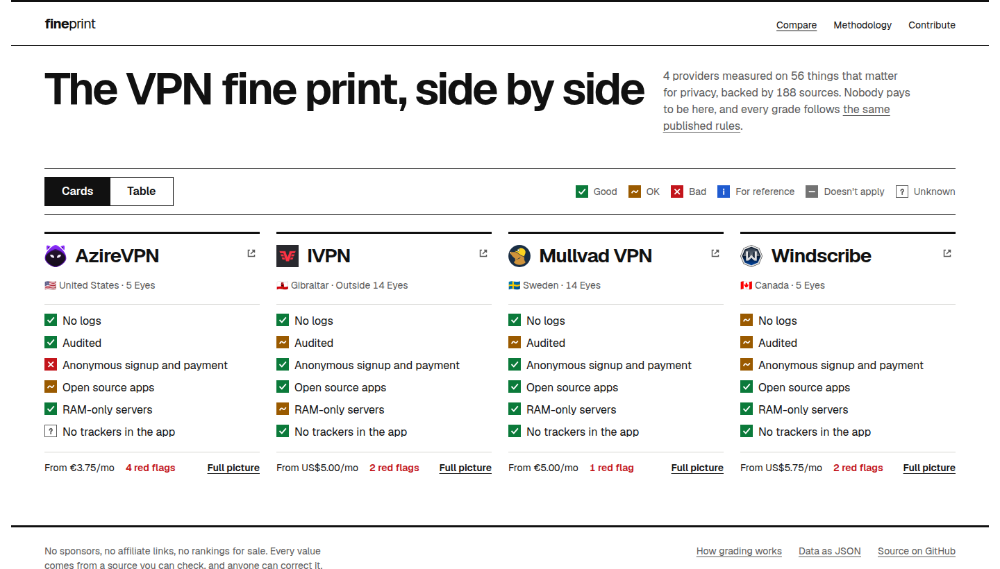

<h1 align="center">fineprint</h1>
<p align="center">
<i>The unsponsored VPN comparison, with a source for every claim</i>
<br />
<b>🌐 <a href="https://fineprint.peng.ly/">fineprint.peng.ly</a></b><br />
</p>

<details>
  <summary>Contents</summary>

- [About](#about)
- [Usage](#usage)
- [Contributing data](#contributing-data)
- [Deployment](#deployment)
- [Development](#development)
- [Credits](#credits)

</details>

## About

Most "best VPN" lists are paid per signup, so they rank whoever pays the biggest cut. fineprint takes no money from anyone, has no affiliate links, and grades every provider on the same published rules.

It picks up where That One Privacy Guy's old VPN comparison chart left off. Logging, jurisdiction, audits, how anonymously you can pay, what the apps get up to and what it all costs, with every value linked to its source. Anything nobody could find says Unknown rather than guessing.

<p align="center"></p>

---

## Usage

Just head to [fineprint.peng.ly](https://fineprint.peng.ly). Cards give you the gist of each provider, the table lets you filter, sort and download the lot as CSV or JSON, and each provider has a page with the full picture and its sources. [How grading works](https://fineprint.peng.ly/methodology) lists every criterion and the rule behind each colour.

The data's there for your own projects too:

| URL                                                                       | What's in it                                              |
| ------------------------------------------------------------------------- | --------------------------------------------------------- |
| [`/api/providers.json`](https://fineprint.peng.ly/api/providers.json)     | Every provider, with grades and derived values worked out |
| [`/api/criteria.json`](https://fineprint.peng.ly/api/criteria.json)       | What's measured, and the grading rules                    |
| [`/schema/provider.json`](https://fineprint.peng.ly/schema/provider.json) | JSON Schema for the provider YAML files                   |
| [`/llms.txt`](https://fineprint.peng.ly/llms.txt)                         | A plain-text summary for AI assistants                    |

---

## Contributing data

Each provider is one YAML file in [`data/providers/`](../data/providers), checked against the criteria in [`data/criteria.yml`](../data/criteria.yml). Spotted something wrong? Hit "Suggest an edit" on its page, fix the value, add a source and open a pull request. The checks point at the exact line if anything's off.

To add a provider, `npm run new -- example-vpn "Example VPN"` writes the file with every criterion listed. The [contributing guide](CONTRIBUTING.md) has the rest.

---

## Deployment

It's a fully static site, so it'll run anywhere that serves files.

### Option 1: Cloudflare

This is what [fineprint.peng.ly](https://fineprint.peng.ly) runs on. Build it, then push the `build/` folder up as a Worker with static assets:

```bash
npm run build
npx wrangler deploy --name fineprint --assets build --compatibility-date 2026-10-01
```

### Option 2: Docker

There's a multi-arch image on DockerHub ([`notaflightrisk/fineprint`](https://hub.docker.com/r/notaflightrisk/fineprint)) and GHCR ([`ghcr.io/notaflightrisk/fineprint`](https://github.com/NotAFlightRisk/fineprint/pkgs/container/fineprint)). It's nginx serving the built site:

```bash
docker run -p 8080:8080 notaflightrisk/fineprint
```

### Option 3: From a release

Every [release](https://github.com/NotAFlightRisk/fineprint/releases) has the built site attached as `site.zip`. Unzip it and serve the folder with anything:

```bash
unzip site.zip -d site
npx serve site
```

### Option 4: Build from source

Follow the [Development](#development) steps, then `npm run build`. The site lands in `build/`.

---

## Development

You'll need [Node](https://nodejs.org/) 22.18 or newer, plus [Git](https://git-scm.com/).

```bash
git clone git@github.com:NotAFlightRisk/fineprint.git
cd fineprint
npm install
npm run dev
```

The dev server is then on [localhost:5173](http://localhost:5173).<br>
`npm run validate` checks the data, `npm test` runs the tests, `npm run check` the types, and `npm run preview` serves a production build.

It's [SvelteKit](https://svelte.dev/docs/kit), prerendered to plain HTML. Loading, validating and grading the data all lives in `src/lib/data/`, shared by the site and the scripts in `scripts/`.

---

## Credits

Inspired by That One Privacy Guy's VPN comparison chart, which did this first and did it well.

##### Contributors

[](https://github.com/NotAFlightRisk/fineprint/graphs/contributors)

---

<!-- License + Copyright -->
<p  align="center">
  <a href="https://github.com/NotAFlightRisk"></a><br>
  <sup>
    <i>Licensed under <a href="../LICENSE">MIT</a>, © <a href="https://peng.ly">NotAFlightRisk</a> 2026</i>
  </sup>
</p>

<!--
oooh, hello there! hope you're having a nice day :)
   |\__      |\___
 (:> __)X  (:o ___(
   |/        |/
-->
