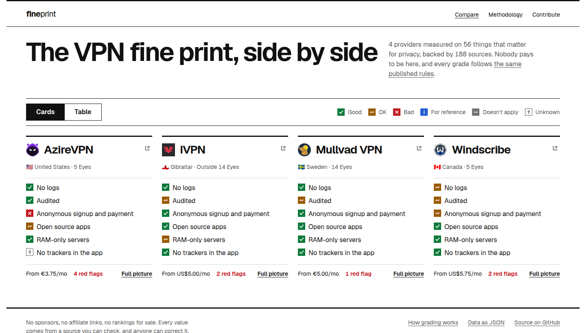

<h1 align="center">fineprint</h1>
<p align="center">
<i>The unsponsored VPN comparison, with a source for every claim</i>
<br />
<b>🌐 <a href="https://fineprint.peng.ly/">fineprint.peng.ly</a></b><br />
</p>

<details>
  <summary>Contents</summary>

- [About](#about)
- [Usage](#usage)
- [Contributing data](#contributing-data)
- [Deployment](#deployment)
- [Development](#development)
- [Credits](#credits)

</details>

## About

The aim of this project, is to provide an objective, unbiased, accurate comparison of VPN providers, focusing on privacy, security and essential features. There are no affiliate links, and every data point has either been manually tested and verified, or backed up by reputable sources. This is a community project, so we welcome additions/edits in the form of pull requests or issues.

Credit to That One Privacy Guy, whose old VPN comparison chart provided the inspiration for this project.

<p align="center"></p>

---

## Usage

Just head to [fineprint.peng.ly](https://fineprint.peng.ly), where there's a summary of all VPN data viewable as cards, table or JSON. Each VPN has a dedicated page with full details, sources, a change history and edit options. For info about how the grading works, see the [methodology](https://fineprint.peng.ly/methodology) page.

You can consume the data programmatically from our API endpoints too:

| URL                                                                       | What's in it                                              |
| ------------------------------------------------------------------------- | --------------------------------------------------------- |
| [`/api/providers.json`](https://fineprint.peng.ly/api/providers.json)     | Every provider, with grades and derived values worked out |
| [`/api/criteria.json`](https://fineprint.peng.ly/api/criteria.json)       | What's measured, and the grading rules                    |
| [`/schema/provider.json`](https://fineprint.peng.ly/schema/provider.json) | JSON Schema for the provider YAML files                   |
| [`/llms.txt`](https://fineprint.peng.ly/llms.txt)                         | A plain-text summary for AI assistants                    |

---

## Contributing data

Each provider is one YAML file in [`data/providers/`](../data/providers). And the criteria definition lives in [`data/criteria.yml`](../data/criteria.yml).
Spotted something wrong? You can edit the YAML directly, and submit a pull request back to the repo. Some automated checks will verify the structure is correct when your PR is opened.

To add a provider, `npm run new -- example-vpn "Example VPN"`, then edit the new `example-vpn.yml` file, filling in the fields. The [contributing guide](CONTRIBUTING.md) has more details on what to put for everything.

---

## Deployment

It's a fully static site, so it'll run anywhere that serves files.
There's several options for deploying:
- **Cloudflare**: Fork the repo, add `CLOUDFLARE_ACCOUNT_ID` and `CLOUDFLARE_API_TOKEN` then trigger the [Deploy](https://github.com/NotAFlightRisk/fineprint/actions/workflows/deploy.yml) workflow
- **Docker**: Just run `docker run -p 8080:8080 notaflightrisk/fineprint`
- **From release**: Download and unzip site.zip from the [releases tab](https://github.com/NotAFlightRisk/fineprint/releases), then run `npx serve site`
- **From source**: Follow the [Development](#development) steps below, then run `npm run build`, and serve `build/`
- **Static host**: Fork the repo, and import it to Vercel, Netlify or any other static hosting provider

---

## Development

You'll need [Node](https://nodejs.org/) 22.18 or newer, plus [Git](https://git-scm.com/).

```bash
git clone git@github.com:NotAFlightRisk/fineprint.git
cd fineprint
npm install
npm run dev
```

The dev server is then on [localhost:5173](http://localhost:5173).<br>
`npm run validate` checks the data, `npm test` runs the tests, `npm run check` the types, and `npm run preview` serves a production build.

It's [SvelteKit](https://svelte.dev/docs/kit), prerendered to plain HTML. Loading, validating and grading the data all lives in `src/lib/data/`, shared by the site and the scripts in `scripts/`.

---

## Credits

Inspired by That One Privacy Guy's VPN comparison chart, which did this first and did it well.

##### Contributors

[](https://github.com/NotAFlightRisk/fineprint/graphs/contributors)

---

<!-- License + Copyright -->
<p  align="center">
  <a href="https://github.com/NotAFlightRisk"></a><br>
  <sup>
    <i>Licensed under <a href="../LICENSE">MIT</a>, © <a href="https://peng.ly">NotAFlightRisk</a> 2026</i>
  </sup>
</p>

<!--
oooh, hello there! hope you're having a nice day :)
   |\__      |\___
 (:> __)X  (:o ___(
   |/        |/
-->
